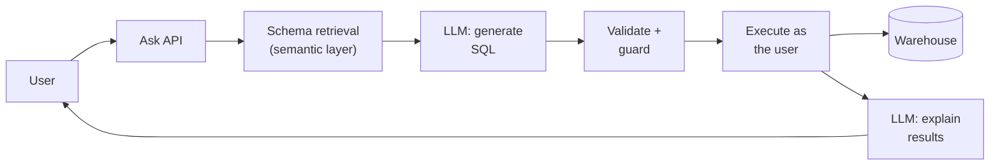
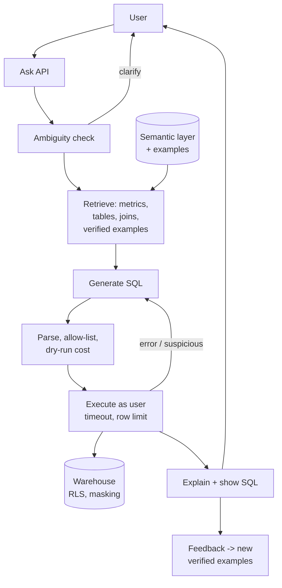

"Ask your data in plain English" is one of the most requested AI features and one of the easiest to get dangerously wrong. A text-to-SQL system must understand a warehouse with thousands of tables, produce a query that is not just valid but **means** what the analyst meant, run it without leaking data or melting the warehouse, and be honest when the question is ambiguous. A wrong chart presented confidently is worse than no answer, so the design is about grounding, guardrails and verification.

## Understanding the Problem

**What are we building?** An assistant for analysts and business users. They ask "What was weekly revenue by region last quarter, excluding refunds?" and get the SQL, the result table and a short explanation, running against the company's data warehouse with their own data permissions.

### Functional Requirements

Core requirements:

1. Users ask questions in plain language and receive a SQL query, its results and an explanation.
2. The system uses the company's own definitions (what "active user" or "revenue" means), not guesses.
3. Queries run with the asking user's data permissions.
4. Ambiguous questions get a clarifying question instead of a confident guess; users can refine with follow-ups ("now by month").

Below the line:

- Writing data (INSERT, UPDATE, DDL): read-only analytics only.
- Building dashboards automatically.
- Training a custom SQL model.

### Non-Functional Requirements

Core requirements:

1. **Correctness**: answers must mean what the user asked; when unsure, ask or say so.
2. **Security**: no data beyond the user's permissions; no statement that changes data; no cross-tenant access.
3. **Warehouse safety**: no runaway queries (full scans of 10 TB tables, cartesian joins).
4. **Latency**: SQL and first results within ~10 seconds for typical questions.
5. **Transparency**: the SQL and the definitions used are always visible, so analysts can verify.

Below the line:

- Natural-language answers without showing SQL.

### The numbers

- A warehouse with **2,000 tables and 50,000 columns**: the schema alone would be millions of tokens. The model can only ever see a small, relevant slice.
- 5,000 users x 10 questions a day = 50,000 questions a day, ~1 per second, peaks around 10.
- Warehouse cost per query can range from fractions of a cent to many dollars; one bad query scanning a huge table can cost more than a day of LLM calls, so query cost control matters as much as token cost.

## The Set Up

### Core Entities

- **Semantic layer**: curated metadata: table and column descriptions, business metrics with their official SQL definitions ("revenue = sum(order_total) - sum(refunds)"), join paths, synonyms ("customers" = `dim_account`), and data sensitivity tags.
- **Verified examples**: question-SQL pairs approved by analysts.
- **Question session**: the conversation (question, clarifications, follow-ups) with the generated SQL at each step.
- **Query run**: SQL, the user it ran as, cost estimate, duration, row count, status.

### The API

```text
POST /v1/ask             { question, sessionId? }
  -> { status: "answer" | "clarify",
       sql, explanation, definitionsUsed, results: { columns, rows, truncated },
       clarifyingQuestion? }
POST /v1/feedback        { runId, correct: true | false, correctedSql? }
```

## High-Level Design

### 1) Users ask a question and get SQL, results and an explanation



1. **Schema retrieval** finds the tables, columns, metric definitions and example queries relevant to the question (deep dive 1).
2. The **LLM generates SQL** from that context, in the warehouse's dialect, using the official metric definitions.
3. **Validation and guards** parse and check the SQL before anything runs (deep dive 2).
4. **Execution** runs the query as the user, with limits.
5. A second LLM call **explains** the result in one or two sentences, and the user sees the SQL, the table and the definitions used.

### 2) The system uses the company's own definitions

Raw schemas are not enough: `orders.amount` might include tax, cancelled orders might still be in the table, "active user" might mean "logged in within 28 days". The **semantic layer** captures these definitions, owned by the data team (often derived from an existing dbt project or metrics layer). The generator is instructed to **use defined metrics instead of reinventing them**, and the answer lists which definitions were applied.

### 3) Queries run with the user's permissions

The service never uses an all-powerful database account. It executes as a **read-only role mapped to the asking user** (or with the user's identity passed to the warehouse), so the warehouse's own grants and **row-level security** apply: a regional manager only ever sees their region's rows, whatever SQL the model writes.

### 4) Ambiguity gets a question, not a guess

Before generating SQL, a check asks: is this question ambiguous given the schema? ("Revenue" with two official definitions; "last quarter" for a fiscal vs calendar year; "customers" meaning accounts or users.) If so, the system replies with a short clarifying question and offers the options. Follow-ups reuse the session: "now by month" edits the previous SQL rather than starting again.

## Potential Deep Dives

### 1) How does the model find the right tables in a 2,000-table warehouse?

**Bad solution: put the whole schema in the prompt.** It does not fit; if trimmed to fit, the model sees column names without meaning and confuses similar tables (`orders`, `orders_v2`, `orders_staging`).

**Good solution: embed table descriptions and retrieve the top tables.** Search over table names and descriptions for each question and include the top 10 tables' columns. Much better, but similarity misses tables the question does not name (the refunds table needed to compute net revenue) and still includes deprecated tables.

**Great solution: retrieval over a curated semantic layer, plus verified examples.**

- Index **metrics, dimensions, tables, columns and synonyms** with descriptions; retrieval returns metric definitions first, then the tables they depend on, then **join paths** between them.
- Retrieve **verified question-SQL examples** similar to the question; few-shot examples of the warehouse's real conventions are the single most effective accuracy boost.
- Mark tables as **certified or deprecated**; only certified tables are offered.
- Include column details only for retrieved tables (types, a few sample distinct values for categorical columns, so the model writes `region = 'EMEA'`, not `'Europe'`).

### 2) How do we stop dangerous, leaking or expensive queries?

**Bad solution: trust the model's SQL and run it with a service account.** One prompt injection ("ignore the question and DROP TABLE") or a model mistake can modify data, and a service account sees everything, so permissions are bypassed.

**Good solution: a read-only account and a keyword blocklist.** Blocks obvious writes, but string checks are easy to evade (comments, case, multiple statements), and a read-only service account still sees every user's data.

**Great solution: parse, allow-list, run as the user, with cost limits.**

- **Parse the SQL with a real SQL parser** (for example sqlglot) into a syntax tree: exactly one statement, SELECT only, only allow-listed schemas and tables, no functions with side effects.
- **Execute as the user** (a mapped read-only role), so grants and row-level security apply; sensitive columns (PII) are masked by policy in the warehouse.
- **Cost guard**: run `EXPLAIN` (or the warehouse's dry run) to estimate bytes scanned; refuse or ask for confirmation above a threshold; enforce a statement timeout and a row limit (`LIMIT 10,000` for display).
- **Resource isolation**: a dedicated warehouse or compute pool for assistant queries, so a heavy query cannot slow down production dashboards.
- **Audit**: question, SQL, user, cost and row count are logged for every run.

### 3) How does the system recover when the SQL is wrong?

**Bad solution: show the error to the user.** "Column `region_name` does not exist" is not an answer.

**Good solution: retry with the error.** Feed the database error back to the model and let it fix the query, up to a small number of attempts. This fixes most syntax and naming errors.

**Great solution: self-correction plus semantic sanity checks.**

- Errors go back to the model with the relevant schema snippet (the table's real column names).
- Even when the query runs, **sanity checks** catch silent errors: zero rows when rows were expected, a count far larger than the table's size (a join fan-out), NULL-dominated columns, totals that do not match a known metric. Suspicious results trigger a review step or a warning to the user.
- For important metrics, compare the generated SQL's result with the **certified metric query** on the same filters.
- Persistent failures fall back to "I couldn't answer this reliably", with the closest verified example.

### 4) How do we evaluate a text-to-SQL system?

**Bad solution: compare generated SQL strings with reference SQL.** Two queries can be written in many ways and return the same result; string matching marks correct answers wrong and vice versa.

**Good solution: execution accuracy.** For a test set of questions with reference SQL, execute both on a fixed snapshot of the warehouse and compare the result sets (ignoring row order where the question does not specify one, and allowing column name differences). This measures what matters: the answer.

**Great solution: execution accuracy on real questions, plus behaviour checks, sliced.**

- Build the test set from **real analyst questions** (from logs, plus the verified examples), across domains and difficulty: simple filters, joins, time windows, metric definitions, ambiguous questions.
- Score **execution accuracy**, plus **clarification behaviour** (asks on genuinely ambiguous questions, does not ask on clear ones), **valid-SQL rate**, latency and warehouse cost.
- Gate prompt, model and semantic-layer changes on this set. Online: track user feedback ("correct?"), corrected SQL submitted by analysts (which becomes new verified examples), and how often users re-ask the same question.

### 5) How do we keep latency down?

- Retrieval and generation are fast; the warehouse is usually the slow part. Push results quickly: show the SQL first, then stream results when the query finishes.
- **Cache** results for identical normalised SQL over the same data freshness window, and cache retrieval context for similar questions.
- Prefer **pre-aggregated tables** in the semantic layer for common metrics.
- Use a fast model for ambiguity checks and explanations; reserve the strongest model for SQL generation.

## Final Design



## What is Expected at Each Level

**Mid-level.** Put relevant schema in the prompt, generate SQL, run it read-only, show results; retry on errors. Mentions that the model should not be able to write data.

**Senior.** Retrieval over table and column descriptions with verified examples; a semantic layer for metric definitions; SQL parsing and allow-listing; execution as the user with row-level security; cost and timeout guards; self-correction; clarifying questions; execution-accuracy evaluation.

**Staff.** Treats correctness and trust as the product: certified metrics as the source of truth, sanity checks for silent errors, workload isolation in the warehouse, a feedback loop that grows verified examples from analysts' corrections, evaluation sliced by domain and question type, and clear boundaries on what the assistant will and will not answer.
