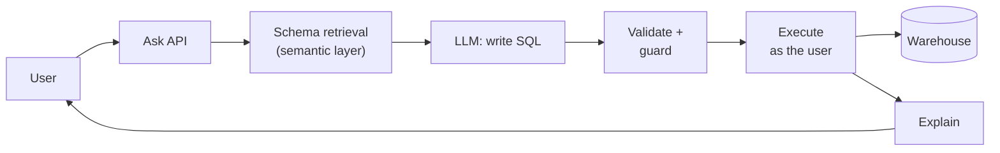

**The prompt:** "Design a system that lets analysts and business users ask questions about our data warehouse in plain English."

Text-to-SQL is one of the most requested AI features and one of the easiest to get dangerously wrong. The system must understand a warehouse with thousands of tables, produce SQL that **means** what the user meant, run it without leaking data or melting the warehouse, and say so when the question is ambiguous. A confident wrong chart is worse than no answer. Run the DP-00 framework.

## 1. Requirements (about 5 minutes)

**Say:** "The risk here is a plausible but wrong answer, so I want to know who uses the results and how much they trust them."

**Functional requirements:**

1. Users ask questions in plain language and receive the SQL, the results and a short explanation.
2. The system uses the company's own metric definitions ("revenue", "active user"), not guesses.
3. Queries run with the asking user's data permissions.
4. Ambiguous questions get a clarifying question; follow-ups refine the previous query ("now by month").

**Below the line:** writing data (read-only analytics only), automatic dashboards, training a custom model.

**Non-functional requirements:**

1. **Correctness**: answers mean what was asked; otherwise ask or decline.
2. **Security**: never beyond the user's permissions; never a statement that changes data.
3. **Warehouse safety**: no runaway scans or cartesian joins.
4. **Latency**: SQL and first results within ~10 s for typical questions.
5. **Transparency**: SQL and definitions always visible, so analysts can verify.

## 2. Success metrics (about 3 minutes)

- **Business**: questions answered without an analyst, analyst acceptance rate.
- **Quality**: execution accuracy on a test set, correct clarification behaviour, valid-SQL rate.
- **System**: time to SQL, time to results, warehouse cost per question.
- **Guardrail**: zero permission bypasses or write statements; expensive queries blocked.

## 3. Entities, API and numbers (about 5 minutes)

**Core entities:** **Semantic layer** (table and column descriptions, official metric definitions with their SQL, join paths, synonyms, sensitivity tags); **Verified examples** (question-SQL pairs approved by analysts); Session (questions, clarifications, SQL per step); Query run (SQL, user, cost estimate, duration, rows, status).

**API:**

```text
POST /v1/ask       { question, sessionId? }
  -> { status: "answer" | "clarify", sql, explanation, definitionsUsed,
       results: { columns, rows, truncated }, clarifyingQuestion? }
POST /v1/feedback  { runId, correct, correctedSql? }
```

**Numbers:**

- **2,000 tables, 50,000 columns**: the schema alone is millions of tokens, so the model only ever sees a small relevant slice.
- 5,000 users x 10 questions = 50,000 a day (~1/s, peaks ~10/s): LLM load is modest.
- A single bad warehouse query can cost more than a day of LLM calls, so **query cost control matters as much as token cost**.

## 4. High-level design (about 10 minutes)

### Requirement 1: question to SQL, results and explanation

**Draw:**



**Say:** "Retrieve the relevant metrics, tables, joins and examples; generate SQL in the warehouse dialect; parse and check it before anything runs; execute as the user with limits; then a short explanation alongside the SQL and the definitions used."

### Requirement 2: company definitions

**Say:** "Raw schemas aren't enough: amounts may include tax, cancelled orders may still be in the table. A semantic layer owned by the data team (often derived from dbt or an existing metrics layer) defines metrics once, and the model is told to use defined metrics instead of reinventing them."

### Requirement 3: the user's permissions

**Say:** "The service never uses an all-powerful account. It executes as a read-only role mapped to the user, so the warehouse's grants and row-level security apply whatever SQL the model writes."

### Requirement 4: ambiguity and follow-ups

**Say:** "Before generating, check for ambiguity against the semantic layer: two definitions of revenue, fiscal versus calendar quarter. If ambiguous, ask with options. Follow-ups edit the session's previous SQL."

## 5. Deep dives (15 to 20 minutes)

### Deep dive 1: Finding the right tables in a 2,000-table warehouse

**Bad: the whole schema in the prompt.** It doesn't fit; trimmed, the model confuses `orders`, `orders_v2` and `orders_staging`.

**Good: embed table descriptions and retrieve the top tables.** Better, but similarity misses tables the question doesn't name (the refunds table needed for net revenue) and includes deprecated ones.

**Great: retrieval over a curated semantic layer, plus verified examples.** Index metrics, dimensions, tables, columns and synonyms; return metric definitions first, then their tables and **join paths**. Retrieve **verified question-SQL examples** as few-shot examples (the biggest accuracy boost). Offer only **certified** tables. Include sample distinct values for categorical columns, so the model writes `region = 'EMEA'`, not `'Europe'`.

### Deep dive 2: Stopping dangerous, leaking or expensive queries

**Bad: run the model's SQL with a service account.** One injection or mistake modifies data, and permissions are bypassed.

**Good: a read-only account plus a keyword blocklist.** String checks are easy to evade, and a shared account still sees everyone's data.

**Great: parse, allow-list, run as the user, with cost limits.**

- **Parse with a real SQL parser** (for example sqlglot): exactly one statement, SELECT only, allow-listed schemas and tables, no side-effect functions.
- **Execute as the user**, with grants, row-level security and column masking for PII.
- **Cost guard**: `EXPLAIN` or a dry run to estimate bytes scanned; refuse or confirm above a threshold; a statement timeout; a row limit for display.
- **Workload isolation**: a dedicated compute pool, so assistant queries cannot slow production dashboards.
- **Audit** question, SQL, user, cost and rows for every run.

### Deep dive 3: Recovering when the SQL is wrong

**Bad: show the database error.** "Column region_name does not exist" is not an answer.

**Good: retry with the error** and the real column names, a bounded number of times.

**Great: self-correction plus semantic sanity checks.** Even when the SQL runs, catch silent errors: zero rows where rows were expected, counts larger than the table (a join fan-out), NULL-dominated columns, totals that disagree with the **certified metric query** on the same filters. Suspicious results get a warning or a review step; persistent failure says "I couldn't answer this reliably" and offers the closest verified example.

## 6. Evaluation and safety (about 5 minutes)

**Say:** "Never compare SQL strings: many queries are equivalent. Compare results."

- **Offline**: real analyst questions with reference SQL, executed on a fixed snapshot; compare result sets (ignoring row order where unspecified). Also score clarification behaviour (asks when ambiguous, not when clear), valid-SQL rate, latency and cost; slice by domain and difficulty; gate prompt, model and semantic-layer changes.
- **Online**: user feedback, analyst-corrected SQL (which becomes new verified examples), re-asked questions.
- **Safety**: the guard chain from deep dive 2; questions and data are never instructions; sensitive columns masked.

## 7. Cost, scale, failures, trade-offs (about 3 minutes)

- **Latency**: the warehouse is usually the slow part, so show the SQL first and stream results when ready; cache results for identical SQL within a freshness window; prefer pre-aggregated tables for common metrics.
- **Models**: a fast model for ambiguity checks and explanations, the strongest for SQL generation.
- **Failures**: warehouse overloaded: queue and inform; model outage: fall back to search over verified examples.
- **Trade-off**: curating a semantic layer costs data-team time, but nothing else moves accuracy as much.

**The 20-second summary:** "Questions are checked for ambiguity, grounded through retrieval over a curated semantic layer and verified examples, turned into SQL that is parsed, allow-listed and cost-checked, then executed as the user under row-level security on isolated compute. Results are sanity-checked and shown with the SQL and definitions. Quality is measured by execution accuracy, and analyst corrections feed new examples."

## What separates levels

- **Mid-level**: schema in the prompt, generate and run SQL read-only, show results, retry on errors.
- **Senior**: semantic-layer retrieval with verified examples, parsing and allow-listing, execution as the user with RLS, cost and timeout guards, self-correction, clarifying questions, execution-accuracy evals.
- **Staff**: certified metrics as the source of truth, sanity checks for silent errors, workload isolation, a feedback loop from analyst corrections, sliced evaluation, and clear boundaries on what the assistant answers.
