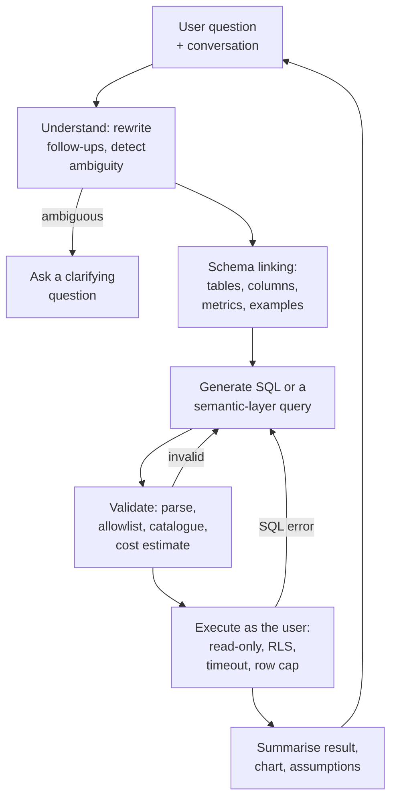

**The prompt:** "Design a system that lets analysts and business users ask questions about our data warehouse in plain English."

Text-to-SQL is one of the most requested AI features and one of the easiest to get dangerously wrong, because **a wrong query does not look wrong**: it returns a clean table with a plausible number. The design is about **safety** (the model must not damage data or reveal what the user may not see), **finding the right tables among thousands** (schema linking), **correct semantics** (the right join, metric definition and time window), **trust** (showing the SQL and its assumptions), and **evaluation by comparing results**, not SQL text.

## 1. Understanding the problem

**Functional requirements (core)**

1. Users should be able to ask a question in plain English and get a result table or chart, a plain-language explanation of what was computed, and the SQL.
2. Users should be able to refine with follow-ups ("only Q3", "split by region").
3. Users should be asked a clarifying question when their question is ambiguous, instead of getting a guess.
4. Users should only see data their own permissions allow.

**Below the line**: writing or modifying data, building dashboards, scheduling reports, joining data from outside the warehouse.

**Non-functional requirements**

- The system should never modify data and never bypass row- or column-level permissions.
- The system should answer within about 15 s, with queries capped in run time and cost.
- The system should be right often enough to trust: measured execution accuracy above an agreed bar on real questions, per question type.
- Scale: a warehouse of 5,000 tables (a few hundred important), 2,000 users.

**Framing the AI task.** Translate a question into a query against a governed schema, then explain the result. Mostly a workflow: understand, link schema, generate, validate, execute, repair, explain. Fine-tuning is rarely the first lever; retrieval of schema and verified examples matters far more.

**Numbers that change the design**

- 5,000 tables x about 40 columns is about 200,000 columns. Even at 15 tokens per column, the schema is about 3 million tokens: it cannot go into a prompt, so **schema linking** is mandatory.
- 2,000 users x 10 questions a day is 20,000 questions a day: LLM cost is small. **Warehouse cost** is not: one careless query can scan terabytes, so cost guards matter more than model choice.

## 2. High-level design

**The catalogue that powers it**

```text
tables       (table_id, schema, name, description, owner, certified, row_count,
              popularity_from_query_logs, freshness)
columns      (table_id, name, type, description, sample_values[], pii_class)
joins        (left_table, left_col, right_table, right_col, cardinality, source)
metrics      (name, definition_sql, grain, description, owner)     semantic layer
verified_qs  (question, sql, tables[], verified_by, last_checked)
```

- `joins` come from declared foreign keys and from query logs (joins analysts actually use), with their cardinality (one-to-one, one-to-many).
- `metrics` define business terms once ("net revenue", "active customer"), so the model reuses a definition instead of inventing one.
- `verified_qs` is a growing library of analyst-approved questions and SQL.



**Requirement 1, question to answer.**

1. The question is checked for an exact or near match in the verified library; a match reuses vetted SQL.
2. **Schema linking** (section 3) selects a handful of tables, their relevant columns, join paths, metric definitions and similar verified examples.
3. The model generates SQL (or a semantic-layer query) with that context and a glossary of business terms, plus a short statement of its assumptions.
4. **Validation** (section 4) parses and checks the query before anything runs.
5. **Execution** runs as the user, read-only, with limits. A syntax or runtime error returns to the generator with the error message, at most twice.
6. **Summarisation** produces the table or chart, a one-paragraph explanation, the assumptions, and the SQL. The summariser treats result rows as data, not instructions.

**Requirement 2, follow-ups.** The conversation keeps the previous question, SQL and result; a follow-up is rewritten into a complete question, or applied as an edit to the previous SQL.

**Requirement 3, clarification.** An ambiguity check runs before generation (section 5).

**Requirement 4, permissions.** Enforced by the warehouse itself at execution (section 4).

## 3. Deep dive: finding the right tables among 5,000

**Bad: put the whole schema into the prompt.** It does not fit, and even a large slice buries the few relevant tables among hundreds of similar ones (`orders`, `orders_v2`, `orders_backup_2021`).

**Good: retrieve tables by embedding similarity between the question and table descriptions.** Finds plausible tables, but misses exact column names, does not know how tables join, cannot map a value like "EMEA" or "enterprise plan" to the stored codes, and happily picks a deprecated table with a good description.

**Great: staged, catalogue-driven linking.**

- **Narrow the domain first.** Classify the question into a business domain (sales, support, finance), each with its own curated set of tables. Uber's QueryGPT, for example, first mapped each question to such a "workspace" before choosing tables.
- **Then tables, with hybrid search** over catalogue documents (name, description, column names, owner), boosted by **certification** and **popularity** from query logs, so the table analysts actually use beats the abandoned copy. Showing the chosen tables and letting the user correct them is cheap and effective; QueryGPT added exactly that after user feedback.
- **Then columns.** Within the chosen tables, keep only columns relevant to the question, so the prompt stays small (QueryGPT added a column-pruning step because large tables overflowed the context).
- **Join paths from the graph.** Include the known joins between the chosen tables with their cardinality, so the model never invents a join key.
- **Values.** For categorical columns, sample values are indexed, so phrases in the question map to stored values ("EMEA" to `region = 'EU'`).
- **Verified examples.** The two or three most similar verified questions and their SQL go into the prompt as few-shot examples; they teach house conventions (which date column means "booked", how test accounts are excluded).
- **A semantic layer where it exists.** If metrics and dimensions are defined in a governed layer (dbt metrics, LookML and similar), the model writes a query against that layer: it chooses metrics, dimensions and filters, and the layer generates correct SQL with the right joins. This removes most semantic errors.

## 4. Deep dive: safe execution

**Bad: put "never modify data" in the prompt and run what comes back.** A prompt is not a control: one injected instruction, or one confused generation, runs `DELETE`, reads a salary table, or scans the whole warehouse.

**Good: a read-only database role.** Writes become impossible, but the role can still read everything it was granted, including other regions' or customers' rows and personal data columns, and a cross join can run for an hour and cost a fortune.

**Great: layered controls that do not depend on the model behaving.**

- **Least-privilege, read-only access**: the service connects with a role that can only `SELECT` from approved schemas and views; personal-data columns are masked unless the user's role allows them.
- **Parse before running.** A SQL parser turns the query into a syntax tree; it must be exactly one `SELECT` statement, with no DDL or DML anywhere (including inside CTEs), no multiple statements, no dangerous functions, and only tables and columns that exist in the catalogue and are allowed for this user.
- **Row-level security by identity, enforced by the database.** The application sets the user's identity on the session, and the warehouse's own policies filter rows. In Postgres, for example:

```sql
ALTER TABLE orders ENABLE ROW LEVEL SECURITY;
CREATE POLICY region_access ON orders
    USING (region = current_setting('app.user_region'));
-- per request, inside a transaction, set by the application from the auth token:
SET LOCAL app.user_region = 'EU';
```

  Cloud warehouses have equivalents (row access policies, row-level security). The model never writes the permission filter, so it cannot forget or alter it.
- **Cost and time guards.** A dry run or `EXPLAIN` estimates bytes scanned or cost before execution; queries above a threshold are rejected with advice ("add a date filter") or need confirmation. Every query gets a statement timeout and a row cap, and runs on a replica or a warehouse with per-user resource quotas.
- **Audit.** Every question, generated query, user and result size is logged.
- **Results are untrusted text.** Values in the result (a customer note, a product description) can contain instructions, so the summarising call treats them as data and has no tools.

## 5. Deep dive: correct semantics, trust, and evaluation

**Bad: run whatever SQL the model produces and show the number.** Users trust a clean table, and many wrong queries look right.

**Good: show the SQL.** Analysts can check it; business users cannot, and even analysts skim.

**Great: catch the classic errors, explain the answer, and measure accuracy properly.**

- **The classic silent errors**, which belong in the examples, the glossary and the eval set:
  - **Fan-out double counting**: joining orders to order lines (one-to-many) and then summing order totals counts each order once per line. Known join cardinalities let the system warn or aggregate before joining.
  - **The wrong date column**: order date versus ship date versus payment date for "sales last month".
  - **Time zones and period boundaries**: "yesterday" in which zone; months computed on UTC timestamps.
  - **NULL handling**: averages that silently ignore NULLs; counts of a nullable column instead of rows.
  - **Test and internal accounts** included; **gross versus net** amounts mixed.
- **Ambiguity first.** Before generating, a check asks whether the question has more than one reasonable reading (which revenue, which period, which definition of "active"). If so, the user gets a short clarifying question with options; the answer is stored as a preference for next time.
- **Sanity checks on results**: empty results, all-NULL columns, or an order of magnitude far from the same metric last period trigger a warning or a regeneration.
- **The explanation**: one paragraph saying what was computed, from which tables, with which filters and definitions, and the assumptions made. Business users can check meaning without reading SQL.

**Evaluation**

- **Dataset**: real questions with gold SQL from analysts' query logs and curated cases, covering joins, time windows, nested logic, ambiguous questions (the right behaviour is to clarify) and unanswerable ones (the data does not exist).
- **Execution accuracy**: run the generated query and the gold query on the same data snapshot and compare the **result sets**: ignore row order (unless the question asked for an order), match columns by content rather than by name, and allow a small tolerance for floating point. Comparing SQL text is the wrong metric; many different queries are equally correct.
- **Component metrics**: schema-linking recall (were the gold query's tables retrieved?), validity rate (parses and runs), repair success rate, clarification precision.
- **Slices**: by domain and by complexity (single table, joins, nested), because averages hide the hard cases.
- **Online**: users editing the SQL, thumbs, repeated rephrasing, and analyst review of a sample. Every confirmed error becomes an eval case, and often a verified query, which raises accuracy faster than prompt changes.

## 6. Failure modes and expectations

**Failure modes**

| Failure | Detection | Mitigation |
| --- | --- | --- |
| Double counting from a fan-out join | Result sanity checks, eval cases | Known join cardinality, semantic layer |
| Hallucinated table or column | Catalogue validation | Validate before running; repair loop |
| Ambiguous metric answered with a guess | Clarification evals | Ambiguity check, assumptions shown |
| Expensive full scan | Dry-run cost estimate | Cost threshold, date filters, quotas |
| Permission bypass | Security tests | Row-level security in the warehouse |
| Correct-looking wrong answer trusted | Sampled analyst review | Explanations, metric definitions, feedback |
| Instructions inside data values | Red-team tests | Results treated as data; summariser has no tools |

**What is expected at each level**

- **Mid-level**: schema in the prompt for a small database, generation, execution with a read-only user, the result shown.
- **Senior**: staged schema linking with a catalogue, join graph and verified examples; parser validation, row-level security by identity and cost guards; clarification of ambiguity; evaluation by result-set comparison with component metrics.
- **Staff and above**: the semantic layer and data catalogue as the real product (ownership, certification, freshness), governance with data owners, the feedback loop that grows verified queries, and when to say "this question needs an analyst".

Say it like this: "The model never touches the warehouse directly. It generates a query that is parsed and limited to a single SELECT on allowed tables, checked against the catalogue and a dry-run cost estimate, and executed read-only as the user, so the warehouse's row-level security applies. Accuracy comes from staged schema linking over a catalogue with join cardinalities, value samples, verified examples and a semantic layer, plus clarifying questions for ambiguity. I evaluate by comparing result sets with gold queries, not SQL text."
