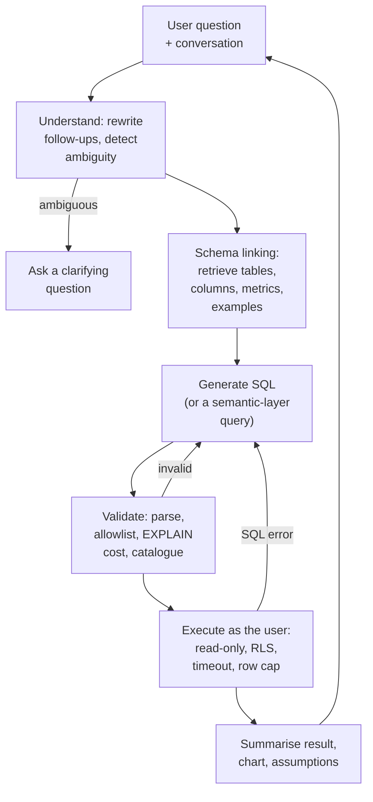

**The prompt:** "Design a system that lets analysts and business users ask questions about our data warehouse in plain English."

Text-to-SQL is one of the most requested AI features and one of the easiest to get dangerously wrong. A wrong SQL query does not look wrong: it returns a clean table with a plausible number. The design is about **safety** (the model must not damage data or see what the user cannot), **finding the right tables among thousands** (schema linking), **correct semantics** (the right join, metric definition and time window), **trust** (showing the SQL and its assumptions), and **evaluation by results**, not by SQL text.

## 1. Requirements

Functional:

- A question in plain English returns a result table or chart, a plain-language explanation, and the SQL.
- Follow-up questions refine the previous query ("only for Q3", "split by region").
- Ambiguous questions get a clarifying question instead of a guess.
- Results respect each user's row and column permissions.
- Feedback (correct, wrong, edited SQL) flows back into the system.

Non-functional (assumptions):

- A warehouse of 5,000 tables, a few hundred of them important; 2,000 users.
- Answers in under 15 s; queries limited in run time and cost.
- Read-only access; every query audited; PII columns masked unless permitted.

## 2. Success metrics

- **Execution accuracy**: the generated query returns the same result as a correct query, on an eval set of real questions.
- Clarification quality: asks when the question is ambiguous, does not ask when it is clear.
- Adoption, share of results users accept without editing the SQL, analyst time saved.
- Safety: zero writes, zero permission bypasses; warehouse cost per question.

## 3. High-level design

1. **Understand**: fold the conversation into a standalone question; detect ambiguity (which revenue, which time zone, which "active user") and ask instead of guessing.
2. **Schema linking**: retrieve the few relevant tables and columns, metric definitions and example queries (section 4.1).
3. **Generate** SQL with the linked schema, the business glossary and similar verified examples in the prompt. Where a governed **semantic layer** exists, generate a query against its metrics and dimensions instead of raw tables.
4. **Validate** before running: parse it, allow only a single `SELECT`, check every table and column exists in the catalogue, estimate cost with `EXPLAIN`.
5. **Execute** with the user's own identity on a read-only connection, with row-level security, a timeout and a row cap. A syntax or runtime error goes back to the generator once or twice with the error message.
6. **Summarise**: a table or chart, a one-paragraph explanation of what was computed, the assumptions made, and the SQL.

## 4. Deep dives

### 4.1 Finding the right tables among 5,000

- **The full schema never fits**, and including it would bury the right tables among the wrong ones.
- **A data catalogue as the retrieval corpus**: one document per table (description, columns with descriptions, sample values, owners, popularity from query logs, known join keys), indexed for hybrid search.
- **Two stages**: retrieve candidate tables for the question, then select columns within them; include foreign keys and **known join paths** so the model does not invent joins.
- **Sample values for categorical columns**, so "EMEA" or "enterprise plan" maps to the actual stored values.
- **Verified query library**: questions and SQL approved by analysts, retrieved as few-shot examples; an exact match to a verified question reuses its SQL directly.
- **Prefer certified datasets** and the semantic layer, where metrics such as "net revenue" are defined once and joins are pre-built. This removes most semantic errors, because the model chooses metrics and filters rather than writing joins.

### 4.2 Safety

- A **read-only role** that sees approved schemas and views only. A prompt saying "do not modify data" is not a control.
- **Syntax-tree validation**: a single `SELECT`; no DDL or DML; no multiple statements; no dangerous functions.
- **Row-level security and column masking** in the warehouse, keyed by the user's identity set by the application, never by a model-written `WHERE` clause.
- **Limits**: timeouts, row caps, a cost estimate check, and resource quotas per user.
- **Results are untrusted text**: values in result rows can contain instructions, so the summarising call treats them as data and has no tools.

### 4.3 Correct semantics and trust

- **The classic silent errors**: joining one-to-many tables and summing, which double-counts (fan-out); the wrong date column (order date versus ship date); time zones; including test accounts; mixing gross and net metrics.
- Defences: the semantic layer and known join paths, metric definitions in the glossary, sanity checks on results (empty, all nulls, an implausible order of magnitude compared with the same metric last month), and the explanation of assumptions shown with the answer.
- **Show the SQL** to analysts; for business users, show the plain-language explanation and the definition of each metric used.

### 4.4 Evaluation

- **Dataset**: real questions from analysts with gold SQL (from query logs and curated cases), covering joins, time windows, nested logic, ambiguous questions and unanswerable ones.
- **Execution accuracy**: run the generated and the gold query and compare the **result sets** (ignoring row order and column naming, with tolerance for floats), because many different SQL strings are equally correct. Text match of SQL is the wrong metric.
- **Component metrics**: schema-linking recall (were the needed tables retrieved?), validity rate (parses and runs), repair success rate, clarification precision.
- **Online**: users editing the SQL, thumbs, repeated rephrasing, analyst review of a sample; every confirmed error becomes an eval case and often a verified query.

## 5. Failure modes

| Failure | Detection | Mitigation |
| --- | --- | --- |
| Double counting from a fan-out join | Result sanity checks, eval cases | Known join paths, semantic layer |
| Hallucinated table or column | Catalogue validation | Validate before running; repair loop |
| Ambiguous metric answered with a guess | Clarification evals | Detect ambiguity, ask, show assumptions |
| Expensive full scan | EXPLAIN cost estimate | Cost threshold, partition filters, quotas |
| Permission bypass | Security tests | Row-level security in the warehouse, user identity |
| Correct-looking wrong answer trusted | Sampled analyst review | Explanations, metric definitions, feedback loop |
| Injection inside data values | Red-team tests | Results treated as data; summariser without tools |

## 6. Next steps

- Grow the verified query library from accepted answers; it raises accuracy faster than prompt changes.
- Multi-step analysis as an agent (query, inspect, refine), within the same execution guard rails.
- Proactive caveats when data is stale (last load time from the catalogue).

Say it like this: "The model never touches the warehouse directly: it generates a query that is parsed and restricted to a single SELECT, checked against the catalogue and a cost estimate, and executed on a read-only connection as the user, so row-level security applies. Accuracy comes from schema linking over a data catalogue, known join paths, a semantic layer for governed metrics and verified example queries, plus clarifying questions for ambiguity. I evaluate by comparing result sets with gold queries, not SQL text."
