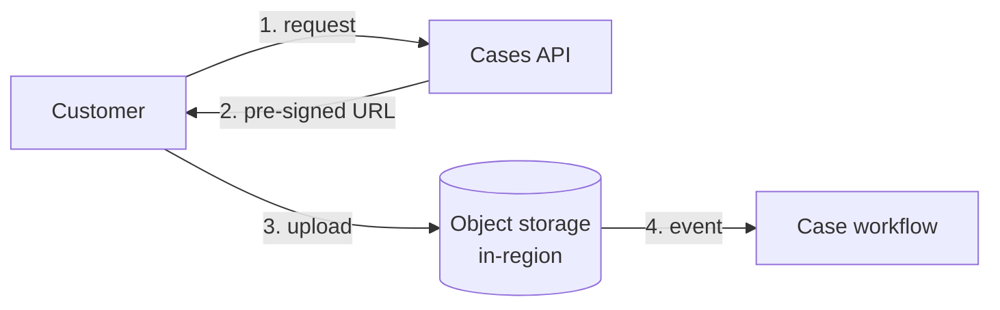
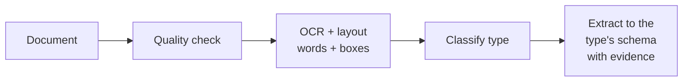
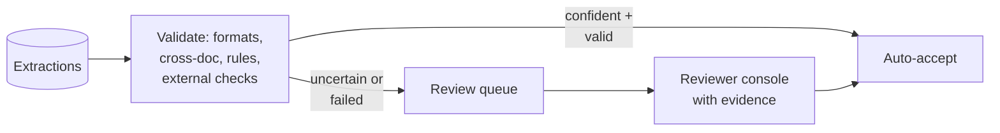

**The prompt:** "Lenders receive applications with dozens of scanned documents. Design a system that extracts the important information and produces a verified report."

Banks, insurers and law firms run on documents: scanned deeds, IDs, statements, contracts, often photographed on a phone, some handwritten, in several languages. This pipeline turns them into verified, structured data a professional can sign off. It uses nearly everything in AI application design: large uploads, OCR, structured extraction, validation, human review, durable workflows and reliable delivery. Run the DP-00 framework.

## 1. Requirements (about 5 minutes)

**Say:** "In regulated work every value must be traceable and every mistake is costly, so I'll treat evidence and human review as first-class requirements."

**Ask:** Which document types and languages? How fast must a case finish? Who reviews? Which external sources can we check against? How do customers receive results?

**Functional requirements:**

1. Customers create a case and upload its documents (PDFs, scans, photos).
2. The system reads every page, classifies each document and extracts typed fields, each with **evidence** (where it came from).
3. Data is validated (formats, cross-document consistency, rules, external sources); uncertain or failing items go to human reviewers.
4. A final report is produced and delivered to the customer's system; status is visible throughout.

**Below the line:** automated approval decisions (people decide), the customer's case-management UI, custom OCR models.

**Non-functional requirements:**

1. **Accuracy with auditability**: every value traceable to a page region and to who accepted it.
2. **Reliability**: no lost case or document; safe retries; long waits survive restarts.
3. **Turnaround**: minutes when automated, within the SLA (hours) with review.
4. **Security and compliance**: encryption, access control, data residency, retention, audit trail.
5. **Cost per case** within the price charged.

## 2. Success metrics (about 3 minutes)

- **Business**: **straight-through-processing (STP) rate** (cases needing no human touch), turnaround time, reviewer hours per case.
- **Quality**: field-level accuracy per document type, missing-field rate, evidence correctness.
- **System**: pages per minute, time per step, delivery success rate.
- **Guardrail**: errors in auto-accepted fields below the agreed target; zero cross-customer access.

## 3. Entities, API and numbers (about 5 minutes)

**Core entities:** Case (customer, type, status, deadline); Document (file, detected type, language, quality flags); Page (OCR words with bounding boxes); **Field extraction** (name, value, evidence: document, page, box, quoted text; confidence; source: model, rule or reviewer); Validation result; Review task; Report (canonical JSON plus PDF, versioned); Delivery (outbox events, webhook attempts).

**API:**

```text
POST /v1/cases                         { type, externalRef } -> { caseId }
POST /v1/cases/{id}/documents          { filename, contentType } -> { documentId, uploadUrl }
POST /v1/cases/{id}/submit             -> 202 Accepted
GET  /v1/cases/{id}                    -> status, fields with evidence, report link
Webhook: POST <customer url> { event: "case.completed", caseId, reportUrl }
         headers: X-Signature (HMAC), X-Event-Id, X-Timestamp
```

**Numbers:**

- 100,000 cases a month x 20 documents x 10 pages = **20M pages a month** (~8 pages/s average, 5-10x bursts).
- ~1 MB per page image = **~20 TB a month** of storage with retention rules.
- ~1,500 tokens per page for extraction = ~1B tokens a day; OCR is also priced per page, so **page-level routing** (cheap path for easy pages) is a real lever.
- If 15% of fields need review at 30 seconds each, reviewer headcount follows directly from the STP rate.

## 4. High-level design (about 10 minutes)

### Requirement 1: upload

**Draw:**



**Say:** "Large files never pass through our servers: the API returns a pre-signed URL, the client uploads directly (resumable for big files), and the storage event starts or continues the case workflow."

### Requirement 2: read, classify, extract

**Draw:**



**Say:** "Check quality first (blur, rotation, missing pages), so a hopeless scan triggers a re-upload request. Layout-aware OCR gives text with positions and tables, with language detection routing regional scripts. A cheap classifier picks the document type, which picks the extraction schema. The LLM fills the schema with structured output, and every field must cite page and source text."

### Requirement 3: validate and route to review

**Draw:**



**Say:** "Validation checks formats such as ID checksums, consistency across documents (the same name on the ID and the statement), business rules, and external registries where available. Failing or low-confidence fields become review tasks; reviewers see the value next to the highlighted region and accept or correct it, which is recorded."

### Requirement 4: report and delivery

**Say:** "When everything is accepted, assemble the canonical report JSON with evidence references and reviewer actions, render a PDF from it, and deliver through a signed webhook sent from an outbox. Customers can also pull it by API."

## 5. Deep dives (15 to 20 minutes)

### Deep dive 1: Orchestrating a multi-step process that waits for hours

**Bad: one synchronous request.** It times out, loses everything on a crash, and cannot wait for a reviewer.

**Good: a chain of queues.** Scalable and crash-tolerant, but the case's state is spread across queues; timeouts, per-step retries, "wait for all documents" and "where is case 123 stuck?" all need custom code.

**Great: a durable workflow per case** (Temporal, Step Functions, Cloud Workflows, or a graph with a durable checkpointer). It fans out per document, joins, validates, waits for review signals, builds the report and delivers. State persists after every step; each step has its own retry policy and timeout and is **idempotent** (keyed by case, document and step version); waiting costs nothing; SLA timers escalate; and every case's position is queryable.

### Deep dive 2: Messy, multilingual and handwritten documents

**Bad: plain OCR text into an LLM.** Reading order breaks on columns and tables, handwriting becomes noise, and coordinates for evidence are lost.

**Good: layout-aware OCR** with positions, tables and language support.

**Great: route each page to the right reader.** Clean printed pages go to standard OCR, tables to table extraction, and handwritten or poor pages to a **multimodal model** that reads the image (more expensive, used only where needed). Use language-aware OCR with per-word confidence, keep coordinates everywhere for evidence, and ask for re-upload of unreadable pages instead of guessing.

### Deep dive 3: Accurate extraction with provable evidence

**Bad: "extract all important information as JSON".** Field names vary, values are invented when absent, and there is no source.

**Good: a schema per document type** with structured output (fixed fields, types, enums, null when absent).

**Great: schema plus evidence plus verification.** Every field quotes its source text and page, and the system **checks the quote exists** in that page's OCR text; unverifiable values become low confidence. **Critical fields** (amounts, identifiers, names) are extracted twice (two prompts or models), and disagreement means review. **Cross-document checks** catch what no single extraction can. **Normalisation in code** (dates, currencies, names), not by the model.

### Deep dive 4: Deciding what humans review

**Say:** "The goal is the least review that still meets a target error rate."

Route by risk: validation failures always; low confidence, combining OCR confidence, evidence verification, double-extraction agreement and rule results (self-reported model confidence alone is unreliable); stricter thresholds for high-impact fields; more review for new customers and unfamiliar formats. **Calibrate thresholds on labelled data** so the measured error rate of auto-accepted fields meets the target. **Reviewer corrections are labelled data**: they feed evals and re-tune thresholds. Track STP and correction rate per document type.

### Deep dive 5: Delivering results reliably

**Bad: call the customer at the end of the workflow.** A failed call, or a crash between saving and calling, means they never hear.

**Good: retry the webhook.** Covers outages, but a crash before enqueueing still loses it, and retries deliver duplicates.

**Great: transactional outbox, signed webhooks, at-least-once with dedupe.** Write the report and an **outbox event in one transaction**; a dispatcher sends it. **Sign** with HMAC over body plus timestamp. Retry with backoff over hours to days, then alert, with deliveries replayable. A unique **event id** lets the customer deduplicate. Never promise exactly-once over HTTP, and keep the pull API as a fallback.

## 6. Evaluation and safety (about 5 minutes)

- **Offline**: labelled test sets per document type with field-level ground truth and evidence; field accuracy, missing-field rate and evidence correctness, sliced by type, language, scan quality and customer; gate every prompt, model, OCR or threshold change.
- **Online**: reviewer correction rate per field and type as a live accuracy signal; unfamiliar layouts (low classification confidence) routed to review until labelled.
- **Safety**: documents are data (instructions inside them are ignored); per-customer isolation in every query; least-privilege reviewers; a full audit trail; in-region storage, processing and model endpoints; retention and deletion policies; providers configured not to train on or retain data.

## 7. Cost, scale, failures, trade-offs (about 3 minutes)

- **Cost**: page-level routing between cheap and expensive readers; a cheap classifier; extraction limited to the type's schema; the STP rate drives reviewer cost.
- **Failures**: an OCR provider outage pauses those steps (workflow retries later); a stuck review escalates on its SLA timer; failed delivery is retried and replayable.
- **Trade-off**: double extraction of critical fields doubles their cost but catches errors before they reach a reviewer or a customer.

**The 20-second summary:** "Pre-signed uploads start a durable workflow per case. Pages are routed to the right OCR, classified, and extracted into per-type schemas with verified evidence. Validation and calibrated confidence decide what goes to reviewers, whose corrections feed the evals. The canonical report is delivered through an outbox and signed webhooks. The key metric is straight-through processing at a measured error rate."

## What separates levels

- **Mid-level**: upload, OCR, LLM-to-JSON, a review screen, a webhook, queues between steps.
- **Senior**: pre-signed uploads, layout OCR, per-type schemas with evidence, cross-document validation, confidence routing, a durable idempotent workflow, outbox plus signed webhooks, field-level evals.
- **Staff**: optimises STP at a target error rate, calibrates thresholds on labelled data, routes pages by cost, closes the loop from reviewer corrections to evals, and treats residency, retention and per-customer quality monitoring as design constraints.
