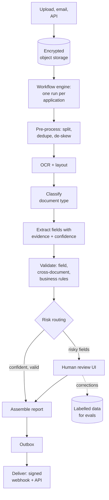
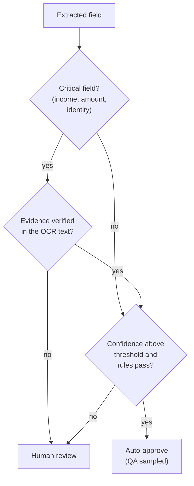
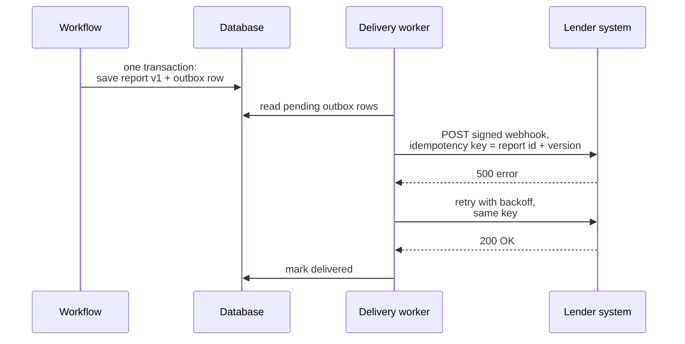

**The prompt:** "Lenders receive applications with dozens of scanned documents. Design a system that extracts the important information and produces a verified report."

Banks, insurers and law firms run on this shape: **scan, classify, extract, validate, review, deliver**. A wrong income figure can approve a bad loan, so the design centres on **evidence for every extracted value**, **sending exactly the risky fields to people** (not everything, not nothing), **a durable workflow** that survives multi-hour human waits and partial failures, and **reliable delivery** of the report to the customer's system, with an audit trail regulators can follow.

## 1. Requirements

Functional:

- Ingest applications through a portal, email or API; each holds 20 to 40 documents (pay slips, bank statements, tax returns, identity documents).
- Classify each document, extract the fields defined for its type, and validate within and across documents (names match, incomes agree, dates make sense).
- A report where every value links to its evidence: document, page and region.
- Human review for low-confidence or rule-breaking fields, in a side-by-side interface.
- Deliver the report to the lender's system; allow corrections that produce a new report version.

Non-functional (assumptions):

- 50,000 applications a day x 30 documents x 3 pages = 4.5 million pages a day, about 52 pages per second on average.
- 95% of reports within 1 hour, excluding human wait time.
- Critical-field error rate after review below an agreed threshold (for example 0.5%).
- Sensitive personal data: encryption, strict access, retention limits, full audit.

## 2. Success metrics

- **Field accuracy** per document type, especially for critical fields, measured after review.
- **Escaped error rate**: errors in auto-approved fields, estimated from QA samples.
- **Review rate** (share of fields sent to people) and reviewer time per application: the main cost driver.
- Time to report, delivery success rate, cost per application.

## 3. High-level design

1. Files land in encrypted storage; a **workflow run** starts for the application.
2. Pre-processing splits multi-document PDFs, removes duplicates, and fixes rotation and skew.
3. **OCR with layout** produces text with page coordinates; a **classifier** labels each document's type (an "other" class goes to review).
4. **Extraction** per document type uses a schema: for each field the model returns the value, the **evidence** (page and the exact text span or region) and a confidence signal. Pages fan out in parallel; the workflow fans back in per application.
5. **Validation**: formats and checksums per field; cross-document checks (the name on the pay slip matches the identity document; monthly income from pay slips agrees with bank-statement deposits within a tolerance); business rules.
6. **Risk routing** sends only risky fields to reviewers; the report is assembled when every field is resolved.
7. The report is written together with an **outbox** record in one transaction and delivered reliably (section 4.4).

## 4. Deep dives

### 4.1 Which fields a human must review

- **Risk = criticality x uncertainty.** Critical fields have stricter thresholds; minor fields can tolerate more.
- **Uncertainty signals**, combined: OCR confidence for the region; model token probabilities for the value; **agreement** between two independent extractions (two prompts or two models); **evidence verification** (the cited text must actually appear at the cited place in the OCR output, and the value must be derivable from it); validation failures.
- **Calibrate thresholds on labelled data** to hit the target error rate with the fewest reviews; recalibrate when models or document mixes change.
- **Sample auto-approved fields** for QA, so the escaped error rate is measured, not assumed.

### 4.2 Evidence and audit

- Every value stores its provenance: document, page, bounding box, the source text span, the model and prompt version, and the reviewer's action if any.
- The review UI shows the page image with the evidence highlighted next to the value, so a reviewer confirms in seconds instead of searching 40 pages.
- The audit trail answers "where did this number come from, who confirmed it, with which system version".

### 4.3 Why a workflow engine, not a chain of queue consumers

- Each application is a **long-running process with state**: fan-out per document, fan-in for cross-document checks, waits of hours for reviewers, retries per step, timeouts and SLA escalations.
- With bare queues you rebuild all of that yourself: correlating messages to applications, tracking partial completion, detecting stuck applications, durable timers, and versioning of in-flight processes.
- A durable workflow engine (Temporal, AWS Step Functions and similar) gives per-step retries with backoff, durable timers, visibility of every application's state, and safe resumption after crashes, with workers that stay stateless.

### 4.4 Delivering results reliably

- **Transactional outbox**: the report and its delivery record commit together, so a crash can never save a report without eventually delivering it, or deliver one that was not saved.
- **At-least-once delivery with an idempotency key** (report id plus version): retries are safe because the receiver deduplicates.
- **Signed payloads** (an HMAC signature header) so the lender can verify the sender; retries with exponential backoff for hours; then a dead-letter queue and an alert.
- The lender can always **pull** the report through the API, so a missed webhook never loses data. Corrections create version 2 with a new notification.

### 4.5 Getting better over time

- Reviewer corrections are labels: they feed the evaluation sets per document type and field.
- Error analysis by type and field shows where extraction fails (a bank's new statement layout, handwriting).
- High-volume document types can get a fine-tuned or distilled extraction model, raising accuracy and lowering cost; every model or prompt change is gated by the per-field evals.

## 5. Evaluation

- Field-level precision, recall and accuracy per document type on a labelled set; classification accuracy; end-to-end report accuracy.
- Calibration curves: does a confidence of 0.95 really mean 95% correct?
- The review rate and the escaped error rate together: lowering one at the expense of the other is a business decision made explicit.
- Latency to report and delivery success rate.

## 6. Failure modes

| Failure | Detection | Mitigation |
| --- | --- | --- |
| Blurry, rotated or partial scans | OCR confidence, missing pages | Pre-processing, request re-upload, review |
| Unknown document type | Classifier "other" class | Route to review; add the type later |
| Value with fake or mismatched evidence | Evidence verification | Force review; never auto-approve unverified critical fields |
| Model update shifts accuracy | Per-field eval gate, QA samples | Pinned versions, staged rollout |
| Reviewer backlog breaches SLA | Queue age metrics | Prioritise by SLA, staff alerts, threshold review |
| Lender endpoint down | Delivery failures | Retries, dead letter, pull API |
| Personal data exposure | Access audits | Encryption, least-privilege access, redacted logs, retention limits |

Say it like this: "Each application is a durable workflow: pre-process, OCR with layout, classify, extract each field with its evidence and confidence, validate within and across documents, and route only risky fields to reviewers, using criticality, calibrated confidence, extraction agreement and verified evidence. Reports are written with an outbox in one transaction and delivered as signed webhooks with idempotency keys and a pull API, and reviewer corrections become the eval data that drives improvement."
