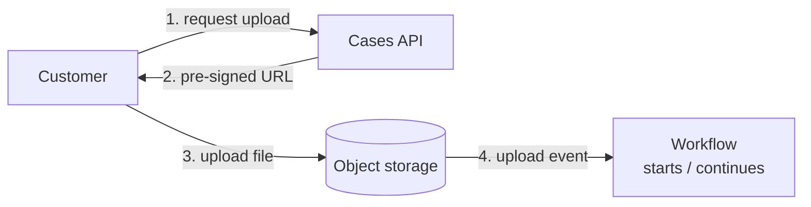
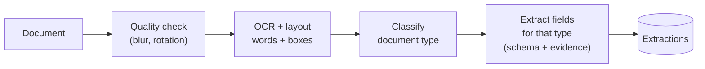
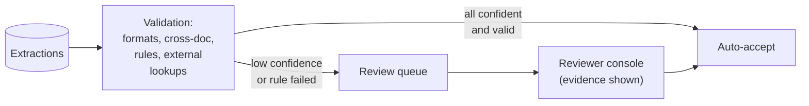
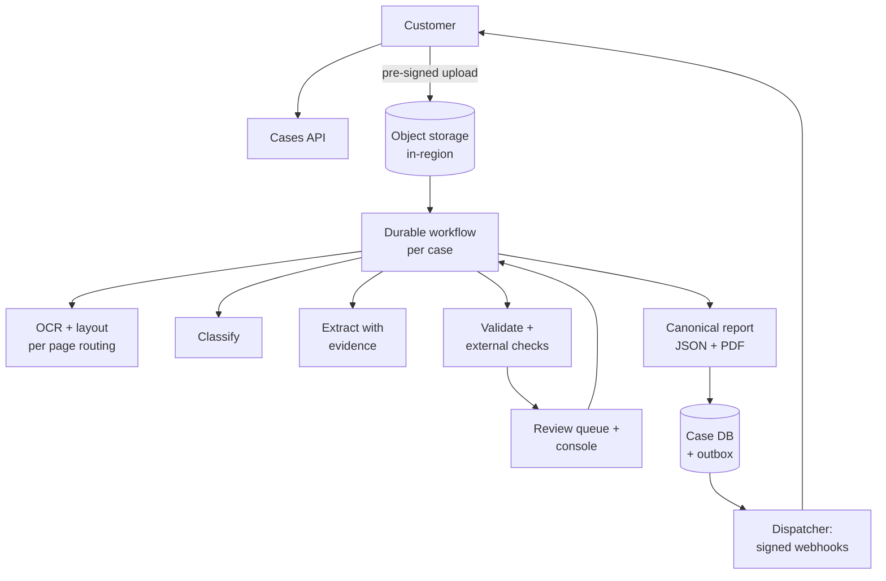

Banks, lenders, insurers and law firms run on documents: scanned deeds, IDs, bank statements, invoices, contracts, many photographed on a phone, some handwritten, in several languages. A document-processing pipeline turns a pile of such files into verified, structured data and a report a professional can sign off. It combines nearly everything in AI application design: large file uploads, OCR, LLM extraction with structured output, validation against rules and outside sources, human review, durable long-running workflows and reliable delivery to the customer's systems.

## Understanding the Problem

**What are we building?** A B2B platform. A customer (say, a lender) opens a **case** for an application and uploads its documents. The platform reads every page, identifies each document's type, extracts the fields that matter (names, amounts, dates, identifiers, property details), checks them against each other and against rules, sends uncertain items to human reviewers, and produces a structured report that is delivered to the customer's system.

### Functional Requirements

Core requirements:

1. Customers create a case and upload its documents (PDFs, scans, photos).
2. The system extracts text, classifies each document and extracts structured fields, each with evidence (where in the document it came from).
3. Extracted data is validated (formats, cross-document consistency, business rules), and uncertain or failing items are routed to human reviewers.
4. A final report is produced and delivered to the customer's system, and the case status is visible throughout.

Below the line:

- Automated decisions (approving or rejecting the loan): the platform reports, people decide.
- Building the customer's own case-management software.
- Training custom OCR models.

### Non-Functional Requirements

Core requirements:

1. **Accuracy with auditability**: every value can be traced to a page and region; a reviewer can see why it was accepted.
2. **Reliability**: no case or document is lost; every step retries safely; long waits (human review) survive restarts and deploys.
3. **Turnaround**: automated processing in minutes; with review, within the contractual SLA (hours).
4. **Security and compliance**: documents contain personal and financial data: encryption, access control, data residency, retention limits, audit trails.
5. **Cost per case** within the price the customer pays.

Below the line:

- Real-time (sub-second) processing.

### The numbers

- 100,000 cases a month x 20 documents x 10 pages = **20 million pages a month**: ~670,000 a day, ~8 pages per second on average, bursts of 5-10x when customers upload in batches.
- Storage: ~1 MB per page image: **20 TB a month** in object storage, with lifecycle rules for retention.
- If extraction sends ~1,500 tokens per page to an LLM: ~1 billion tokens a day. OCR is also priced per page. The cost per case is a sum per page, so page-level routing (cheap path for easy pages, expensive for hard ones) matters.
- If 15% of fields need human review and a review takes 30 seconds, the reviewer team's size follows directly from the **straight-through-processing rate** (the share of cases needing no human touch). Improving that rate is the main lever on operating cost.

## The Set Up

### Core Entities

- **Case**: customer, type (for example a loan application), status, deadline.
- **Document**: file in object storage, detected type, language, page count, quality flags.
- **Page**: OCR text with layout (words with bounding boxes), confidence.
- **Field extraction**: field name, value, **evidence** (document, page, bounding box, quoted text), confidence, source (model, rule, reviewer).
- **Validation result**: rule, pass or fail, details.
- **Review task**: the fields to check, assignee, decision, corrections.
- **Report**: the canonical structured output (JSON) plus a rendered PDF, versioned.
- **Delivery**: outbox events and webhook attempts.

### The API

```text
POST /v1/cases                              { type, externalRef } -> { caseId }
POST /v1/cases/{id}/documents               { filename, contentType } -> { documentId, uploadUrl }
POST /v1/cases/{id}/submit                  -> 202 Accepted (starts processing)
GET  /v1/cases/{id}                         -> status, fields with evidence, report link

Webhook to the customer:  POST <customer url>  { event: "case.completed", caseId, reportUrl }
                          headers: X-Signature (HMAC), X-Event-Id, X-Timestamp
```

## High-Level Design

### 1) Customers upload documents



Large files never pass through the API servers. The API returns a **pre-signed URL**; the client uploads directly to object storage (resumable uploads for large files); the storage's upload event notifies the system. Files are encrypted at rest, and the bucket is in the customer's required region.

### 2) Documents are read, classified and extracted



1. **Quality check**: detect blur, rotation and missing pages early; a hopeless scan triggers a request to re-upload instead of producing garbage.
2. **OCR with layout**: a document-AI OCR service returns text with **bounding boxes**, reading order and tables, not just a flat string. Language detection routes regional-language pages to OCR models that support them.
3. **Classification**: a model (often a small, cheap one) labels each document's type (ID card, bank statement, sale deed), which decides the extraction schema.
4. **Extraction**: an LLM fills a **type-specific schema** with structured output. Every field must include its **evidence**: the page and the exact text it was taken from.

### 3) Data is validated, and uncertain items go to people



**Validation** checks formats (an ID number's checksum, valid dates), **cross-document consistency** (the name on the ID matches the name on the bank statement; the property area matches across deeds), business rules (statement covers the last 6 months), and, where available, **external sources** (registries, verification APIs). Fields that fail, or whose confidence is low, become **review tasks**. The reviewer sees the value next to the highlighted page region, accepts or corrects it, and the correction is recorded with who made it.

### 4) The report is produced and delivered

When every field is accepted, the system assembles the **canonical report** (structured JSON with fields, evidence references, validation results and reviewer actions) and renders a human-readable PDF from it. Delivery to the customer is a **signed webhook** sent from an outbox (deep dive 5); the customer can also fetch the report by API.

## Potential Deep Dives

### 1) How do we orchestrate a multi-step process that can wait for hours?

**Bad solution: one synchronous request.** Upload, OCR, extraction and validation in one API call. It times out on large cases, loses everything on a crash, and cannot wait for a reviewer.

**Good solution: a chain of queues.** Each step is a consumer that reads from one queue and writes to the next (OCR queue, extract queue, validate queue). Scales and survives crashes. But the case's state is spread across queues and tables; timeouts ("review not done in 4 hours"), retries per step, "wait for all 20 documents", and answering "where is case 123 stuck?" all need custom code, and it is easy to lose track of a case.

**Great solution: a durable workflow per case.**

- A workflow engine (Temporal, AWS Step Functions, Google Cloud Workflows, or a LangGraph graph with a durable checkpointer) runs **one workflow per case**: fan out per document (OCR, classify, extract in parallel), join, validate, wait for review signals, build the report, deliver.
- **State is persisted after every step**: a crash or deploy resumes exactly where it stopped.
- **Each step (activity) has its own retry policy and timeout**, and is **idempotent** (keyed by case, document and step version), so a retried step never duplicates work or results.
- **Waiting is free**: the workflow sleeps until a "review completed" signal or a timer fires (escalate when the SLA approaches).
- **Visibility**: every case's current step and history can be queried, which operations and support need daily.

### 2) How do we handle messy, multilingual and handwritten documents?

**Bad solution: plain OCR text into an LLM.** Reading order breaks on multi-column pages and tables; handwriting and stamps come out as noise; the coordinates needed for evidence are lost.

**Good solution: layout-aware OCR.** A document-AI service returns words with positions, tables and reading order, and supports the languages needed. Extraction works from structured text, and evidence can point to regions.

**Great solution: route each page to the right reader, and keep the page image in the loop.**

- **Page-level quality and type routing**: clean printed pages go through standard OCR; tables through table extraction; handwritten or low-quality pages through a **multimodal LLM** that reads the image directly (more expensive, used only where needed).
- **Language-aware OCR** for regional scripts, with confidence per word; low-confidence regions are flagged.
- **Keep coordinates everywhere**, so every extracted value can be highlighted on the page.
- **Detect problems early** (blur, cut-off pages, password-protected PDFs) and ask for re-upload instead of guessing.

### 3) How do we extract accurately and prove where each value came from?

**Bad solution: "extract all important information as JSON".** Field names and formats vary from run to run, values are invented when absent, and nothing says where a value came from.

**Good solution: a schema per document type with structured output.** Fixed field names, types, enums and "null if absent" rules per type; the provider's structured-output mode guarantees valid JSON. Consistent, but a well-formed wrong value still passes.

**Great solution: schema plus evidence plus verification.**

- Each field must include **evidence**: page number and the quoted source text. The system **verifies the quote exists** in that page's OCR text (fuzzy match); a value without verifiable evidence is treated as low confidence.
- **Critical fields** (amounts, identifiers, names) are extracted **twice** (two prompts, or two models), and disagreement triggers review.
- **Cross-document checks** catch errors no single extraction can (a name mismatch, an amount that does not reconcile).
- **Normalisation in code**: dates, currencies and names are normalised by deterministic functions after extraction, not by the model.

### 4) How do we decide what a human must review?

The goal is the lowest review volume that still meets a target error rate.

- **Route by risk, not by a single global threshold**: validation failures always go to review; low-confidence values go to review; high-impact fields (amounts, identities) have stricter thresholds; new customers and unfamiliar document formats get more review at first.
- **Confidence signals** combine OCR confidence, evidence verification, agreement between double extractions and validation results; models' self-reported confidence alone is unreliable.
- **Calibrate thresholds on labelled data**: choose them so the accepted fields' measured error rate meets the target.
- **Reviewer corrections are labelled data**: they feed the evaluation set, reveal systematic errors (one document type, one field) and tune thresholds over time.
- Track **straight-through-processing rate** and **reviewer correction rate** per document type as the business metrics.

### 5) How do we deliver results reliably to the customer?

**Bad solution: call the customer's endpoint at the end of the workflow.** If the call fails, or the process crashes right after saving the report but before calling, the customer never hears about it.

**Good solution: retry the webhook.** Retries with backoff cover temporary outages, but a crash between "report saved" and "webhook enqueued" still loses the notification, and retries can deliver duplicates.

**Great solution: transactional outbox, signed webhooks, at-least-once with deduplication.**

- Write the report and an **outbox event** in the **same database transaction**; a dispatcher reads the outbox and sends the webhook, so a saved report always produces a notification.
- **Sign** each webhook (HMAC over the body with a timestamp) so the customer can verify it came from you and reject replays.
- **Retry with backoff** for a long window (hours to days), then mark it failed and alert; deliveries are **replayable** from a console or API.
- Delivery is **at-least-once**, so every event has a unique **event id** that the customer uses to deduplicate. Never promise "exactly once" over HTTP.
- Customers can always **pull** the latest report by API, as a fallback.

### 6) How do we measure quality and keep it from drifting?

- **Labelled test sets per document type**, with field-level ground truth and evidence. Measure **field-level accuracy**, missing-field rate and evidence correctness, sliced by document type, language, scan quality and customer.
- Every change to prompts, models, OCR or thresholds runs against these sets before release.
- **In production**: reviewer correction rates per field and type are a live accuracy signal; a rise after a release or for a new customer triggers investigation.
- **New formats** appear constantly (a new bank's statement layout); unfamiliar layouts are detected (low classification confidence, unusual structure) and routed to review until labelled examples are added.

### 7) How do we protect sensitive documents?

- **Encryption** at rest and in transit; per-customer access isolation enforced in every query.
- **Data residency**: storage, processing and model calls in the customer's required region (choose model endpoints that keep data in-region).
- **Least privilege** for reviewers (only cases assigned to them) and a full **audit trail** of every view and change.
- **Retention and deletion** policies per customer, applied to files, OCR output, extractions and logs.
- Model providers configured for **no training on customer data** and minimal retention.

## Final Design



## What is Expected at Each Level

**Mid-level.** Upload to object storage, OCR, an LLM extracting JSON, a review screen for low-confidence results, and a webhook when done. Uses queues between steps.

**Senior.** Pre-signed uploads; layout-aware OCR; per-type schemas with structured output and evidence; validation including cross-document checks; confidence-based routing to review; a durable workflow per case with idempotent, retried steps and waits for review; outbox plus signed, retried webhooks with event ids; field-level evaluation.

**Staff.** Optimises the business, not just the pipeline: straight-through-processing rate as the key metric, risk-based review thresholds calibrated on labelled data, page-level routing between cheap and expensive readers, the feedback loop from reviewer corrections into evals, data residency and retention as design constraints, and per-customer quality monitoring that catches new document formats before they cause errors.
