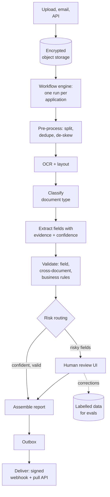
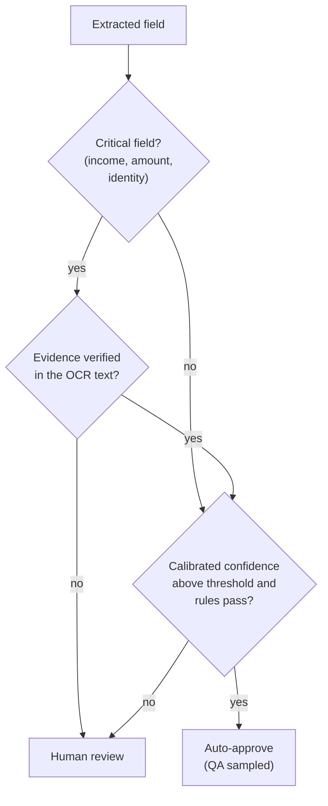
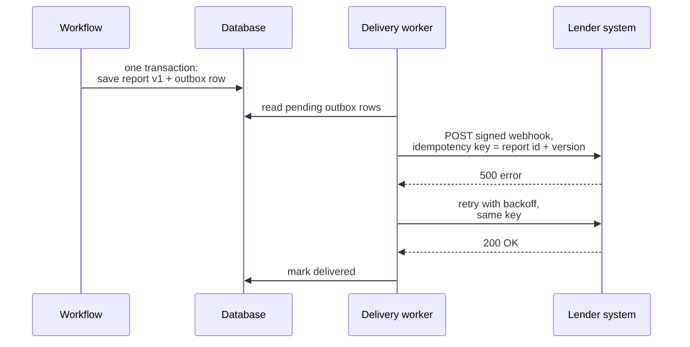

**The prompt:** "Lenders receive applications with dozens of scanned documents. Design a system that extracts the important information and produces a verified report."

Banks, insurers and law firms run on this shape: **scan, classify, extract, validate, review, deliver**. A wrong income figure can approve a bad loan, so the design centres on **evidence for every extracted value**, **sending exactly the risky fields to people** (not everything, not nothing), **a durable workflow** that survives hours of human waiting and partial failures, and **reliable delivery** to the customer's system, with an audit trail a regulator can follow.

## 1. Understanding the problem

**Functional requirements (core)**

1. Lenders should be able to submit an application's documents (portal, email or API) and receive a report in which every value links to its evidence (document, page, region).
2. The system should classify each document (pay slip, bank statement, tax return, identity document) and extract the fields defined for its type.
3. Reviewers should be able to confirm or correct risky fields side by side with the page image.
4. Lenders should receive the report reliably in their own system, and receive corrected versions when values change.

**Below the line**: the credit decision itself, fraud detection beyond basic anomaly flags, document collection from applicants.

**Non-functional requirements**

- The system should keep critical-field errors after review below an agreed rate (for example 0.5%), and measure the error rate of auto-approved fields.
- The system should produce 95% of reports within 1 hour, excluding time waiting for reviewers.
- The system should never lose or duplicate a delivered report.
- The system should protect personal data: encryption, least-privilege access, retention limits, a full audit trail.
- Scale: 50,000 applications a day x 30 documents x 3 pages = 4.5 million pages a day.

**Framing the AI task.** Several model tasks in a fixed pipeline: page-level OCR and layout, document classification, schema-guided extraction with evidence, and checks. A workflow, not an agent: every application goes through the same steps, and auditors need the same steps every time.

**Numbers that change the design**

- 4.5 million pages a day is about 52 pages per second on average, perhaps 150 at peak: OCR and extraction run as horizontally scaled workers fed by the workflow.
- At about 1,500 tokens per page, extraction reads about 6.75 billion tokens a day. On a small model at $0.15 per million input tokens that is about $1,000 a day in input; the model is not the main cost.
- **Review is the main cost.** 50,000 applications x 40 critical fields = 2 million critical fields a day. If 3% go to review at about 10 s each, that is 60,000 reviews, about 167 reviewer-hours a day, roughly 21 full-time reviewers. Halving the review rate halves the team. Routing quality drives the economics.

## 2. High-level design

**The data model**

```text
applications (app_id, lender_id, status, sla_due_at, report_version)
documents    (doc_id, app_id, type, type_confidence, pages, file_ref, hash)
pages        (doc_id, page_no, image_ref, ocr_ref, ocr_confidence)
fields       (app_id, doc_id, name, value, normalised_value, page_no, bbox,
              source_text, confidence, checks_failed[], status, reviewer, reviewed_at)
              status: auto_approved | needs_review | confirmed | corrected
reports      (app_id, version, content_ref, created_at)
outbox       (event_id, app_id, version, payload_ref, status, attempts, next_try_at)
```



**Requirement 1 and 2, extraction with evidence.**

1. Files land in encrypted object storage, and a **workflow run** starts for the application, with its SLA deadline.
2. **Pre-processing** splits multi-document PDFs into documents, removes duplicate uploads by hash, and fixes rotation and skew.
3. **OCR with layout** produces each page's text with coordinates and per-word confidence.
4. A **classifier** labels each document's type; low-confidence or unknown types go to a reviewer to label.
5. **Extraction** runs per document with the schema for its type and returns, for every field, the value, the page, the bounding box, the exact source text, and a confidence signal (section 3).
6. **Validation** runs field rules, cross-document rules and business rules.
7. **Risk routing** marks each field auto-approved or needing review (section 4).

**Requirement 3, review.** Fields needing review appear in a queue ordered by SLA; the reviewer confirms or corrects each against the highlighted page region.

**Requirement 4, delivery.** When every field is resolved, the report is assembled, written together with an outbox event, and delivered (section 5).

## 3. Deep dive: extraction you can trace and trust

**Bad: send the whole PDF to a model and ask for a JSON report.** It works on clean samples, but values arrive without provenance (nobody can check where "monthly income: 5,200" came from), long applications exceed the context, and a misread digit is indistinguishable from a correct value.

**Good: OCR, then per-document extraction into a schema, with a page reference per field.** Values are now traceable to a page, but a page has hundreds of numbers; the model can cite the right page and the wrong figure, and confidence is unknown.

**Great: evidence at the level of a text span, verified by code.**

- **OCR or vision model.** Classic OCR with layout gives word-level coordinates and confidences and is cheap at volume; a vision-language model reads complex layouts and handwriting better but gives weaker coordinates. A common choice: OCR with layout for everything, a vision model for the pages or document types where OCR confidence is low.
- **Schemas per document type.** A pay slip has employer, employee name, pay period, gross pay, net pay, deductions; each field has a type, format, and normalisation (dates to ISO format, amounts to numbers with currency).
- **Extraction returns evidence.** For each field: the value, the page, the exact source text it was read from, and the bounding box of that text.
- **Evidence verification in code.** The cited source text must actually occur in the OCR output of that page, inside or near the cited box, and the value must be derivable from it (after normalisation, "5,200.00" equals 5200). A field whose evidence cannot be verified is never auto-approved.
- **Cross-document validation.** The applicant's name matches across documents (with fuzzy matching for initials); monthly income from pay slips agrees with salary deposits in bank statements within a tolerance; pay periods are recent; tax-return income is consistent with pay slips. A failed rule attaches to the fields involved.
- **Business rules**: required documents present, documents not older than allowed, totals that add up (gross minus deductions equals net).

## 4. Deep dive: which fields go to people

**Bad: review everything, or review nothing.** Reviewing everything costs dozens of reviewers and makes the SLA impossible; reviewing nothing lets misread incomes through to credit decisions.

**Good: one confidence threshold for all fields.** Simple, but model confidence is poorly calibrated (a "0.9" is not 90% right), a misread net pay matters far more than a misread employer address, and validation failures are ignored.

**Great: risk-based routing, calibrated on labelled data, with quality measured.**



- **Signals combined into one score per field**: OCR confidence of the evidence region, model token probabilities for the value, **agreement** between two independent extractions (two prompts or two models), verified evidence, and validation results.
- **Calibration.** On a labelled set, group fields by score and measure how often each score bucket is actually correct; map scores to calibrated probabilities. Now "0.97" means 97% of such fields are right.
- **Thresholds per field criticality**, chosen to hit the target error rate with the fewest reviews: for critical fields the threshold is set so that the expected errors among auto-approved fields stay below the target; minor fields tolerate more.
- **Measure what escapes.** A random sample of auto-approved fields is reviewed every day; the escaped error rate, with a confidence interval, is the real quality metric. If it rises, thresholds tighten automatically.
- **The review queue**: ordered by SLA deadline; fields grouped per application, so a reviewer handles one application at once; the highest-risk fields (large amounts, failed cross-document checks) get a second reviewer.
- **The reviewer screen**: the page image with the evidence box highlighted, the extracted value, the failed checks, and keyboard shortcuts to confirm or correct. Most reviews take seconds because the reviewer never searches for the value.

## 5. Deep dive: orchestration, delivery and data protection

**Orchestration.** Bad: one synchronous request that processes the application end to end (it cannot wait hours for a reviewer). Good: a chain of queue consumers, one per step (each step scales, but you must build correlation of messages to applications, partial-completion tracking, stuck-application detection, timers for SLAs, and versioning of in-flight processes yourself). Great: a **durable workflow engine** (Temporal, AWS Step Functions and similar):

- Each application is a workflow: fan out per document and per page, fan back in for cross-document validation, wait for human review (durably, for hours), then assemble and deliver.
- Each step is an activity with its own retries, backoff and timeouts; a crashed worker's activity is retried elsewhere; the workflow's state survives restarts.
- Durable timers escalate applications approaching their SLA; every application's current state is visible for support.
- Workflow definitions are versioned, so in-flight applications finish on the version they started with.

**Delivery.** Bad: call the lender's webhook right after saving the report, once (a timeout loses the report, and a crash between save and call never sends it). Good: retry the webhook (but a crash before the first attempt still loses it, and retries can duplicate). Great:



- **Transactional outbox**: the report and its outbox row commit together, so a saved report is always eventually delivered.
- **At-least-once delivery with an idempotency key**: retries are safe because the lender deduplicates on the key.
- **Signed payloads**: an HMAC signature over the timestamp and body, sent in a header, lets the lender verify the sender and reject replays.
- **Retries** with exponential backoff for up to a day, then a dead letter and an alert; the lender can always **pull** the report through the API, so a missed webhook never loses data. Corrections create a new version and a new notification.

**Data protection.** Documents and extracted values are encrypted at rest; reviewers see only applications assigned to them; logs and traces carry ids, never values; documents are deleted after the retention period; the model provider is contracted for zero retention, or extraction runs on self-hosted models; every view and change is in the audit trail.

## 6. Evaluation, failure modes and expectations

**Evaluation**

- **Field-level** precision, recall and accuracy per document type on a labelled set; classification accuracy; end-to-end report accuracy.
- **Calibration** curves per field type, rechecked after every model or prompt change.
- **The review rate and the escaped error rate together**: lowering one at the cost of the other is a business decision made explicit.
- **Operations**: time to report, SLA breaches, delivery success rate, cost per application (models plus review time).
- **The improvement loop**: reviewer corrections are labels; error analysis by type and field shows where extraction fails (a bank's new statement layout, handwriting); high-volume types can get a fine-tuned extraction model; every change is gated by the per-field evals.

**Failure modes**

| Failure | Detection | Mitigation |
| --- | --- | --- |
| Blurry, rotated or partial scans | OCR confidence, missing pages | Pre-processing, re-upload request, review |
| Unknown document type | Classifier "other" class | Reviewer labels it; new schema later |
| Value with wrong or fake evidence | Evidence verification | Never auto-approve unverified critical fields |
| Model update shifts accuracy | Per-field eval gate, QA samples | Pinned versions, staged rollout |
| Reviewer backlog breaches SLA | Queue age metrics | SLA ordering, staffing alerts, threshold review |
| Lender endpoint down | Delivery failures | Retries, dead letter, pull API |
| Personal data exposure | Access audits | Encryption, assignment-based access, redacted logs |

**What is expected at each level**

- **Mid-level**: OCR, classification and extraction into a schema, a review step, a report delivered by webhook.
- **Senior**: evidence verified in code, calibrated risk-based routing with a measured escaped error rate, a durable workflow engine, a transactional outbox with signed idempotent delivery, the review-cost arithmetic.
- **Staff and above**: review operations as a business system (staffing against review rate, SLA tiers per lender), auditability and model governance for regulators, the corrections-to-model improvement loop, and multi-tenant isolation across lenders.

Say it like this: "Each application is a durable workflow: pre-process, OCR with layout, classify, extract every field with its source text and box, verify that evidence in code, and validate within and across documents. Risk routing sends only critical fields with weak evidence, low calibrated confidence or failed checks to reviewers, and a daily sample of auto-approved fields measures what escapes. Reports are written with an outbox in one transaction and delivered as signed webhooks with idempotency keys plus a pull API, and reviewer corrections become the labels that drive improvement."
