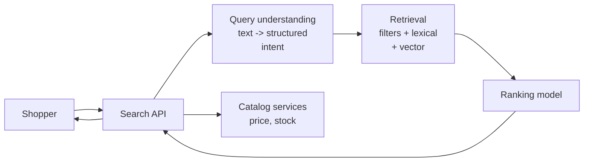
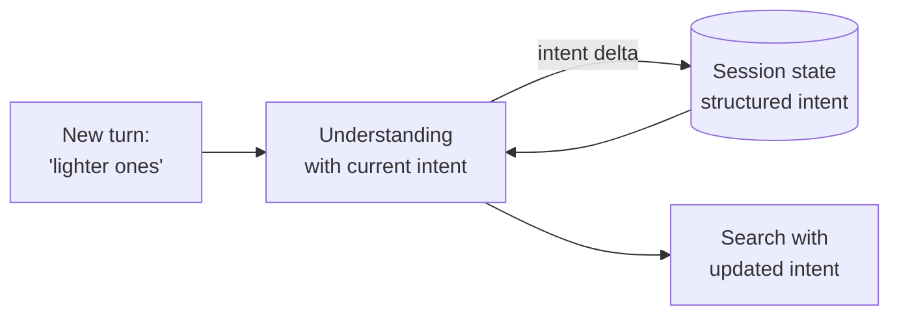

**The prompt:** "Design conversational product search for an e-commerce site: shoppers describe what they want in their own words and refine it over several turns."

This is retrieval with a twist: the answer is not a paragraph but a **ranked grid of real products**, it must feel as fast as normal search, it runs at search-engine volume (so every LLM call is multiplied by millions), and the model must never invent a price or a size. It tests whether you can put an LLM into a high-traffic, latency-critical path without making it slow, expensive or untrustworthy. Run the DP-00 framework.

## 1. Requirements (about 5 minutes)

**Say:** "Search is high volume and latency-sensitive, so I'll be careful about where the LLM sits on the critical path. Let me confirm scope first."

**Ask:** What is the traffic? What latency does today's search have? Does the shopper see only results, or also a message? Which catalog systems hold price, stock and sizes?

**Functional requirements:**

1. Shoppers type a request in natural language ("waterproof hiking boots under 5,000, wide fit") and get a ranked product grid.
2. They refine over several turns ("lighter ones", "in black", "show cheaper"), with earlier constraints carried forward.
3. Product facts (price, stock, sizes, ratings) always come from catalog services.
4. Optionally, a short message helps the shopper ("Showing waterproof boots in wide fit; 3 are on sale").

**Below the line:** checkout, personalised recommendations outside search, voice, image search.

**Non-functional requirements:**

1. **Latency** close to regular search: results in well under ~1 second at p95; any message may stream slightly after.
2. **No hallucinated product facts**, ever.
3. **Relevance** at least as good as today's keyword search, measured.
4. **Cost per search** tiny: millions of searches a day.
5. **Freshness**: prices and stock reflect the catalog in real time.

## 2. Success metrics (about 3 minutes)

- **Business**: search conversion rate, add-to-cart rate, revenue per search.
- **Quality**: NDCG on judged queries, filter-extraction accuracy, zero-result rate, reformulation rate (the shopper rephrases because results were wrong).
- **System**: p95 latency to results, cost per 1,000 searches.
- **Guardrail**: zero wrong prices or stock shown; no drop in conversion for plain keyword queries.

## 3. Entities, API and numbers (about 5 minutes)

**Core entities:** Product (catalog id, category, attributes, description, enriched tags); Facet schema (allowed attributes and values per category); **Search session state** (the structured intent so far: category, hard filters, soft preferences, sort); Result list (product ids with scores).

**API:**

```text
POST /v1/search    { text, sessionId? }
  -> { results: [{ productId, score }], intent: { category, filters, preferences },
       message? (streamed separately), sessionId }
```

**Say:** "The response carries product ids and the intent we understood; the page fetches prices and stock from catalog services, so the LLM never produces them."

**Numbers:**

- 50M searches a day: ~600/s average, **~3,000/s peak**.
- If every search made a 1,000-token LLM call: **50B tokens a day**. Even with a cheap model that is serious money, and a large model would add seconds. So **most searches cannot hit a big LLM**: caching, fast paths and small models are required, not optional.
- Head queries ("running shoes", "iphone case") repeat constantly: a large share of traffic is a small set of queries, which makes caching powerful.

## 4. High-level design (about 10 minutes)

**Say:** "I'll keep the existing search and ranking stack and add an understanding layer in front of it, plus a session state for multi-turn."

### Requirement 1: natural language to a ranked grid

**Draw:**



**Say:** "Query understanding turns text into a structured intent: category, hard filters like price under 5,000 and waterproof, soft preferences like lightweight, plus the free-text part. Retrieval applies the filters and runs lexical and vector search for the free text. A ranking model orders candidates. Facts are fetched from catalog services at render time."

### Requirement 2: multi-turn refinement

**Draw:**



**Say:** "The session stores the structured intent, not the transcript. A follow-up produces a delta (add a preference for low weight, change colour to black), applied to the stored intent. That's small, fast and easy to debug."

### Requirement 3: facts only from the catalog

**Say:** "The model outputs intents and, at most, a short message. Prices, stock and sizes are filled in by the page from catalog services, and any message referencing facts is generated from the actual result data, never from the model's memory."

### Requirement 4: the optional message

**Say:** "Results return first; the message is generated afterwards, in parallel, and streamed in. Search never waits for prose."

## 5. Deep dives (15 to 20 minutes)

### Deep dive 1: Turning free text into reliable filters

**Bad: send the whole sentence to vector search.** "Under 5,000" and "wide fit" are hard constraints, and embeddings treat them as vague similarity, so you get boots at 9,000 in normal fit.

**Good: an LLM extracts filters as JSON.** Structured output with a schema of common filters. It works, but the model invents attribute names and values the catalog doesn't have ("waterproofness: high"), and every query pays an LLM call.

**Great: extraction constrained to the catalog's facet schema.**

- Detect the category first, then give the model **only that category's allowed attributes and values** (retrieved from the facet schema), so its output can be mapped to real filters.
- **Validate and normalise** in code: units, currency, size systems, synonyms ("navy" means blue).
- Separate **hard filters** (price ceiling, size) from **soft preferences** (lightweight, stylish) that feed ranking instead of filtering.
- **Relax gracefully**: if hard filters return nothing, drop the least important one and tell the shopper ("No wide-fit boots under 5,000; showing up to 6,000").

### Deep dive 2: Meeting the latency target

**Bad: a large LLM on every search.** 1-3 seconds added, at a huge token bill.

**Good: a small model plus streaming the message.** Faster and cheaper, but still a model call on every query.

**Great: a tiered path where most searches never touch an LLM.**

- **Cache parsed intents** for head queries (a big share of traffic), keyed by normalised text and category.
- A **fast path**: plain keyword queries ("nike air max") go straight to classic search, decided by a cheap classifier or rules.
- A **small, fine-tuned or distilled parser** for the rest (hundreds of milliseconds, not seconds), trained on queries labelled by a larger model and checked by people.
- **Start lexical retrieval in parallel** while parsing runs, and merge when the intent arrives.
- The message runs **after** results, never blocking them.

### Deep dive 3: Using LLM signals in ranking

**Bad: let an LLM rerank by reading product descriptions.** Slow, expensive, and blind to what shoppers actually buy.

**Good: keep a learning-to-rank model** with behavioural features (clicks, purchases, popularity) and text relevance.

**Great: move LLM work offline, feed it to ranking as features.**

- **Product enrichment at ingestion**: an LLM reads each description once and extracts normalised attributes and tags (waterproof, wide fit available, weight class). This costs a one-time batch job (the DP-06 pattern), not per-search calls, and it fixes messy catalog data for filters too.
- The ranking model combines behavioural signals, text and vector relevance, enriched attribute matches with the soft preferences, and business rules (in stock, delivery time) as a separate final layer.
- A cross-encoder reranker on the top ~20 only where the latency budget allows.

### Deep dive 4: Conversation state that behaves

- Store the **structured intent plus the last result ids**, in Redis with a TTL, keyed by session.
- **References** ("the second one", "something like that but cheaper") resolve against the last results.
- **Topic changes** ("now show me tents") reset the intent instead of merging, decided by the understanding model.
- Log intents per turn: when results are wrong, you can see whether understanding or ranking failed.

## 6. Evaluation and safety (about 5 minutes)

- **Offline**: a judged query set (human labels, plus calibrated LLM judges to scale) to measure NDCG@k; filter-extraction accuracy on labelled queries per category; multi-turn scripts checking that constraints carry forward.
- **Online**: A/B test against current search on conversion, add-to-cart, zero-result and reformulation rates, sliced by query type (head versus long tail, keyword versus conversational); latency and cost dashboards.
- **Safety**: product descriptions and reviews are data (a review saying "ignore instructions" does nothing); the model never emits prices; offensive or unsafe queries go through moderation.

## 7. Cost, scale, failures, trade-offs (about 3 minutes)

- **Cost**: intent caching, the keyword fast path, a small parser, and enrichment done once offline keep per-search LLM cost near zero for most traffic.
- **Failures**: if the parser is slow or down, fall back to keyword search with no user-visible error; the catalog service is the source of truth for facts, cached briefly.
- **Trade-off**: a distilled parser needs training data and maintenance, but it is the only way to get language understanding at search latency and volume.

**The 20-second summary:** "A query-understanding layer turns text plus session state into a structured intent constrained to the catalog's facets, using cached parses, a keyword fast path and a small model to stay within search latency. Existing retrieval and learning-to-rank do the ranking, with LLM-enriched product attributes computed offline as features. Facts always come from catalog services, and quality is proven by judged NDCG and A/B conversion."

## What separates levels

- **Mid-level**: an LLM extracts filters, search applies them, results returned; remembers previous turns.
- **Senior**: hard versus soft constraints, schema-constrained extraction, structured session state, the latency budget with caching and a fast path, facts from the catalog, NDCG and A/B metrics.
- **Staff**: moves LLM cost offline through enrichment, uses distilled parsers for latency, designs graceful relaxation and fallbacks, integrates with learning-to-rank instead of replacing it, and ties every decision to conversion and cost per search.
