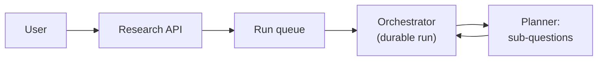
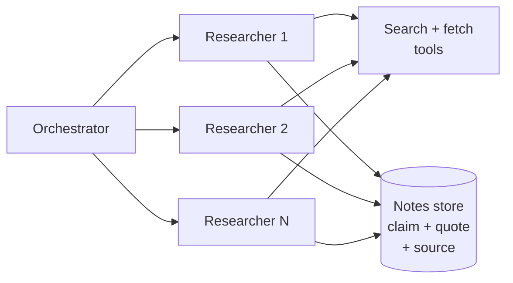
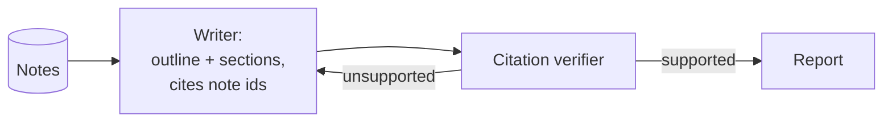

**The prompt:** "Design a deep research agent: a user asks a complex question, and the system researches it across many sources and returns a cited report."

This is the long-running agent in its purest form: one question becomes dozens of searches, hundreds of page reads and a structured report, over 5 to 30 minutes, costing dollars per run. It tests planning, parallel sub-agents, keeping citations honest, defending against hostile web content and capping cost. Run the DP-00 framework.

## 1. Requirements (about 5 minutes)

**Say:** "A single run can take many minutes and cost dollars, so I'll design it as an async job with clear budgets. Let me confirm the sources and the expected output."

**Ask:** Public web only, or also internal documents? How long may a run take? What does the report look like? Can users steer the plan? Who pays per run?

**Functional requirements:**

1. Users submit a research question; the system may ask one clarifying question about scope.
2. The system plans sub-questions, searches and reads many sources, and tracks what it has learned.
3. Users see the plan and progress, and can adjust the plan.
4. Users receive a structured report where every key claim cites its source, and can ask follow-ups.

**Below the line:** private paywalled sources, collaborative editing of reports, scheduled recurring research.

**Non-functional requirements:**

1. **Faithful citations**: every cited claim is supported by its source.
2. **Run time** 5 to 30 minutes, with progress visible throughout.
3. **Cost cap** per run, never exceeded.
4. **Durability**: runs survive worker crashes and deploys.
5. **Safety** against untrusted web content (prompt injection).
6. **Scale**: thousands of runs a day.

## 2. Success metrics (about 3 minutes)

- **Business**: report ratings, follow-up and share rates, runs per active user.
- **Quality**: **citation precision** (cited claims supported by their source), coverage of key facts against expert checklists, factual error rate.
- **System**: run time, cost per run, share of runs hitting budget limits.
- **Guardrail**: injection incidents (must be zero), unsupported claims shown without a warning.

## 3. Entities, API and numbers (about 5 minutes)

**Core entities:** Research run (question, plan, status, budget used); Subtask (a sub-question with its status and findings); **Source** (URL, fetched snapshot, content hash, fetch time, quality score); **Note** (one finding: a claim, the verbatim quote supporting it, the source id); Report (sections, claims, citations pointing to notes).

**API:**

```text
POST /v1/research                { question } -> { runId, clarifyingQuestion? }
GET  /v1/research/{id}/events    -> SSE: plan, subtask progress, notes count, status
POST /v1/research/{id}/plan      { edits }            (steer while running)
GET  /v1/research/{id}/report    -> report with citations
```

**Numbers:**

- 10,000 runs a day x ~15 minutes average = **~100 concurrent runs**, peaks several times that.
- Per run: ~50 pages read at ~5,000 tokens each = **~250,000 tokens of reading**, plus planning and writing: roughly **0.5-1M tokens per run**, so 5-10B tokens a day. Reading dominates, so it should use a cheaper model than planning and writing.
- Each run makes 100+ tool calls (search, fetch): search API quotas and per-site politeness become real limits.

## 4. High-level design (about 10 minutes)

**Say:** "It's an async job: a planner, parallel researcher sub-agents that turn pages into notes, and a writer that only cites notes. All state is checkpointed."

### Requirement 1: plan the research

**Draw:**



**Say:** "Optionally clarify scope with one question. The planner, using a strong model, breaks the question into sub-questions with what each should establish. The plan is shown to the user, who can edit it."

### Requirement 2: research in parallel

**Draw:**



**Say:** "Each sub-question gets a researcher sub-agent with its own context: it searches, fetches pages, and extracts notes, each a claim plus the verbatim quote plus the source. Only notes go back to the orchestrator, never raw pages, so the main context stays small. Fetched pages are snapshotted for reproducibility."

### Requirement 3: progress and steering

**Say:** "Every step emits an event over SSE: plan, subtask status, number of sources and notes. A plan edit updates the run's state and the orchestrator picks it up at its next decision."

### Requirement 4: a cited report

**Draw:**



**Say:** "The writer builds the report only from notes and must cite note ids for every claim. A verifier checks each cited claim against its quote before the report is released."

## 5. Deep dives (15 to 20 minutes)

### Deep dive 1: Planning and replanning

**Bad: a fixed plan executed once.** The first plan is based on guesses; the research reveals new angles, contradictions and dead ends that a fixed plan ignores.

**Good: plan, execute, then write.** Works for simple questions, but gaps found during research never get filled.

**Great: rounds of plan, research, reflect.** After each round the orchestrator reviews the notes: which sub-questions are answered, which sources contradict each other, what is still unknown. It **replans** (new sub-questions, deeper dives on contradictions) until a stopping rule fires: coverage of the plan reached, diminishing new information (new notes mostly duplicate old ones), or the budget is spent. The whole run is a checkpointed workflow, so a crash resumes at the last completed round.

### Deep dive 2: Parallel sub-agents done right

- **Context isolation**: each researcher sees only its sub-question and returns compact notes; the orchestrator never sees raw pages.
- **Fan-out with limits**: a cap on concurrent researchers per run, a global cap per search API quota, and **per-domain politeness** (rate limits, robots rules) for fetching.
- **Deduplication**: notes are merged by source and claim similarity, so ten researchers reading the same popular page don't produce ten copies.
- **Failure isolation**: a researcher that fails or times out marks its subtask incomplete; the run continues and the report states the gap.

### Deep dive 3: Keeping citations honest

**Bad: the writer adds citations at the end.** The model attaches plausible-looking links to claims they don't support. This is the most common failure of research agents.

**Good: the writer must cite note ids.** Citations now point to real notes, but the writer can still overstate what a note says.

**Great: quote-backed notes plus automatic verification.**

- Notes store the **verbatim quote** and a **source snapshot**, so every claim traces to exact text that existed at fetch time.
- The writer may only make claims supported by the notes it cites.
- A **verifier** (a calibrated judge model) checks each claim against its quoted evidence; unsupported claims are rewritten, removed, or clearly flagged as the writer's inference.
- **Contradictions are surfaced**, not hidden: "Source A reports X; source B reports Y."
- Citation precision is a tracked metric.

### Deep dive 4: Defending against prompt injection from the web

**Say:** "Every fetched page is untrusted. Some will contain instructions aimed at AI agents."

- **Readers have no dangerous tools**: researcher agents can search and fetch, nothing else (no email, no writes, no access to user data), so an injected instruction has nothing to trigger.
- **Data, not instructions**: page content is passed as clearly delimited data, and readers output only structured notes, which is all the orchestrator consumes.
- **Source quality**: domain reputation, allow and deny lists, and down-weighting of low-quality or SEO-spam pages.
- **Anomaly checks**: notes that contain instructions or URLs unrelated to the question are dropped.

### Deep dive 5: Capping cost per run

**Bad: no limits.** One curious run loops through 500 searches and costs more than the user pays in a month.

**Good: a hard cap on tool calls and tokens** that stops the run.

**Great: budget-aware research.**

- Each run has a **token, tool-call and time budget**, split across sub-questions; the orchestrator spends more on important or contradictory areas.
- **Model routing**: a strong model for planning, reflecting and writing; a cheaper model for reading pages and extracting notes, which is the bulk of tokens.
- **Caching** search results and fetched pages across runs, by URL and content hash.
- **Early stopping** on diminishing returns, and a **graceful finish**: when the budget runs out, write the best report from the notes so far and state what was not covered.
- Show the user the cost or quota consumed.

## 6. Evaluation and safety (about 5 minutes)

- **Offline**: a set of research questions with **expert-written checklists** of key facts a good report must contain; score coverage, citation precision (calibrated judge plus human spot checks), factual errors, run time and cost; run each question several times, since runs vary; gate prompt, model and tool changes.
- **Trajectory review**: are the searches sensible, are good sources found, where do runs waste budget?
- **Online**: report ratings, follow-up questions that reveal gaps, user-reported wrong citations.
- **Safety**: read-only researchers, sources treated as data, injection anomaly checks, no personal-data collection beyond the question.

## 7. Cost, scale, failures, trade-offs (about 3 minutes)

- **Cost**: model routing (cheap readers), caching across runs, budget allocation, early stopping.
- **Scale**: concurrent runs are bounded by search API quotas and model rate limits more than servers; queue runs with priorities.
- **Failures**: search API down or sites blocking: retry, use alternative sources, and finish with a partial report that states its gaps; worker crash: resume from the checkpoint.
- **Trade-off**: verification adds time and cost per report, but unverified citations destroy trust, which is the product.

**The 20-second summary:** "An async, checkpointed orchestrator plans sub-questions, fans out read-only researcher sub-agents that turn pages into quote-backed notes, and replans in rounds until coverage or budget stops it. A writer composes the report only from cited notes, and a verifier checks every claim. Budgets, model routing and caching cap cost; untrusted pages can't trigger anything because readers have no dangerous tools."

## What separates levels

- **Mid-level**: plan, search, read and summarise with links; runs as a background job.
- **Senior**: sub-agents with isolated contexts, notes with quotes, cited writing, budgets, progress events, a checkpointed run, injection awareness.
- **Staff**: iterative replanning with stopping rules, claim-level verification as a product guarantee, budget allocation and model routing tied to cost per report, source quality and politeness at scale, and evaluation against expert checklists with repeated runs.
