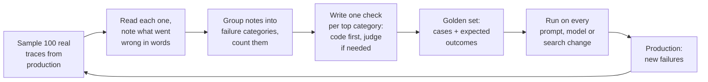
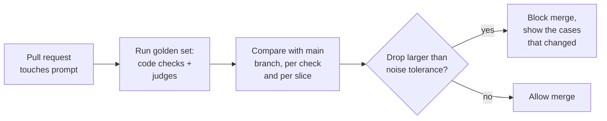

Three months after launch, FreshCart's COO forwards a screenshot: Ask FreshCart told an agent that bakery items can be refunded within 48 hours. The policy says 12. Her question: "Is this thing actually working, and how would we even know?" The honest answer so far is "agents seem to like it." That is not an answer. This page and the next four are how you get a real one.

## 1. What an eval is

An **eval** (evaluation) is a test for an AI system: give it an input, then grade its output with some logic. Unlike a unit test, the output is open-ended text, so "grading" can mean an exact check in code, a judgement by another model, or a person's verdict.

Two more terms:

- A **trace** is the full record of one request: the question, the retrieved chunks and their scores, any tool calls, the final prompt, the answer, the time and the tokens.
- A **golden set** is a fixed, versioned collection of test cases with their expected outcomes, run against every change to the system.

## 2. Look before you measure

The tempting first move is to install an evaluation library and report "helpfulness: 4.1 out of 5." That number would tell the COO nothing: not what is wrong, how often, or what to fix. The people who teach evals most widely (Hamel Husain and Shreya Shankar, and Anthropic's guide to agent evals) agree on a different order: read real outputs first, name the failures, count them, and only then build measurements for the failures that matter.

Week one, step by step:

- **Sample 100 traces** from production, spread across question types and days.
- **Open coding**: read each trace and write a short note in plain words about what went wrong, or "fine". For example: "cited the 2023 bakery policy", "never searched, answered from memory", "right chunk found, wrong number in the answer".
- **Axial coding**: group those notes into categories and count them. FreshCart's result:

| Failure category | Count of 100 |
|---|---|
| Outdated document version retrieved | 11 |
| Right chunk retrieved, answer contradicts it | 6 |
| Order question answered without looking up the order | 5 |
| Answer too long for agents to read on a call | 4 |

- Now you know what to fix first. The biggest category, outdated versions, is an indexing bug (old chunks never deleted), not a prompt problem.
- **Write one check per top category**:
  - Code checks first, because they are cheap and exact: "every cited chunk is the latest version", "the order tool was called when the question contains an order id", "answer under 120 words".
  - A model acting as judge only where code cannot decide, such as "is the answer supported by the cited chunks?" (next page).
  - People to label examples, so the judge itself can be checked.
- **Build the golden set** from these traces plus their correct outcomes. Version it, and add every new production failure to it.
- **Gate changes in CI** (continuous integration, the automatic checks that run on every code change): every pull request that touches prompts, models, search or tools runs the golden set and is blocked if a check drops below its threshold.

## 3. Pass or fail, not 1 to 5

People, and models, disagree about whether an answer is a 3 or a 4. They agree far more on "does it cite the correct policy: yes or no?" A failed yes/no check also tells you exactly what to fix, while "3.4 average" does not. Capture nuance as several separate yes/no checks, each with a short written reason.

## 4. Two kinds of test suite

- **Capability evals** ask "can it do this hard thing yet?" They hold tasks the system mostly fails today, such as questions about several orders at once, or questions in Marathi. The pass rate starts low and you work to raise it.
- **Regression evals** ask "does it still do what it used to?" They hold tasks the system reliably passes. The pass rate should stay near 100%, and a drop blocks the merge. Once a capability task is reliably solved, it moves into the regression suite.

Keeping them apart stops a noisy capability score from blocking every deploy, and stops a real regression from hiding inside an average.

**Decision point: your golden set is 50 questions you wrote yourself while reading the documents. What can it not tell you?**

- How agents really ask: shorter, messier, several questions in one, with typos. Questions written while reading a document reuse its words, which makes search look better than it is.
- Small differences: one question flipping is 2%, so a 2-3 point change is noise. Look at which questions changed, not just the total.
- Failures you never imagined, such as out-of-scope or adversarial questions.
- If the same model wrote the questions and answers them, it is biased toward its own phrasing.

The fix: sample real questions from production, label the failures, and grow the set every week.

Correction: generic metrics ("helpfulness", text-similarity scores, a library's default score) rarely track whether a product works. Checks built from your own failure categories do.

## 5. Building a golden set that means something

- **Size**: start with 50-100 cases, enough to see big problems; grow towards a few hundred as the system matures. Anthropic's guide to agent evals suggests 20-50 tasks drawn from real failures is already enough to start.
- **Stratify**: make sure every question type, city, language and difficulty level is represented, so you can report results per slice, not just one average.
- **Include the awkward cases**: unanswerable questions, ambiguous ones, adversarial ones (instructions hidden in a document), and questions about recently changed policies.
- **Synthetic data, done carefully**: when real data is thin, have a model generate cases from a grid of dimensions (question type x city x difficulty x persona) rather than "write 100 questions", which produces 100 near-copies. Review every generated case before it enters the set.
- **Label the expected outcome, not just an answer**: the correct source chunks, the facts the answer must contain, and anything it must not say.

## 6. Running evals in CI without flakiness

Model outputs vary between runs, so a naive CI gate fails randomly. Make it reliable:

- **Compare against the main branch**, not a fixed number, so drift in the judge or data affects both sides equally.
- **Allow for noise**: run unstable cases more than once, and block only drops larger than the run-to-run variation you have measured.
- **Show the changed cases**, not just the score, so the reviewer can see what got worse.
- **Control cost**: cache model responses for unchanged inputs, run the cheap code checks on every commit and the full judged suite before merge.

## 7. Tools you will hear about

You can build all of this with plain scripts, and many teams start that way. Common tools: **LangSmith** and **Langfuse** (tracing, datasets, experiments, online evaluation), **promptfoo** (prompt tests in config files, easy to run in CI), **DeepEval** (test-style assertions for LLM outputs), and **Ragas** (RAG metrics). Pick the one that fits your stack; the method on this page matters more than the tool.
