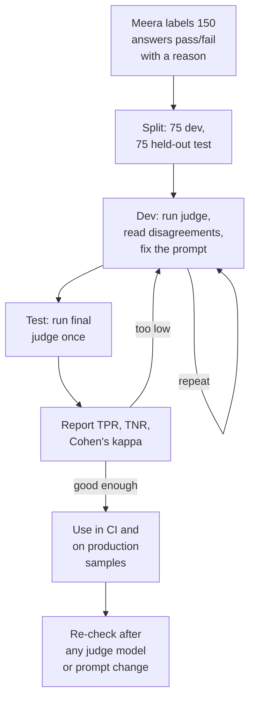
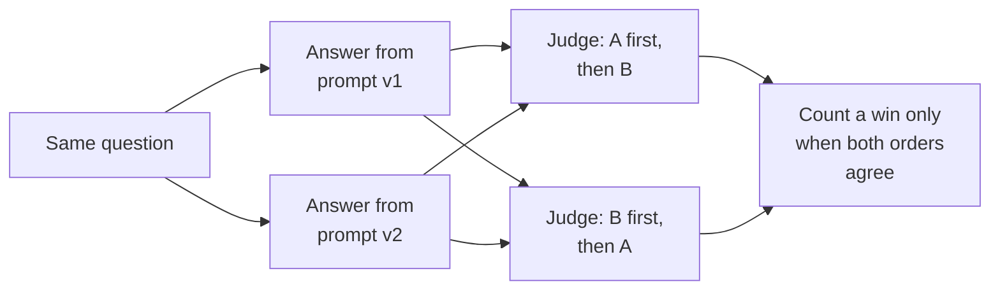

Some of Ask FreshCart's checks need judgement. "Is every claim in this answer supported by the cited chunks?" is not something a regular expression can decide. So you use a model to grade the answers. The COO's follow-up is the question every interviewer asks next: "And who checks the judge?"

## 1. LLM-as-judge

**LLM-as-judge** means using a language model to grade another model's output against written criteria. Three common setups:

- **Single output, pass or fail**: "does this answer meet criterion X?"
- **Reference-based**: compare the answer with a known-good answer.
- **Pairwise**: show two answers and ask which is better.

A judge is a measuring instrument. Like any instrument, you have to check it reads correctly before you trust its numbers.

## 2. Checking the judge against people



- **Labels**: Meera, the person who knows the policies best, labels 150 answers pass or fail with a one-line reason, covering every failure category from the error analysis.
- **Development set**: you run the judge on 75 of them, read every case where it disagrees with Meera, and improve its instructions or examples. Repeat.
- **Test set**: the other 75 are used once, at the end, so the number you report has not been tuned to.
- **Report two rates**:
  - **TPR** (true positive rate): of the answers Meera passed, the share the judge also passed.
  - **TNR** (true negative rate): of the answers Meera failed, the share the judge also failed.
  - TNR matters most. A judge that misses failures gives false comfort; a judge that never fails anything has a TNR of zero.
- **Re-check** whenever the judge's model or instructions change.

## 3. Cohen's kappa: agreement that is not just luck

If you and the judge both pass most answers, you will agree often by pure chance. **Cohen's kappa** measures agreement after removing the agreement chance alone would produce:

`kappa = (observed agreement - chance agreement) / (1 - chance agreement)`

Worked example: 40 answers. You and the judge agree on 34. Each of you marks 20 as pass.

- Observed agreement = 34 / 40 = 0.85.
- Chance agreement: both say pass 0.5 x 0.5 = 0.25, both say fail 0.25, total 0.5.
- kappa = (0.85 - 0.5) / (1 - 0.5) = 0.70, usually read as substantial agreement.

Report TPR and TNR alongside it: kappa shows how much you agree, not in which direction the judge errs.

## 4. How judges go wrong

- **Position bias** (pairwise): prefers whichever answer is shown first, or second. Run both orders and count only consistent verdicts.
- **Verbosity bias**: prefers longer answers. Write criteria about content, not length.
- **Self-preference**: prefers answers written by its own model family. Use a judge from a different family.
- **Leniency**: passes too much. Include failing examples in its instructions, ask for its reasoning before its verdict, and watch the TNR.
- **Vague criteria**: "is it helpful?" produces noise. One narrow criterion per judge.

**Decision point: the judge checking groundedness uses the same model as Ask FreshCart itself.** The risk is correlated errors: the judge shares the answering model's blind spots and accepts exactly the kind of unsupported claim that model makes. Use a judge from a different model family (or a model trained specifically to check whether text is supported), check claim by claim, and measure its TNR.

Shreya Shankar's research ("Who Validates the Validators?") found **criteria drift**: grading real outputs changes what people think the criteria should be. Expect to rewrite the rubric after labelling; that is normal, not a mistake.

## 5. A judge prompt that works

```text
Check one property: is every factual claim in ANSWER supported by CONTEXT?
Supported means stated in, or directly implied by, the context. Ignore style.
1. List each claim. 2. For each, quote the supporting context or write NONE.
Then output JSON: {"critique": "...", "grounded": true or false}.
grounded is false if any claim is NONE.
<two passing and two failing examples, each with its critique>
CONTEXT: ...
ANSWER: ...
```

What makes it work: a single criterion, the reasoning before the verdict, a yes/no output, examples of failure as well as success, and structured output that code can read.

## 6. Correcting a rate measured by an imperfect judge

Suppose the judge says 82% of production answers are grounded. You know the judge's TPR is 0.90 and its TNR is 0.80. The true rate is not 82%: the judge wrongly passes some failures and wrongly fails some passes. You can correct for that:

`true rate = (observed rate + TNR - 1) / (TPR + TNR - 1)`

Here: (0.82 + 0.80 - 1) / (0.90 + 0.80 - 1) = 0.62 / 0.70 = about 0.89. The system is actually somewhat better than the raw judge number suggests. (This is the Rogan-Gladen correction from medical testing; the evals literature recommends it for judge-measured rates.) It only works if TPR + TNR is clearly above 1, which is another reason to measure them.

## 7. Pairwise judging for A/B decisions

To choose between two prompt versions, absolute scores are noisy. **Pairwise judging** shows the judge both answers to the same question and asks which is better on a specific criterion, run in both orders to cancel position bias. Report the win rate of B over A, with ties. Pairwise comparisons are usually more consistent than independent scores, and they answer the question you actually have: is the new version better?



## 8. Cost and sampling

Judges cost a model call per graded output. In CI, the golden set is small enough to judge fully. In production, judge a random sample (say 2-5% of traffic), plus every answer that received a thumbs-down, plus a boosted sample of rare slices you care about. Use a cheaper judge model where its measured agreement is good enough, and a stronger one only for the hard criteria.

Also asked: "Is your judge any good?" Answer with the procedure in section 2: labels from a domain expert, a held-out test set, TPR and TNR. If you have not done it yet, say so and say it is the next step.
