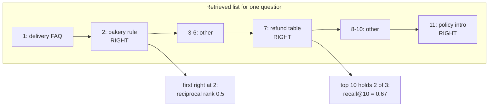

The bakery failure was a search problem: the wrong version was retrieved. The "answer contradicts its own chunk" failure was a generation problem. To fix the right half, you measure the two halves separately. Interviewers often ask you to compute these numbers by hand, so this page works through them.

## 1. Measuring search

Search metrics need, for each test question, the ids of the chunks that actually answer it (the **relevant** chunks).

- **recall@k**: of all relevant chunks, the share that appear in the top k results. "Did we find it?"
- **precision@k**: of the top k results, the share that are relevant. "How much noise came with it?"
- **hit rate@k**: did at least one relevant chunk appear in the top k?
- **MRR** (mean reciprocal rank): for each question, take 1 divided by the position of the first relevant chunk (1 if first, 0.5 if second, 0.33 if third), then average over all questions. It rewards putting the right chunk at the very top.
- **nDCG@k** (normalised discounted cumulative gain): every relevant chunk earns credit, but less the lower it appears. DCG adds up `1 / log2(position + 1)` for each relevant chunk; dividing by the DCG of the perfect ordering gives a score from 0 to 1.

Worked example. For "bakery refund window", three chunks are relevant, and search returns them at positions 2, 7 and 11.



- recall@5 = 1/3 = 0.33 (only position 2 is in the top 5).
- recall@10 = 2/3 = 0.67 (positions 2 and 7).
- Reciprocal rank = 1/2 = 0.5; this question adds 0.5 to the MRR average.
- DCG@10 = 1/log2(3) + 1/log2(8) = 0.631 + 0.333 = 0.964.
- Perfect DCG@10, with the three relevant chunks at positions 1-3 = 1 + 0.631 + 0.5 = 2.131.
- nDCG@10 = 0.964 / 2.131 = 0.45.

Reading the numbers: the right material is being found, but ranked poorly. The next step is a reranker.

## 2. Measuring answers

Four metrics, popularised by the RAGAS library, cover the answer side. They are usually scored by a model acting as judge, so the judge needs checking as on the previous page.

- **Faithfulness**: the share of the answer's claims that are supported by the retrieved chunks. "Did it stick to the evidence?" Needs no reference answer.
- **Answer relevance**: does the answer address the question that was asked? Needs no reference answer.
- **Context precision**: are the relevant chunks ranked near the top of what was retrieved? Needs relevance labels.
- **Context recall**: of the facts in a known-good reference answer, the share present in the retrieved chunks. "Did search bring back everything needed?" Needs a reference answer.

Together they split every failure: low context recall means fix search; high context recall with low faithfulness means fix generation.

**Decision point: faithfulness is 0.95, but agents still say answers are wrong.** Faithfulness only means "agrees with the chunks it was given". So suspect the chunks: an outdated or wrong document (exactly FreshCart's bakery bug), the wrong document retrieved (check context recall), or a misunderstood question (check answer relevance). Or the judge is too lenient: check its TNR.

Correction: faithful is not the same as correct. An answer perfectly faithful to an outdated policy is still wrong.

Also asked: "You report recall@10 on 51 questions. Do you trust a 0.02 improvement?" No. 0.02 of 51 is about one question changing. Look at which questions improved and which got worse, use a paired statistical test across questions (such as a bootstrap or a sign test), or grow the set to a few hundred questions.

## 3. Complete example: the metrics in code

```python
import math

def recall_at_k(ranked, relevant, k):
    return len(set(ranked[:k]) & relevant) / len(relevant)

def reciprocal_rank(ranked, relevant):
    for i, cid in enumerate(ranked, start=1):
        if cid in relevant:
            return 1 / i
    return 0.0

def ndcg_at_k(ranked, relevant, k):
    dcg = sum(1 / math.log2(i + 1) for i, c in enumerate(ranked[:k], start=1) if c in relevant)
    ideal = sum(1 / math.log2(i + 1) for i in range(1, min(len(relevant), k) + 1))
    return dcg / ideal

def cohens_kappa(human, judge):
    n = len(human)
    p_o = sum(h == j for h, j in zip(human, judge)) / n
    ph, pj = sum(human) / n, sum(judge) / n
    p_e = ph * pj + (1 - ph) * (1 - pj)
    return (p_o - p_e) / (1 - p_e)

def gate(results, thresholds):
    failed = {name: score for name, score in results.items() if score < thresholds[name]}
    return ("BLOCK", failed) if failed else ("PASS", {})
```

Expected behaviour:

- With `ranked = ["faq", "bakery", "x3", "x4", "x5", "x6", "table", "x8", "x9", "x10", "intro"]` and `relevant = {"bakery", "table", "intro"}`: `recall_at_k(..., 5)` is 0.33, `recall_at_k(..., 10)` is 0.67, `reciprocal_rank` is 0.5, and `ndcg_at_k(..., 10)` is about 0.45.
- `cohens_kappa` on 40 labels where the two agree on 34 and each marks 20 as pass returns 0.70.
- `gate({"recall@10": 0.81, "faithfulness": 0.88}, {"recall@10": 0.80, "faithfulness": 0.90})` returns `("BLOCK", {"faithfulness": 0.88})`: the pull request is blocked and the failing check is named.
