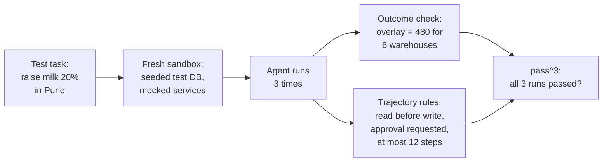

Planner Copilot is much harder to test than Ask FreshCart. It takes many steps, calls tools, changes data, and does not behave identically twice. "Does the final message look right?" is not enough: it can say "done" while having updated the wrong warehouse.

## 1. Three levels of testing an agent

- **Final outcome**: did the task actually succeed? Check the **system of record**, the database or service that holds the truth, not the agent's message. Does the staged change hold 480 units for exactly the right 6 warehouses?
- **Trajectory**: the sequence of tool calls the agent made, checked against rules. Did it read current stock before proposing? Did it request approval before any write? Did it never call a delete tool? Did it finish within 12 steps? Rarely demand an exact sequence: there are often several valid paths, and rigid matching punishes good runs.
- **Single step**: given this exact state, is the next tool call the right one? Useful for pinpointing where a run goes wrong.

- Each run starts in a fresh **sandbox**: a test database seeded with known data, and fake versions of external services, so runs do not interfere with each other or with real systems.
- The same task runs several times, because agents vary from run to run.
- The outcome is checked in the sandbox's database; the trajectory is checked against the rules.

## 2. pass@k and pass^k: one success is not reliability

Run the same task k times:

- **pass@k** is the chance that at least one of the k attempts succeeds. It fits tools where a person picks the best of several attempts, such as code suggestions.
- **pass^k** (read "pass to the power k") is the chance that all k attempts succeed, roughly the single-attempt success rate raised to the power k. It fits anything facing customers or changing data, because each real request gets exactly one attempt.

At 80% success per attempt, pass^3 = 0.8 x 0.8 x 0.8 = 0.51. An agent that "works 80% of the time" handles three requests in a row correctly only about half the time. That is the argument for working on consistency, not just capability.

**Decision point: Planner Copilot passes 9 of 10 test tasks on a single run. Ready to launch?** Not yet. Run each task several times and look at pass^3, and check the failures: one wrong-warehouse write is worse than five slow runs.

## 3. Testing conversations

For agents that hold multi-turn conversations, a **simulated user** stands in for a person: a model plays Arjun from a scenario card (his goal, the facts he knows, when he gives up) and chats with the agent until the task is done or a turn limit is reached. Then the outcome and the conversation are graded. Read some transcripts by hand: an unrealistic simulated user produces misleading scores.

Also asked: "Exact trajectory matching, or not?" Mostly not. Grade outcomes first, check must-do and must-not-do rules on the trajectory, allow different valid orders, and use a judge for "was this a reasonable path?" Reserve exact matching for narrow, fixed workflows.
