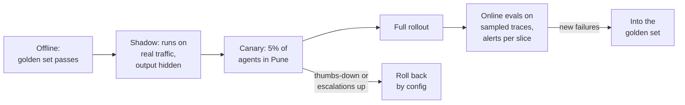

The golden set passes. That says the new version works on yesterday's questions. It says nothing about tomorrow's, about the model provider changing something underneath you, or about one city where answers quietly got worse. Production needs three more things: a record of every request, ongoing grading of live traffic, and launches that can be rolled back.

## 1. Seeing every request: traces and observability

**Observability** for an AI system means being able to answer "what happened in this request, and why?" after the fact. Its core is the trace from the evals overview: one record per request, with a nested entry for every model call, search and tool call, each holding its inputs, outputs, model version, tokens, time and cost. Tools such as LangSmith and Langfuse store and display these; OpenTelemetry has standard conventions for them.

What a trace for Ask FreshCart holds:

- model and version, and the prompt template version;
- the input messages (with personal data masked);
- retrieved chunk ids and their scores;
- tool calls with arguments, results and errors;
- the answer, tokens in and out, time to first word and total time, cost;
- agent id, franchise, conversation id, and the user's later thumbs up or down.

Decide retention and masking rules up front: traces often contain sensitive data.

## 2. Grading live traffic: online evals

**Online evals** run checks on a sample of real production traces, continuously. They have to be reference-free, since live questions have no known-good answer: code checks (citations valid, format right) and calibrated judges (grounded or not). Chart the results per slice (city, franchise, question type) and alert on drops. An average across everything hides a regression in one area.

Signals worth watching alongside them: thumbs-down rate, how often agents regenerate an answer, the same question asked again in different words, escalations to a supervisor, format failures, refusals, answer length, time and cost per request.

## 3. Launching safely

- **Offline**: the golden set must pass before anything ships.
- **Shadow**: the new version answers real questions in parallel, but agents still see the old version's answers. You compare the two without risk.
- **Canary**: a small group, say 5% of agents in Pune, gets the new version. The success metric (questions resolved without escalation) and the rollback triggers (thumbs-down rate, escalation rate) are written down before it starts.
- **Full rollout**, followed by online evals. Every new failure found in production goes into the golden set.
- Rolling back is a configuration change, not a redeploy, so it takes seconds.

**Decision point: the model provider silently updates its model and answers change. How do you find out before agents do?**

- **Pin dated model versions**, so updates happen when you choose, not when the provider does.
- **Run the regression suite daily** against the live model endpoint.
- **Watch signals that move immediately** when a model changes: answer length, refusal rate, format failures, token counts.
- **Keep the previous version one configuration switch away**, so you can route back instantly.

Also asked: "A stakeholder wants to launch, but the evidence is weak." Do not just say no. State what the evals do and do not show, propose a shadow run or a small canary with a written success metric and rollback trigger, review a daily sample by hand, and set a date to decide from the data. That turns an argument into an experiment.
