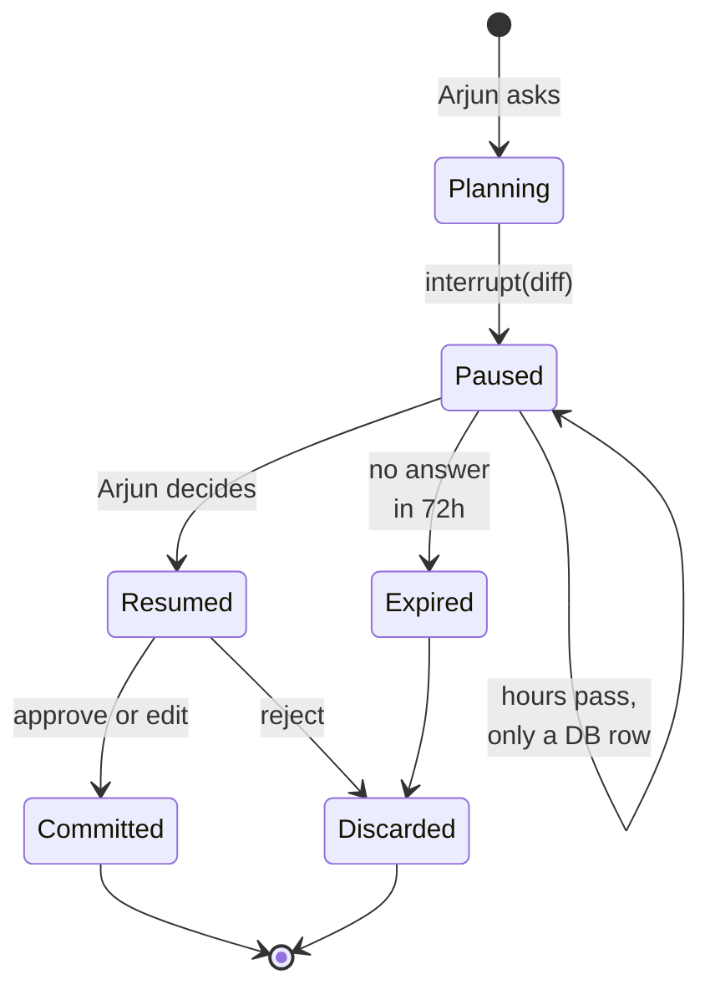
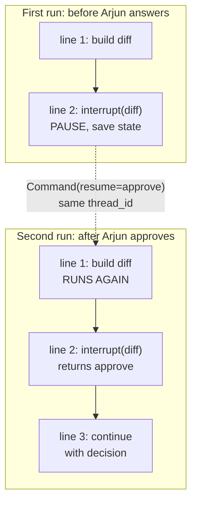
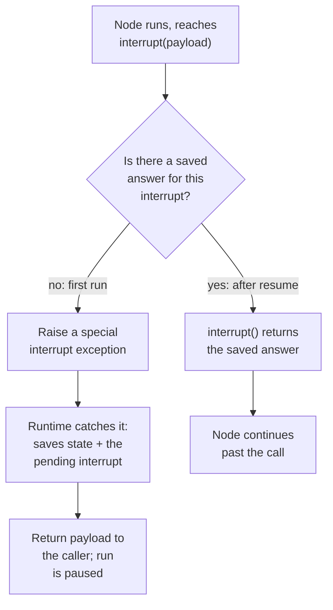

FreshCart's planning team wants an agent too. Arjun plans stock for the Pune warehouses. Every week he adjusts **safety stock** (the extra units kept on hand so a product does not run out when demand spikes) for hundreds of products, through tickets that take days. You build **Planner Copilot**: Arjun types "Raise safety stock for milk in all Pune warehouses by 20% before Diwali" and the agent works out the change.

A wrong change here empties shelves or wastes lakhs of rupees of dairy (a lakh is 100,000). So Planner Copilot works out the change: 6 warehouses, milk SKU-881, safety stock from 400 to 480 each. Then it must stop, show Arjun, wait (maybe until tomorrow, maybe across a deploy), and continue only with his decision. Nothing should be left running while it waits.

## 1. The idea: human-in-the-loop

**Human-in-the-loop (HITL)** is a design where an agent pauses at chosen points so a person can approve, edit or reject what it is about to do. LangGraph builds this on the saved state from the persistence page: since the whole run is saved after every step, pausing just means stopping and leaving the saved state in the database, and resuming means loading it again.

Two functions do it:

- `interrupt(payload)`, called inside a node, pauses the run and hands `payload` (for example the proposed change) to whoever started the run.
- `Command(resume=value)`, passed in when the run is started again on the same thread, continues it. `value` becomes the return value of the `interrupt()` call, so the node receives the human's decision as if the function had simply returned it.

## 2. The life of one proposal



- **Planning**: the agent reads current stock and forecasts with read-only tools and builds the **diff**, the exact list of what would change from what to what.
- **Paused**: the node calls `interrupt({"diff": ...})`. The state and the pending question are saved in Postgres, and the call returns to the server with the payload in `result["__interrupt__"]`. No thread, connection or process waits. The paused run is just rows in a table.
- **Resumed**: Arjun clicks a decision. Any server process calls `graph.invoke(Command(resume={"type": "approve"}), config={"configurable": {"thread_id": "plan-881"}})`. LangGraph loads the saved state and continues.
- **Expired**: nobody answered in time, and a cleanup job closes the proposal (the production page covers this).
- **Committed or Discarded**: the change is applied, or thrown away.

A checkpointer is required, and in production it must be durable. With the in-memory one, a restart silently loses every paused proposal.

## 3. The trap: the node starts over

What "continues" means is the part people get wrong:



- On resume, LangGraph does not jump to the line where it paused. It runs the whole node again from its first line.
- This time `interrupt()` finds the saved answer and returns it instead of pausing.
- So everything before `interrupt()` in that node runs twice.

Correction: "the run continues from the interrupt line" is wrong. It continues from the start of the node.

**Decision point: the code that saves the proposal sits before the interrupt. What goes wrong?**

Broken version:

```python
def propose(state):
    diff = build_diff(state)
    db.execute("INSERT INTO staged_changes (plan_id, diff) VALUES (%s, %s)", (state["plan_id"], diff))
    decision = interrupt({"diff": diff})        # on resume, the INSERT runs again
    return {"decision": decision}
```

After Arjun approves, there are two saved rows for one proposal.

Fixed version: give the side effect its own node, and make it safe to repeat anyway:

```python
def stage(state):
    diff = build_diff(state)
    db.execute("""INSERT INTO staged_changes (proposal_id, diff) VALUES (%s, %s)
                  ON CONFLICT (proposal_id) DO NOTHING""", (state["proposal_id"], diff))
    return {"diff": diff}

def review(state):
    return {"decision": interrupt({"diff": state["diff"]})}    # only this node re-runs
```

`stage` finished in an earlier round, so it is not re-run on resume; and if it ever were, the insert keyed by `proposal_id` does nothing the second time.

## 4. Rules interviewers check

- **Several interrupts in one node are matched by order.** On resume, the first `interrupt()` call gets the first answer, the second gets the second. If a condition or a changing list alters how many calls run, answers land on the wrong question. Work out everything that needs approval in an earlier node, store it in the state, and interrupt once with the whole batch.
- **Never wrap `interrupt()` in a bare `try/except`.** The pause works by raising a special exception; catching everything swallows it, and the run never pauses.
- **The payload must be plain data** (dicts, strings, numbers), because it is saved in the database.
- **Two parallel branches waiting at once**: each pending interrupt has an id, and you resume both together with `Command(resume={id_a: {"type": "approve"}, id_b: {"type": "reject", "message": "wrong warehouse"}})`.
- **Breakpoints are different**: `interrupt_before=["tools"]` set when building the graph pauses before a node every time, with no payload, like a debugger breakpoint. Real approvals use `interrupt()` inside the node, because it pauses only when your code decides (for example only for changes over 10%) and carries the diff to the reviewer.

## 5. What happens underneath

Knowing the mechanism makes every rule above obvious.



- On the first run there is no saved answer, so `interrupt()` raises a special exception. The runtime catches it, saves the state together with the pending interrupt, and hands the payload back.
- `Command(resume=value)` stores the answer against that pending interrupt and starts the node again from the top.
- This time `interrupt()` finds the saved answer and simply returns it.

That is why the node restarts from its first line (the runtime cannot resume halfway through a Python function), why a bare `except` breaks it (it catches the special exception), and why several interrupts are matched by order (answers are stored in the order the calls happen).

## 6. Interrupts inside tools, and checking the human's answer

**Approval inside the tool.** Instead of a separate approval node, the tool itself can pause:

```python
@tool
def update_safety_stock(sku: str, warehouse: str, new_qty: int):
    """Change safety stock for one SKU in one warehouse."""
    decision = interrupt({"sku": sku, "warehouse": warehouse, "new_qty": new_qty})
    if decision["type"] == "reject":
        return f"Rejected by planner: {decision.get('reason', 'no reason given')}"
    qty = decision.get("new_qty", new_qty)          # the planner may edit the number
    apply_change(sku, warehouse, qty)
    return f"Safety stock for {sku} in {warehouse} set to {qty}"
```

The approval travels with the tool: any agent that uses this tool gets the pause for free. The tool's own code before `interrupt()` must still be safe to repeat.

**Checking the human's answer.** People make typos too: Arjun types "4800" instead of "480". Validate the resume value, and if it is invalid, ask again. The pattern is one `interrupt()` per node run, with an edge that loops back to the node while the answer is invalid, rather than a `while` loop of interrupts inside one node (which breaks the matching-by-order rule). Recent LangGraph versions can also attach a schema to an interrupt so the resume value is validated automatically and a UI can render a form from it.

## 7. The same pattern inside create_agent

When the agent is a plain `create_agent` loop, LangChain's `HumanInTheLoopMiddleware` pauses before chosen tools:

```python
agent = create_agent(
    model, tools=[get_stock, get_forecast, update_safety_stock],
    middleware=[HumanInTheLoopMiddleware(interrupt_on={
        "update_safety_stock": {"allowed_decisions": ["approve", "edit", "reject"]},
        "get_stock": False,
    })],
    checkpointer=PostgresSaver.from_conn_string(DB_URL),
)
```

When the model proposes `update_safety_stock`, the run pauses with the tool name and arguments. The reviewer's options: `approve` runs the call as proposed; `edit` runs it with the reviewer's arguments; `reject` skips it and tells the model why; `respond` sends a message back as the tool's result without running it. Resume with `Command(resume={"decisions": [{"type": "approve"}]})`.

Correction: do not use `respond` to refuse a call. The model treats a responded result as success; use `reject` with a reason.
