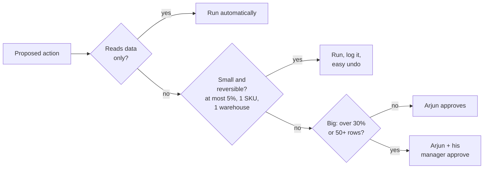
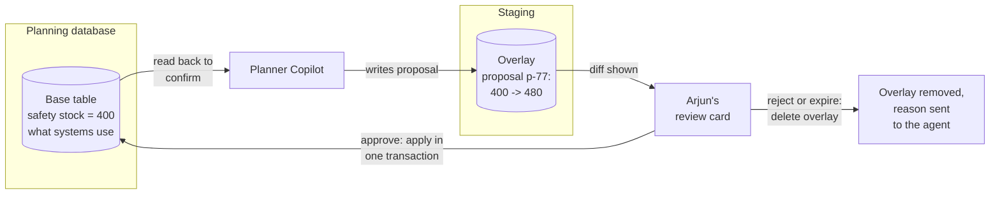

The first version of Planner Copilot asks Arjun to approve everything, including "show me milk stock in Kothrud". Within a week he approves every request in two seconds without reading it. The approval step has become theatre: it slows everyone down and catches nothing. The real design questions are which actions need a human, what the human sees, and where a change lives while it waits.

## 1. Which actions need a human

Sort every action by how much damage it can do and whether it can be undone:

- Reads, explanations and what-if simulations on a copy of the data never need approval.
- Small, reversible changes inside limits run automatically, and are logged so they can be undone.
- Anything larger waits for Arjun; very large or bulk changes need a second approver.
- The limits live in code, not in the prompt. A prompt can be ignored or overridden; a check in code cannot.

## 2. Approve the exact change, not the idea

If Arjun approves a sentence ("raise milk safety stock 20%") and the agent builds the database update afterwards, the model can still get the details wrong after approval: the wrong product, or all of Maharashtra instead of Pune. Arjun must approve the exact change: which product, which warehouses, old value, new value. If he wants a different number, he edits it, and the edited change is exactly what runs.

His review card should let him decide in under a minute:

- **The diff**: SKU-881 milk 1L, 6 Pune warehouses, safety stock 400 -> 480 each, +480 units in total.
- **Why**: his original request, the agent's reasoning, and the forecast numbers it used.
- **Risk flags**: "+20% is above the usual 10%", "forecast data is 3 days old".
- **His options**: approve, edit, or reject with a reason.

A thin card ("Approve action #42?") gets rubber-stamped. Track the approval rate and the time taken to decide: 100% approvals in three seconds each means the gate adds nothing.

## 3. Where the change lives while it waits

The safest pattern keeps the proposed change completely separate from the live data until approval.

- The **base** is the real table that ordering systems read.
- The **overlay** is a staging area holding proposed changes: a separate table, or Redis with an automatic expiry time.

- The agent writes its proposal to the overlay. The base does not change, so no ordering system sees anything yet.
- Arjun's card shows the difference between base and overlay.
- **Approve**: the overlay is applied to the base in one database transaction, so either every row changes or none does.
- **Edit**: Arjun's values replace the proposed ones, then the same commit runs.
- **Reject or expiry**: the overlay is deleted, and the reason goes back to the agent as the tool's result, so it can revise its proposal in the same conversation.
- After committing, the agent reads the base table back and reports success only if the new values are really there.

## 4. Two framings worth knowing

- **"Contact humans with tool calls"** (from the 12-Factor Agents guide): asking for approval is just another tool the agent can call, such as `request_approval(diff)`. Pausing and resuming then becomes ordinary control flow rather than a special case.
- **Ambient agents**: agents started by events rather than by a chat message, such as a nightly forecast job. They post their proposals to an inbox and wait, saved in the database, until someone answers. LangChain's Agent Inbox is one such interface.

Also asked: "How do rejections make the agent better?" Each rejection or edit is a labelled example: the proposal, its context and the correct action. In the moment, the reason goes back to the model so it can revise. Over time, rejected cases join the test set as "must not propose this", recurring patterns (wrong scope, outdated forecasts) are fixed in the prompt, tools or validation, and the rejection and edit rates per action type are tracked as quality signals.
