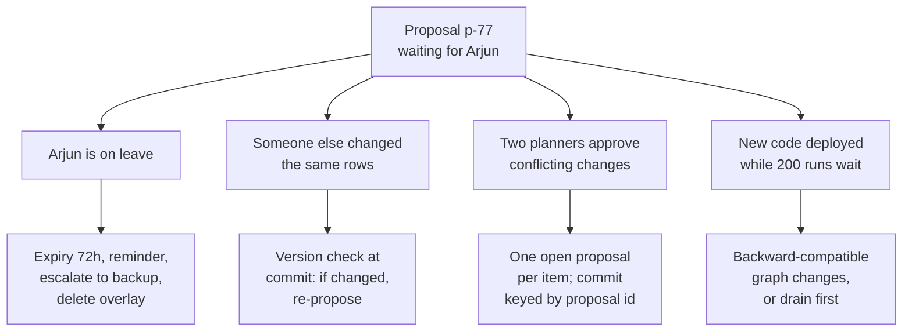
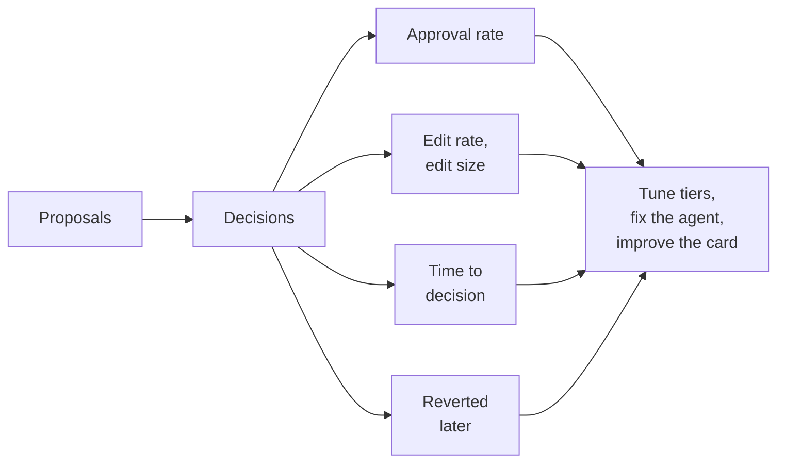

Planner Copilot goes live. Within a month, every one of the situations below happens at least once. They are also the standard follow-up questions to any human-in-the-loop design in an interview.

## 1. What goes wrong while a proposal waits



**The approver never answers.** Nothing is applied without approval, so the risk is clutter, not bad writes. Every proposal gets an expiry (24-72 hours depending on risk), with a reminder and an escalation to a backup approver before it runs out. A cleanup job marks expired proposals, deletes their overlay (or the Redis keys simply expire) and tells the requester. Resuming an expired run returns "expired, please ask again".

**The data changed while Arjun was deciding.** Another planner raised the same warehouse's milk stock an hour later. Applying Arjun's diff now would overwrite that change with numbers computed from old data. The fix is **optimistic concurrency**: every row carries a `version` number that goes up on each change. When the proposal is made, the agent records each row's version. The commit only succeeds if the versions are unchanged:

```sql
UPDATE safety_stock SET qty = 480, version = version + 1
WHERE id = 'pune-kothrud-881' AND version = 7;
```

If the row is now at version 8, zero rows are updated, the commit is aborted, and the agent rebuilds its proposal on fresh data.

**Two planners approve conflicting changes.** Prevent it and detect it: allow only one open proposal per product and warehouse (a unique constraint on the item plus "pending" status); keep the version check, so the second commit fails; and key every commit by its `proposal_id`, so a double-click or a retried request applies the change only once.

**A deploy lands while 200 runs are paused.** Each paused run is a saved state written by the old version of the workflow: its node names, its state fields, its position in the graph. Renaming a node or changing a field can make those runs fail to resume. Keep workflow changes backward-compatible (add optional fields, keep node names), version the workflow, or drain first: stop new proposals and let pending ones finish or expire before deploying. Test that an old saved state still resumes, as part of CI.

**"Who changed this, and why?"** Keep an append-only audit record for every action: the request, the proposal (tool, arguments, diff, reasoning), the trace id, the approver, the decision and any edits, timestamps, the commit result, and the row versions before and after. Store it outside the agent's own state, so it survives even if workflow data is cleaned up.

## 2. Measuring the human loop

A human-in-the-loop system has its own health metrics. Track them per action type and per approver:

- **Approval rate**: near 100% with instant decisions suggests rubber-stamping; very low suggests the agent proposes badly.
- **Edit rate and edit size**: how often, and how much, people change proposals. Large, frequent edits point at what the agent gets wrong.
- **Time to decision**: from proposal to answer, with the share that expire unanswered.
- **Post-approval incidents**: approved changes that were later reverted. The most important number: it shows whether the review catches what it should.



## 3. Testing a system that pauses

Paused runs are easy to forget in tests. Cover at least:

- pause, then resume with each decision type (approve, edit, reject), and check the database each time;
- resume after a simulated restart (new process, same checkpointer);
- resume twice with the same decision (must apply once);
- resume after the data changed (must abort and re-propose);
- resume an expired proposal (must refuse);
- resume a checkpoint saved by the previous version of the workflow (must still work).

## 4. Complete example: Planner Copilot's approval workflow

```python
class State(TypedDict):
    request: str
    proposal_id: str
    diff: dict
    decision: dict

def propose(state):
    diff = plan_change(state["request"])                        # model + read-only tools
    pid = hashlib.sha256(json.dumps(diff, sort_keys=True).encode()).hexdigest()[:16]
    stage_overlay(pid, diff, ttl_hours=72)                       # upsert keyed by pid
    return {"proposal_id": pid, "diff": diff}

def review(state):
    return {"decision": interrupt({"proposal_id": state["proposal_id"], "diff": state["diff"]})}

def commit(state):
    d = state["decision"]
    if d["type"] == "reject":
        discard_overlay(state["proposal_id"])
        return {}
    diff = d.get("edited_diff", state["diff"])
    apply_with_version_check(state["proposal_id"], diff)        # version check, idempotent by pid
    return {}

g = StateGraph(State)
g.add_node("propose", propose)
g.add_node("review", review)
g.add_node("commit", commit)
g.add_edge(START, "propose")
g.add_edge("propose", "review")
g.add_edge("review", "commit")
g.add_edge("commit", END)
app = g.compile(checkpointer=PostgresSaver.from_conn_string(DB_URL))

cfg = {"configurable": {"thread_id": "plan-881"}}
first = app.invoke({"request": "Raise milk SKU-881 safety stock 20% in Pune"}, cfg, durability="sync")
card = first["__interrupt__"][0].value                          # shown to Arjun
app.invoke(Command(resume={"type": "approve"}), cfg)            # later, from any process
```

Expected behaviour:

- The first call returns as soon as `review` pauses. `card` holds the proposal id and the diff. The base table still says 400; the overlay holds 480.
- Restarting the server between the two calls changes nothing: the second call loads the saved state from Postgres and continues.
- On resume only `review` runs again, and immediately returns the decision. `propose` finished in an earlier round, so the overlay is not written twice.
- Approve sets the base to 480 once. Resuming twice with the same decision does not apply it twice, because the commit is keyed by `proposal_id`.
- If another planner changed one of the rows in between, the version check aborts the commit and the other planner's value stays.
- Reject deletes the overlay; the base table is never touched.
