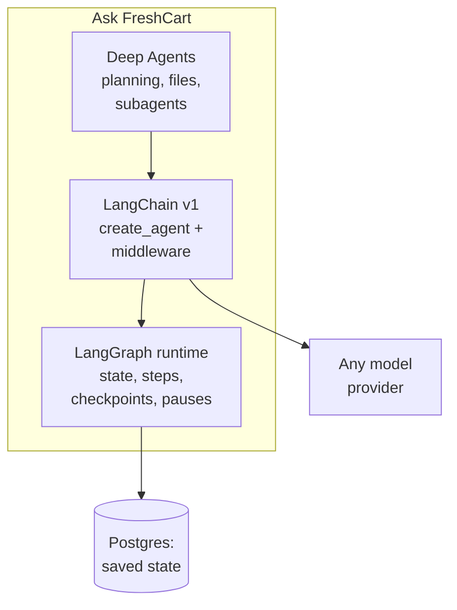
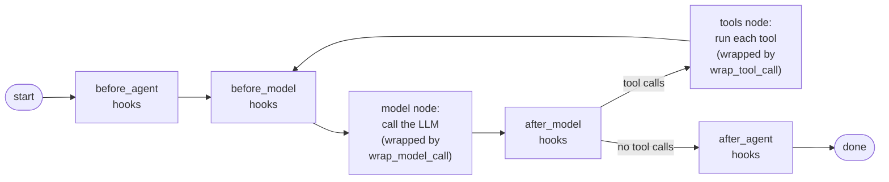

Ask FreshCart answers policy questions well. Now agents ask things no document contains: "Where is order FC-20931 right now?", "Is there milk in the Kothrud warehouse?", "Issue a 150 rupee credit for the late delivery." To answer, the assistant has to look things up in live systems, and sometimes act. It is turning into an agent, and this is where LangChain and LangGraph come in.

## 1. Two new ideas: tools and agents

A **tool** is a function your code exposes to the model, for example `get_order(order_id)`. The model is given each tool's name, a description of what it does, and the shape of its arguments. The model cannot run the function itself. What it can do is reply, instead of with text, with a request: "please call `get_order` with order id FC-20931". Your code runs the function and sends the result back.

An **agent** is a model in a loop built on that ability: it decides which tool to call, your code runs it, the result goes back to the model, and it decides again, until it has enough to answer. The next page goes deep on how tool calls work. Here the point is that this loop is the same in almost every agent, and frameworks package it.

## 2. What LangGraph and LangChain each are

**LangGraph** is a low-level runtime for workflows that have state. You describe the workflow as steps and the transitions between them; LangGraph runs it, saves its state after every step to a database, can pause it to wait for a human, and streams progress to a user interface. It does not care whether a step calls a model; it is the engine.

**LangChain (version 1, released October 2025)** is a thin layer on top of LangGraph. Its main entry point is `create_agent`, which builds exactly the tool-calling loop described above. Around it, LangChain gives you a common interface to chat models from any provider, tools, structured output, and **middleware**: small hooks that run before or after each model call or tool call, used for limits, retries, fallbacks and approvals.

**Deep Agents** sits on top of both: a ready-made design for long, multi-step tasks (covered on the multi-agent page).

- `create_agent` compiles into a LangGraph workflow, so even a simple agent gets saved state and the ability to pause.
- When you need control the standard loop cannot express, you write the LangGraph workflow yourself.

## 3. Which one to reach for

**Decision point: Ask FreshCart must always check the policy before proposing a refund, retry search at most twice, and pause for a manager on credits over 500 rupees.** The plain agent loop lets the model decide everything, including skipping the policy check. These rules need explicit control flow, so this is a hand-written LangGraph workflow.

- Use **`create_agent`** when the design really is "the model picks tools until done". Add middleware for call limits, retries, and approval of specific tools.
- Write a **LangGraph workflow** when you need fixed steps in a fixed order, branches, work in parallel, loops with your own exit rules, a pause at a specific step, or several cooperating agents.
- Use **plain code and the provider's SDK** (software development kit: the provider's official client library) for one or two model calls with nothing to remember between them.

What changed in version 1, which interviewers use to check you are current:

- `create_agent` replaced the older `create_react_agent` and `AgentExecutor`.
- Middleware hooks: `before_model`, `after_model`, `wrap_model_call`, `wrap_tool_call` and others, with built-ins such as `HumanInTheLoopMiddleware` (pause for approval), `ModelCallLimitMiddleware` and `ToolCallLimitMiddleware` (stop runaway loops), `ModelFallbackMiddleware` (switch model on failure), `SummarizationMiddleware` (shrink long history) and `PIIMiddleware` (mask personal data).
- Structured output inside the agent loop through `response_format`.
- The old chain classes (`LLMChain` and friends) moved to a separate `langchain-classic` package. The `prompt | model | parser` pipe syntax (LCEL) still exists for short fixed pipelines.

Correction: answering with 2023-era LangChain ("AgentExecutor", "LLMChain", "chains for everything") signals you have not used it recently.

## 4. What create_agent builds underneath

`create_agent` is not magic; it compiles into a small LangGraph graph you could have written yourself:

- The model node calls the LLM with the conversation and the tool descriptions.
- If the reply contains tool calls, the tools node runs them and loops back to the model.
- If not, the run ends.
- Middleware hooks sit at each of these points. That is where limits, retries, approvals and context trimming plug in without rewriting the loop (the middleware page covers them).

Because it is a LangGraph graph, it can be given a checkpointer, streamed, paused and resumed like any other.

## 5. The building blocks around it

- **Chat models**: `init_chat_model("provider:model-name")` returns a model object with the same methods for every provider: `invoke` for one answer, `stream` for tokens as they arrive, `batch` for many inputs at once. Switching provider is a one-line change, though behaviour is never identical, so re-run your tests.
- **Messages**: conversations are lists of typed messages (system, human, AI, tool), each with content blocks that are standard across providers: text, reasoning, tool calls, citations.
- **Runnables and LCEL**: everything above is a "runnable", an object with `invoke`, `stream` and `batch`. LCEL lets you chain runnables with `|`, for example `prompt | model | parser`, and the chain gets streaming and batching for free. Fine for short fixed pipelines; anything with branches or loops belongs in LangGraph.
- **LangSmith**: LangChain's tracing and evaluation service. With an environment variable set, every model call, tool call and graph step is recorded as a trace you can inspect, turn into test cases and evaluate. It works with code that does not use LangChain too.

## 6. When to skip the framework

Frameworks pay off when you need what they provide: many providers, agents with state, pauses, streaming to a UI, tracing. They cost you when the task is simple. A nightly job that sends 10,000 tickets through one classification prompt needs a provider SDK, a retry wrapper and a Pydantic model (a Python class that checks data has the right fields and types; the next page uses it), not an agent framework. Choosing not to use one where it adds nothing is a good engineering signal in an interview.

Also asked: "Would you use LangChain in production?" Yes, selectively. The value is real: one interface across providers, middleware, tracing, and LangGraph's saved state underneath. The costs are layers of abstraction to debug through and changes between versions. Pin versions, keep your prompts in your own code rather than hidden in framework templates, and write tools as plain functions you can test without the framework.
