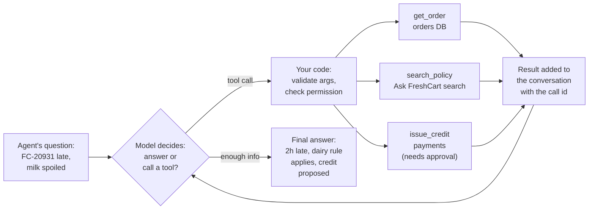

An agent asks Ask FreshCart: "Customer says order FC-20931 is late and the milk was spoiled. What do I do?" A good answer needs the order's status (orders database), the damaged-items policy (documents), and maybe a credit (payments system). No single search does this. The model must decide which lookups to make, in what order, and when it knows enough. Underneath every agent framework, that is done with tool calls.

## 1. How a tool call actually works

Each tool is described to the model in three parts: a **name** (`get_order`), a **description** in plain words ("Look up one order's status, items and delivery times by order id like FC-12345"), and a **schema**, a precise description of the arguments in JSON Schema format (`order_id`: a string matching a pattern).

When the model decides a tool would help, its reply is not text but a **tool call**: the tool's name, the arguments as JSON, and an id. The model has executed nothing.



One run:

- The model reads the question and the tool descriptions and returns a call: `get_order` with `{"order_id": "FC-20931"}`, id `c1`.
- Your code checks the arguments are valid and that this agent may use this tool, then runs the query.
- The result ("delivered 2 hours late, 1 litre milk") goes back into the conversation as a tool result tagged `c1`, so the model knows which request it answers.
- The model now calls `search_policy("spoiled dairy refund")` and gets the 24-hour dairy rule.
- It proposes `issue_credit(150)`; writes like this go through an approval step (the human-in-the-loop pages).
- With enough information, it writes the answer.

What follows from "the model only asks, your code acts":

- **Safety lives in your code.** "Only issue credits under 200 rupees" in the prompt is a suggestion; a check inside `issue_credit` is a control.
- **Tool descriptions cost tokens** on every call, because they are sent with every request.
- **Descriptions are prompts.** "orders api" gets misused; a description saying what the tool does and when to use it gets used correctly.
- **Errors go back as results.** If the orders database times out, return "error: orders service timed out, try again" as the tool result so the model can adapt. Retrying with backoff is your code's job.
- **Several calls at once.** One reply can request several tools; run them in parallel and return each result with its own id.

**Decision point: Meera wants a "smart" assistant with 25 tools covering every FreshCart system.** Push back. Similar tools confuse the model's choice, every tool costs tokens on every request, and every tool is something that can be misused. Give it the 4-6 tools support actually needs. A good tool has one clear job named for its action, a description of when to use it, tightly typed arguments (fixed lists of allowed values, exact formats), short output (the six fields needed, not a 50 KB record), clear error messages, and, if it writes anything, approval and safety against being run twice.

## 2. Structured output: getting machine-readable answers

Ask FreshCart also classifies every incoming ticket so it can be routed: `{"intent": "refund", "order_id": "FC-20931", "urgent": true}`. **Structured output** means getting the model to return data in an exact shape your code can rely on, instead of free text. Ways to get it, from weakest to strongest:

- Asking for JSON in the prompt: the model sometimes adds chatter or breaks the syntax.
- **JSON mode**: guarantees valid JSON, but not your fields.
- Tool calling with your schema as the "tool": the model fills in arguments that are really your output.
- **Strict schemas** offered by providers: the model is only allowed to produce output that fits your schema.

Broken version:

```python
resp = llm.invoke(f"Classify this ticket as JSON: {ticket}")
data = json.loads(resp.content)      # crashes on "Sure! Here is the JSON: {..."
order_id = data["order_id"]          # KeyError when the model wrote "orderId"
```

Fixed version:

```python
class Ticket(BaseModel):
    intent: Literal["refund", "late_delivery", "missing_item", "other"]
    order_id: str | None
    urgent: bool

classify = llm.with_structured_output(Ticket)     # schema sent to the provider
try:
    t = classify.invoke(f"Classify this ticket: {ticket}")
except ValidationError as e:
    t = classify.invoke(f"Classify this ticket: {ticket}\nPrevious attempt failed: {e}")
```

The schema is a Pydantic class, so the result is checked for types and allowed values. On failure, retry once with the error message included, then fail cleanly.

Correction: valid structure is not a correct answer. The JSON can be perfect and the intent wrong. Structured output removes parsing failures, not the need to test answer quality.

## 3. Complete example: the agent loop without a framework

Practical rounds often ask for this loop by hand, against a provider's SDK:

```python
MAX_STEPS = 8

def run_agent(client, model, question, tools, schemas, arg_models):
    messages = [{"role": "system", "content": SYSTEM}, {"role": "user", "content": question}]
    for step in range(MAX_STEPS):
        resp = client.chat(model=model, messages=messages, tools=schemas)
        messages.append(resp.message)
        if not resp.tool_calls:
            return resp.text
        for call in resp.tool_calls:
            try:
                args = arg_models[call.name].model_validate_json(call.arguments)
                result = tools[call.name](**args.model_dump())
            except Exception as e:
                result = f"error: {e}"
            messages.append({"role": "tool", "tool_call_id": call.id, "content": str(result)})
    return "Stopped: step limit reached."
```

Expected behaviour:

- The late-milk question takes about three model calls: one requesting `get_order`, one requesting `search_policy`, one writing the answer.
- If `get_order` raises, the model receives `"error: ..."` as the result and explains or tries again; the loop does not crash.
- Invalid arguments fail validation before the tool runs, and the model sees why.
- A model that keeps requesting tools stops after 8 calls with a clear message instead of running forever.
