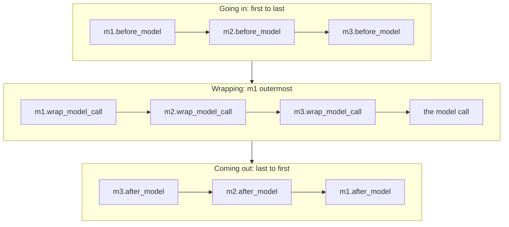

Ask FreshCart runs on `create_agent`, and production problems pile up. One conversation loops through 40 tool calls. A customer's phone number appears in a trace. The model provider has an outage on a Friday evening. Long conversations get slow and expensive. Every fix seems to need code inside the agent loop, and nobody wants to fork the loop. LangChain's answer is middleware.

## 1. What middleware is

**Middleware** is code that wraps around the agent loop at fixed points, the same idea as middleware in a web framework, which runs before and after every request. You add controls by stacking small pieces, without touching the loop itself.

There are two kinds of hook:

- **Node-style hooks** run at a point in the loop and can update the state or redirect the run:
  - `before_agent` and `after_agent`: once per run, at the start and end.
  - `before_model` and `after_model`: around every model call. These can also jump: to the end, to the tools, or back to the model.
- **Wrap-style hooks** wrap a call and decide what happens to it:
  - `wrap_model_call`: around every model call. It can change the request (a different model, fewer tools, a shorter history), skip the call, or retry it.
  - `wrap_tool_call`: around every tool call. It can check, change, retry or block it.

## 2. The order they run in

With `middleware=[m1, m2, m3]`:



- `before_*` hooks run in list order.
- `wrap_*` hooks nest like layers of an onion: m1 wraps m2, which wraps m3, which wraps the model. m1 sees everything, including m2's and m3's retries.
- `after_*` hooks run in reverse order.

So put cross-cutting wrappers that must see everything (logging, cost accounting, retries) first, and guards that must run just before the model (masking personal data) last.

## 3. Built-in middleware, mapped to FreshCart's problems

- **The 40-call loop** -> `ModelCallLimitMiddleware` (caps model calls per run or per thread) and `ToolCallLimitMiddleware` (caps calls overall or for one tool). Each ends the run cleanly with a defined message when the limit is hit.
- **A customer's phone number in a trace** -> `PIIMiddleware`: detects personal data such as emails, phone numbers and card numbers, and masks, redacts or blocks it before it reaches the model or the logs.
- **The Friday outage** -> `ModelRetryMiddleware` (retries failed model calls with exponential backoff) and `ModelFallbackMiddleware` (switches to another model when the main one keeps failing).
- **Flaky tools** -> `ToolRetryMiddleware`.
- **Long, slow conversations** -> `SummarizationMiddleware` (summarises older messages when the history nears a token limit) and `ContextEditingMiddleware` (clears old, bulky tool outputs).
- **Too many tools confusing the model** -> `LLMToolSelectorMiddleware`: a small model first picks the relevant tools, and only those are sent to the main model.
- **Writes that need a human** -> `HumanInTheLoopMiddleware` (the human-in-the-loop pages cover it in depth).
- **Long multi-step tasks** -> `TodoListMiddleware` gives the agent a to-do list tool for planning.

```python
agent = create_agent(
    model="anthropic:claude-sonnet",
    tools=[get_order, search_policy, issue_credit],
    middleware=[
        ModelCallLimitMiddleware(run_limit=12),
        ModelFallbackMiddleware("openai:gpt-4o-mini"),
        SummarizationMiddleware(model="openai:gpt-4o-mini"),
        PIIMiddleware("email", strategy="mask"),
        HumanInTheLoopMiddleware(interrupt_on={"issue_credit": True}),
    ],
    checkpointer=PostgresSaver.from_conn_string(DB_URL),
)
```

Model names and option names change between versions; check the current documentation before relying on exact arguments.

## 4. Writing your own

**Decision point: FreshCart wants a cheap model for simple questions and the strong model only for hard ones, decided per request.** No built-in does exactly that, so you write a `wrap_model_call` hook:

```python
@wrap_model_call
def route_by_difficulty(request, handler):
    last = request.messages[-1].content
    if len(last) < 120 and not request.state.get("needs_reasoning"):
        request = request.override(model=cheap_model)
    return handler(request)
```

- The hook looks at the request and decides which model should handle it.
- `request.override(...)` returns a modified copy; the original is untouched.
- Calling `handler(request)` runs the rest of the chain and the model. Not calling it skips the model; calling it twice retries.

Other common custom middleware: per-user tool filtering (remove tools this user may not use), cost accounting per tenant, and output checks (block an answer that cites no source).

## 5. The risk of middleware

Middleware is powerful because it changes the request invisibly. That is also the risk: a fallback model may follow your prompt differently, a summary may drop a key fact, a tool filter may hide the tool the task needed. Test the agent with its full middleware stack, log every time a middleware changes a request (a fallback fired, a summary was made), and alert when those rates jump.

Correction: "add a fallback model and you are safe from outages" is incomplete. Run your test set against the fallback model too, or the outage turns into a quality incident.

Also asked: "In what order do middleware hooks run?" Before hooks first to last, wrap hooks nested with the first outermost, after hooks last to first.
