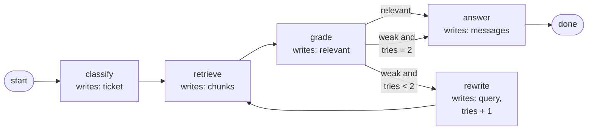
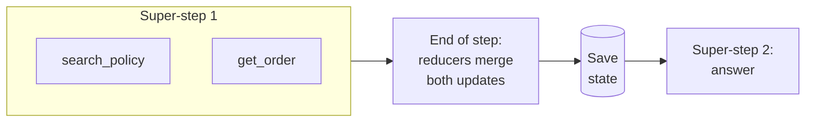

The free-running agent loop works, but Meera finds two problems. Some answers skip the policy check entirely, because the model decided it did not need it. And vague questions get answered from weak search results instead of a second try. You want explicit rules: always classify the ticket first, always search the policy, grade what came back, retry at most twice, then answer. That is a workflow you write yourself in LangGraph.

## 1. The four parts of a LangGraph workflow

LangGraph describes a workflow as a **graph**: boxes for steps, arrows for what runs next. Four ideas make it work.

**State** is the run's shared memory: a typed record holding everything the run knows so far. For Ask FreshCart: the conversation `messages`, the classified `ticket`, the retrieved `chunks`, and the `tries` counter.

**Nodes** are the steps. Each node is a plain function that receives the current state and returns only the fields it wants to change. It never edits the state directly.

**Reducers** decide how a node's returned value is merged into a field. By default the new value simply replaces the old one. For a list you often want to add rather than replace: `Annotated[list, operator.add]` appends (`Annotated` is standard Python typing that attaches extra information to a type, here the reducer; `TypedDict` declares the fields of a dictionary), and LangGraph's `add_messages` appends new messages (and replaces a message that has the same id).

**Edges** decide what runs next. A fixed edge always goes to the same node. A **conditional edge** calls a small router function that looks at the state and returns the name of the next node.



- **classify** fills `ticket` using structured output.
- **retrieve** searches the policy documents and writes `chunks`.
- **grade** records whether the chunks are relevant.
- The router after grade reads `relevant` and `tries`: relevant goes to answer; weak with tries left goes to rewrite, which adds one to `tries` and loops back to retrieve; weak with no tries left goes to answer anyway, which then says what it could not find.
- **answer** writes the reply into `messages`.

## 2. How the graph runs: super-steps

LangGraph executes in rounds called **super-steps**, an idea borrowed from Google's Pregel system for processing large graphs. In each round, every node that was triggered by the previous round runs, in parallel if there are several. Their returned updates are merged through the reducers at the end of the round. Then the state is saved (next page), and the edges decide what runs in the following round.



- Searching the policy and looking up the order do not depend on each other, so they run in the same round.
- Neither sees the other's result during the round.
- At the end of the round both updates are merged and the state is saved; then the answer node runs with both results.

What interviewers probe:

- If two parallel nodes write the same field and that field has no reducer, LangGraph cannot pick a winner and raises `InvalidUpdateError`. Fix: give the field a reducer, or let each node write its own field.
- If one parallel node fails, the other's finished update is kept and not redone when the run resumes.
- A `recursion_limit` setting caps the number of rounds and raises `GraphRecursionError` when hit.

**Decision point: one strange question made the rewrite loop run 40 times and cost 30 rupees.** Four layers stop runaway loops: a counter in the state that the router checks (`tries < 2`); a fallback route when the counter runs out; `recursion_limit` as the last-resort backstop; and a budget on tokens, cost and time for the whole run.

## 3. Other building blocks, briefly

- **Command**: a node can return `Command(goto="answer", update={...})` to change state and choose the next node in one move. Useful when the node's own result decides the route, such as a model choosing which specialist handles a ticket next.
- **Send** (fan-out): to summarise 500 complaint emails, a conditional edge returns one `Send("summarise", {"email": e})` per email; all 500 summaries run in a single round and a list reducer collects them. Limit how many run at once with `max_concurrency`.
- **Subgraph**: a whole compiled workflow used as one node, with its own state. Good for reusing the retrieve-grade-rewrite loop in several workflows.
- **Streaming**: the `messages` mode sends the model's words as they are generated; `updates` tells the interface which node just finished ("searching policies..."); `custom` carries your own progress messages.

## 4. Designing the state well

Most messy LangGraph code comes from a messy state. Some rules that keep graphs readable:

- **Store facts, not formatted text.** Keep `ticket = {"intent": "refund", "order_id": ...}`, not a prompt string with those values baked in. Nodes build prompts from state when they need them.
- **One writer per field, where possible.** If only `retrieve` writes `chunks`, bugs are easy to trace. Fields written by several parallel nodes need reducers.
- **Keep it small.** Everything in the state is saved at every step. Large tool outputs belong in a store or a file, with a reference in the state.
- **Separate what goes in and out.** LangGraph lets a graph declare input and output schemas narrower than its internal state, so callers send only a question and receive only an answer, while scratch fields stay private.

A **custom reducer** is just a function `(current, update) -> new value`. For example, keep only the best retrieval seen so far:

```python
def keep_best(current, update):
    if current is None or update["score"] > current["score"]:
        return update
    return current

class State(TypedDict):
    best_retrieval: Annotated[dict, keep_best]
```

## 5. Routing with Command: handing a ticket to a specialist

Ask FreshCart grows separate nodes for refunds and for delivery problems. A triage node reads the ticket and decides which runs next. With `Command`, the node updates the state and chooses the route in one return value:

```python
def triage(state) -> Command[Literal["refunds", "delivery", "human"]]:
    t = classify(state["messages"])
    if t.intent == "refund":
        return Command(goto="refunds", update={"ticket": t})
    if t.intent == "late_delivery":
        return Command(goto="delivery", update={"ticket": t})
    return Command(goto="human", update={"ticket": t})
```

The type hint lists the possible destinations, so LangGraph can still draw the graph. A conditional edge would do the same with a separate router function; `Command` is neater when the node that does the work also knows where to go next.

## 6. The functional API, briefly

LangGraph also offers a **functional API**: instead of drawing nodes and edges, you write ordinary Python with an `@entrypoint` function and call `@task` functions inside it. You keep checkpointing, pauses and streaming, and each `@task` result is saved, so on resume it is reused instead of recomputed. It suits workflows that read naturally as code with loops and ifs; the graph API suits workflows you want to see and reason about as a diagram.

## 7. Complete example: Ask FreshCart's support agent as a graph

```python
class State(TypedDict):
    messages: Annotated[list, add_messages]
    steps: int

def call_model(state: State):
    msg = model_with_tools.invoke(state["messages"])
    return {"messages": [msg], "steps": state["steps"] + 1}

def route(state: State):
    if state["messages"][-1].tool_calls and state["steps"] < 8:
        return "tools"
    return END

g = StateGraph(State)
g.add_node("model", call_model)
g.add_node("tools", ToolNode([get_order, search_policy, check_stock]))
g.add_edge(START, "model")
g.add_conditional_edges("model", route, ["tools", END])
g.add_edge("tools", "model")
app = g.compile(checkpointer=PostgresSaver.from_conn_string(DB_URL))

cfg = {"configurable": {"thread_id": "agent7-FC20931"}}
app.invoke({"messages": [("user", "FC-20931 late, milk spoiled. What do I do?")], "steps": 0}, cfg)
app.invoke({"messages": [("user", "And was the bread delivered?")]}, cfg)
```

Expected behaviour:

- The first question runs model -> tools -> model -> tools -> model, about three model calls, then stops because the last reply has no tool calls.
- The follow-up "And was the bread delivered?" works without repeating the order id, because the same `thread_id` brings back the earlier conversation (the next page explains how).
- A model that keeps asking for tools is routed to the end after 8 model calls.
