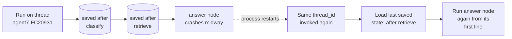
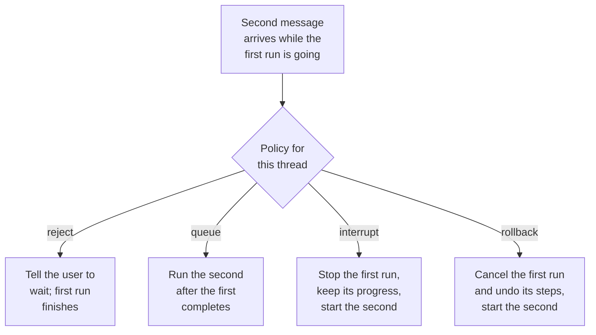

An agent starts a conversation about order FC-20931 at 10:00, steps away, and returns at 10:20: "and did they also get the bread?" Ask FreshCart must remember which order they meant. Later, Ask FreshCart starts proposing credits that wait overnight for a manager, and the service is redeployed in between. The run must carry on exactly where it stopped. Both needs are met by one feature: persistence.

## 1. Checkpoints, threads and the store

A **checkpointer** is the component that saves a workflow's state to a database after every round of execution (every super-step, from the previous page). Each saved snapshot is a **checkpoint**. In production the checkpointer is backed by a real database, such as `PostgresSaver`. `InMemorySaver` keeps snapshots in memory and is for tests only: everything vanishes when the process stops.

A **thread** is one conversation's history: the chain of checkpoints for one run, identified by a `thread_id` you choose, for example `"agent7-FC20931"`. Calling the workflow again with the same `thread_id` continues that conversation from its last checkpoint; a new `thread_id` starts empty.

A **store** is a different kind of memory: facts that future conversations need, shared across threads, such as an agent's preferred language. It is organised by namespaces like `("agents", "agent7")`. Rule of thumb: what this conversation needs goes in the state; what next week's conversations need goes in the store.

## 2. What happens when the process crashes



- Each completed step leaves a checkpoint in Postgres.
- The answer node crashes halfway through.
- The next call with the same `thread_id` loads the last complete checkpoint (after retrieve) and runs the answer node again, from its first line. Classify and retrieve are not repeated.

How often to save is a trade-off you choose with the `durability` setting:

- `"exit"`: save only when the run finishes or pauses. Fastest; a crash loses the whole run's progress.
- `"async"`: save in the background while the next step runs. A sensible default.
- `"sync"`: save before the next step starts. Safest; use it for long or expensive runs, anything with side effects, and anything waiting on a human.

## 3. The trap: a step can run more than once

Look again at the crash picture: the answer node ran twice. The same happens when a run resumes after a pause for human approval, and when someone replays a run from an old checkpoint. If a node has a **side effect**, an action outside the workflow like charging a card or writing a database row, that action can happen twice.

The fix is making side effects **idempotent**: safe to repeat, so the second run has no extra effect.

Broken version:

```python
def issue_credit(state):
    payments.credit(state["order_id"], 150)          # re-run after a crash: customer credited twice
    return {"credited": True}
```

Fixed version:

```python
def issue_credit(state):
    payments.credit(state["order_id"], 150,
                    idempotency_key=f"credit:{state['order_id']}:late-delivery")  # repeat = no-op
    return {"credited": True}
```

The payment service remembers each idempotency key it has processed and ignores repeats. Other ways to get the same safety: database upserts keyed by something deterministic; putting each side effect in its own small node; placing side effects after a pause rather than before it; or wrapping the work in LangGraph's `@task`, whose result is saved and reused on resume instead of being redone.

Correction: "the checkpointer gives exactly-once execution" is wrong. It makes runs resumable. The interrupted step is redone, so effects outside LangGraph are only safe if they are idempotent.

## 4. Time travel

Because every checkpoint is kept, you can go back in a thread's history:

- `graph.get_state_history(config)` lists every checkpoint of a thread.
- Running from an older checkpoint replays the run from that point; later steps run again, including model calls.
- `graph.update_state(config, values)` writes a corrected checkpoint and continues from it, leaving the original history untouched.

Uses: "what exactly did the assistant see when it gave that wrong answer?", letting a human fix the state and continue, and turning bad production runs into test cases.

## 5. Living with persistence in production

**Storage grows.** Every step of every conversation saves a checkpoint. A busy assistant writes millions of rows a week. Decide a retention policy: keep full history for recent threads, keep only the latest checkpoint (or nothing) for old ones, and delete threads after a set time unless needed for audit. Keep large data out of the state so each checkpoint stays small.

**Two messages arrive at once.** An agent sends "where is FC-20931?" and, before the answer comes back, "never mind, check FC-20944". Both target the same thread. If both runs proceed in parallel they read the same checkpoint and overwrite each other's results. Handle **concurrent runs on one thread** deliberately:



LangGraph's deployment platform names these same four strategies for "double-texting". Whatever you build yourself, allow only one active run per thread at a time (a lock keyed by `thread_id`) and pick one of these behaviours on purpose.

**Long-term memory in the store.** The store holds JSON documents under namespaces, such as `("agents", "agent7", "preferences")`. Nodes read and write it through the runtime. It can also search stored items by meaning when configured with an embedding model, which is how an agent can recall "relevant things I learned about this user" across conversations. The memory page covers what to store and when.

**Serialisation.** Everything in the state must be storable: plain dictionaries, lists, strings, numbers, messages. Open database connections, clients or locks belong in the runtime context, not in the state.

Also asked: "Thread vs checkpoint vs store?" A thread is one conversation, a checkpoint is one saved moment in it, and the store holds memory for future conversations.
