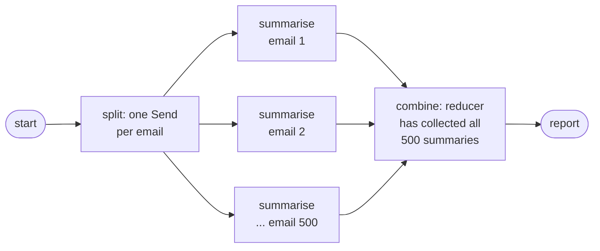
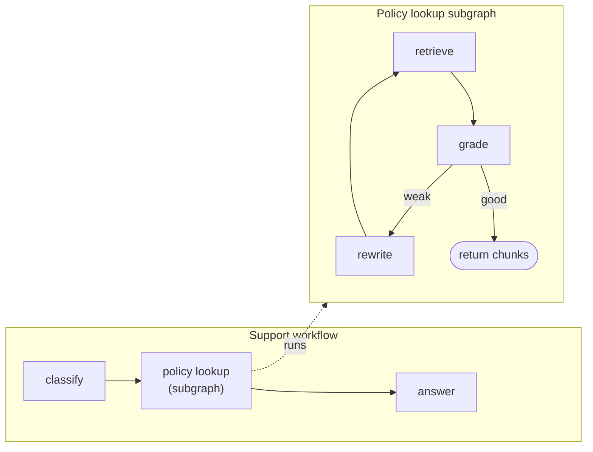
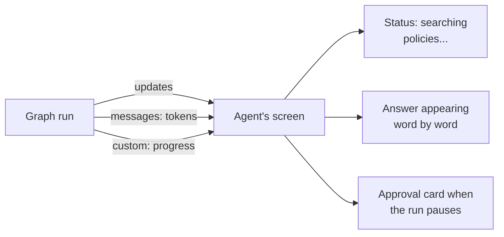

Ask FreshCart's workflows are getting bigger. A weekly job must summarise 500 complaint emails and combine them into one report. The retrieve-grade-rewrite loop is needed in three different workflows. Agents want to see progress while long questions run ("searching policies..."), not stare at a spinner. And the payments API fails one call in fifty. This page covers the LangGraph features for exactly these: fan-out, subgraphs, streaming, and node-level retries and caching.

## 1. Fan-out and fan-in with Send

Some work splits into many independent pieces whose number is only known at run time: 500 emails this week, 312 next week. **Map-reduce** is the pattern: run the same step on every piece (map), then combine the results (reduce).

In LangGraph, a conditional edge can return a list of `Send` objects. Each `Send("node", payload)` starts one run of that node with its own input, and all of them run in the same super-step (the round of execution from the graph page).



```python
class State(TypedDict):
    emails: list
    summaries: Annotated[list, operator.add]     # collects results from every branch
    report: str

def split(state):
    return [Send("summarise", {"email": e}) for e in state["emails"]]

g.add_conditional_edges(START, split, ["summarise"])
g.add_edge("summarise", "combine")
```

- `split` returns 500 `Send` objects; LangGraph runs 500 `summarise` calls.
- Each returns `{"summaries": [one_summary]}`; the `operator.add` reducer concatenates all of them.
- `combine` runs once, after every branch finishes, and writes the report. If the summaries are too long for one prompt, combine them in stages (summaries of summaries).
- Limit parallelism with `max_concurrency` in the run config, so 500 simultaneous calls do not hit the provider's rate limit.
- With a checkpointer, branches that finished are not re-run if the job crashes and resumes.

## 2. Subgraphs: reusable pieces

A **subgraph** is a compiled graph used as a single node inside another graph. FreshCart's retrieve-grade-rewrite loop becomes one subgraph used by the support workflow, the planner workflow and the weekly report.



- The subgraph has its own state. Fields it shares with the parent (by name) flow in and out; its scratch fields (`tries`, rewritten queries) stay private.
- If the schemas differ, wrap the subgraph in a small node function that maps parent fields to subgraph input and back.
- Subgraphs get their own checkpoint namespace, so you can inspect their state separately.
- A node inside a subgraph can jump to a node of the parent with `Command(graph=Command.PARENT, goto="...")`, which is how one agent hands over to another in multi-agent setups.

One trap: after a pause for human approval inside a subgraph, both the parent node that called the subgraph and the subgraph's own node restart from their first lines (the interrupt page explains why), so side effects in either must be safe to repeat.

## 3. Streaming progress to the user

A slow answer feels much faster when the user sees progress. LangGraph can stream several kinds of event at once:

- **`messages`**: the model's tokens as they are generated, so the answer appears word by word.
- **`updates`**: after each node finishes, what it changed. The UI turns these into status lines: "Classified as refund", "Found 5 policy passages".
- **`values`**: the full state after each step. Handy for debugging, heavy for a UI.
- **`custom`**: anything your node emits itself, such as "summarised 120 of 500 emails".
- **`debug`**: everything, for development.



The server forwards these events to the browser over **Server-Sent Events (SSE)**, a simple one-way stream over HTTP that browsers support natively. When the run pauses for approval, the pause itself arrives as an event, and the UI shows the approval card.

## 4. Retries, caching and timeouts on nodes

Some protection belongs on the node rather than inside it:

- **Retry policy**: attach a retry policy to a node that calls a flaky service (the payments API), with the number of attempts, the backoff and which exceptions count as retryable. Only retry steps that are safe to repeat.
- **Cache policy**: for an expensive node whose output depends only on its input (embedding a fixed document, an expensive classification), a cache policy reuses the stored result for the same input for a set time.
- **Timeouts**: recent LangGraph versions support per-node timeouts and error handlers, so one hung call cannot stall a whole run.

**Decision point: the weekly report job fails on email 431 of 500 when the summariser hits a rate limit.** Attach a retry policy with backoff to `summarise`, cap `max_concurrency` below the rate limit, and run with a checkpointer so a rerun only redoes the branches that never finished.

Also asked: "How would you summarise 500 documents in LangGraph?" Fan out with `Send`, collect with a list reducer, combine in stages if needed, and cap concurrency.
