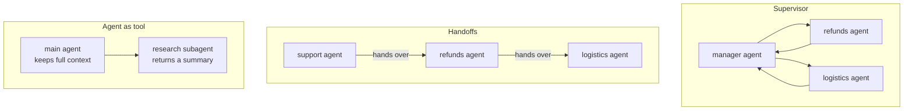

Six months in, FreshCart's leadership asks for "a team of agents": a support agent, a refunds agent, a logistics agent, and a manager agent coordinating them. It sounds powerful. Before building it, know the patterns and what the evidence says about them.

## 1. Three ways agents can cooperate

A **multi-agent system** splits work between several agents, each with its own instructions, tools and context.

- **Supervisor**: a manager agent sees every turn, hands the task to a worker, gets the result back and decides what happens next. Easy to log and reason about. Every step goes through the manager, which adds a hop and makes it a bottleneck.
- **Handoffs** (also called a swarm): the active agent passes control straight to another, for example with LangGraph's `Command(goto="refunds_agent")`, and the next customer message goes to whoever has control. Fewer hops and faster; harder to enforce company-wide rules, because no single agent sees everything.
- **Agent as tool**: specialist agents are exposed as tools of one main agent and return only a summary. The main agent keeps the whole picture.

## 2. When splitting helps, and when it hurts

Splitting helps when:

- the work is **parallel and separable**, such as searching ten document sources at once;
- one agent's context window cannot hold all the intermediate work;
- roles need different tools or permissions.

It hurts when steps depend on each other's decisions. A decision made inside one agent's context is invisible to the others, so they act on different assumptions, and the bugs this causes are hard to trace.

The evidence cuts both ways. Anthropic built a research system with one lead agent and several parallel subagents; it clearly beat a single agent on research tasks, but agents used about 4 times the tokens of a normal chat and the multi-agent system about 15 times. Cognition (the team behind the Devin coding agent) published "Don't Build Multi-Agents", arguing that agents must share full context or not be split at all.

**Decision point: what do you tell FreshCart's leadership?** One agent with five good tools first. Split off a subagent only for a measured reason, such as researching across many document sources in parallel, and only after the single agent's failures show the need.

## 3. Deep Agents: the shape of long-running agents

Some tasks take dozens of steps: "investigate why late deliveries in Pune doubled this week." A plain loop loses track. **Deep Agents** is LangChain's ready-made design for such tasks, and the same shape coding agents use. It has four parts:

- **A planning tool**: the agent writes a to-do list and updates it as it works, so the plan survives a long run.
- **A filesystem**: a scratch space where it saves notes and large tool outputs, instead of carrying everything in its context window.
- **Subagents**: it can launch a subagent through a `task` tool for an isolated subtask; the subagent returns a summary, keeping the main context clean.
- **A detailed system prompt** that explains how to use all of the above.

It runs on LangGraph, so it gets saved state, streaming and pauses for approval like everything else.

Also asked: "Supervisor or handoffs?" Supervisor when you need central control and auditability; handoffs when latency matters and each agent can own the conversation for a while; agent-as-tool when one agent should keep the full context.
