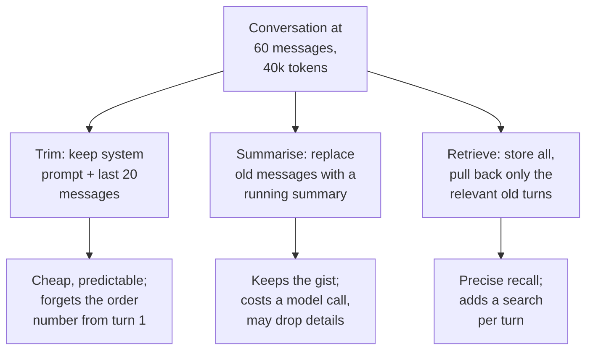
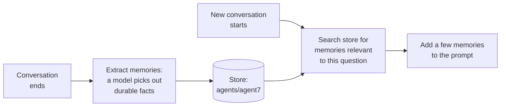

Two complaints arrive in the same week. First: in long conversations, Ask FreshCart forgets the order number the agent gave at the start, and each answer gets slower and more expensive. Second: agents are annoyed that every new conversation starts from zero; the assistant never remembers that agent7 handles only Pune, or that agent12 wants answers in Hindi. Both are about what the model sees on each call, which is the subject of context engineering and memory.

## 1. Context engineering

**Context engineering** is deciding exactly what goes into the model's context window on each call: instructions, tool descriptions, retrieved documents, memories, conversation history and tool results, in what order, and what gets left out. It has replaced "prompt engineering" as the term for serious work, because in a multi-step agent the wording of the instructions matters less than the whole set of tokens the model sees at every step.

Why it matters: models do not use all of a long context equally well (the "lost in the middle" and "context rot" findings from the RAG debugging page). More context is not safer; the right context is.

## 2. Short-term memory: the conversation

**Short-term memory** is the current conversation: the messages and intermediate results in the graph's state, saved by the checkpointer under the thread id. It grows with every turn and every tool call. Three ways to keep it in bounds:

- **Trim**: keep the system prompt and the most recent messages that fit a token budget. Simple, but early facts disappear.
- **Summarise**: when the history passes a threshold, replace older messages with a summary ("Customer: order FC-20931, milk spoiled, photo sent, refund approved"). LangChain's `SummarizationMiddleware` does this.
- **Retrieve**: keep everything, embed each turn, and pull back only the turns relevant to the current question.

The common combination: recent messages word for word, a summary of older ones, and **pinned facts** (order id, customer id) kept in dedicated state fields so they can never be trimmed away. That last part fixes FreshCart's first complaint.

Tool outputs are usually the biggest consumers of context. Clear or shrink old tool results once they have been used (`ContextEditingMiddleware`), and keep large outputs in a store with only a reference in the conversation.

## 3. Long-term memory: across conversations

**Long-term memory** survives beyond one conversation. In LangGraph it lives in the **store**, organised by namespaces such as `("agents", "agent7")`. Three kinds are commonly distinguished:

- **Semantic memory**: facts. "agent7 handles Pune only", "agent12 prefers Hindi".
- **Episodic memory**: past experiences. "Last time a cold-chain question came up, the answer was in runbook 17", or good past answers used as examples.
- **Procedural memory**: how to behave. Usually the system prompt itself, which some systems let the agent refine over time from feedback.

**When memories are written** is a design choice:

- **In the hot path**: the agent calls a `save_memory` tool during the conversation. Immediate, but adds latency and relies on the model deciding well.
- **In the background**: after the conversation, a separate job extracts memories. No added latency, and better extraction, but memories appear a little later.

**What can go wrong**:

- **Wrong or stale memories** used with confidence. Store a timestamp and source with each memory, and let newer facts overwrite older ones.
- **Privacy**: memories about people are personal data. Users must be able to see and delete them, and memories must never cross tenants.
- **Poisoned memories**: if a prompt-injection attack gets saved as a memory, it affects every future conversation. Treat memory writes as untrusted, the same as tool output.
- **Bloat**: too many memories added to every prompt. Retrieve a few relevant ones, do not load all.

## 4. Ordering the context

**Decision point: in what order should Ask FreshCart build each prompt?** Fixed parts first, changing parts last:

- system instructions and rules;
- tool descriptions;
- a few examples;
- long-term memories for this agent;
- retrieved documents, most relevant first;
- the conversation summary and recent messages;
- the current question.

The fixed start can be reused by provider prompt caching (cheaper and faster); the question sits last, nearest to where the model starts writing; and the most important evidence sits at the edges of the context, not buried in the middle.

## 5. Context engineering for long-running agents

For agents that run for many steps (the Deep Agents pattern from the multi-agent page), four strategies are commonly named:

- **Write**: save notes, plans and intermediate results outside the context (a scratchpad file, the store) and keep only references.
- **Select**: pull in only what the next step needs (just-in-time retrieval, tool filtering).
- **Compress**: summarise history at thresholds, clear old tool outputs.
- **Isolate**: hand subtasks to subagents with their own fresh contexts, which return short results.

Correction: "the model has a million-token window, so memory is solved" is wrong. Cost and latency grow with every token, and quality falls as the context fills with irrelevant history.

Also asked: "The conversation exceeds the context window. What are your options?" Trim, summarise, retrieve, plus pinned facts in state, with the trade-off of each.
