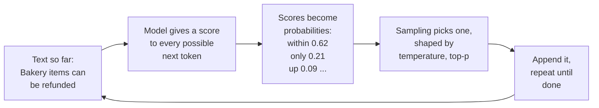
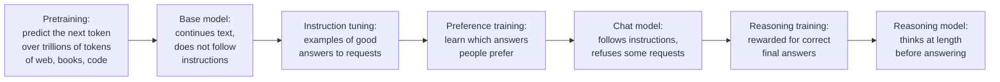

Before you build anything for FreshCart, you spend your first week doing something simple: you let people across the company try a plain chat model, the kind anyone can open in a browser, and you collect their questions. Three come back again and again, and each one is a classic interview question in disguise.

- Meera, the support lead: "I asked the same thing twice and got two different answers. Which one is right?"
- Finance: "Why does a question in Marathi cost more than the same question in English?"
- Everyone, after one bad afternoon: "It confidently told me a refund rule that does not exist. How can it just make things up?"

To answer them you need a mental model of what a language model actually is. That is this page.

## 1. What a language model is: autocomplete, scaled up enormously

Your phone's keyboard suggests the next word as you type. A **large language model (LLM)** is the same idea taken to an extreme: a program that, given some text, predicts what text is likely to come next.

The "large" matters. These models were trained on trillions of words of books, websites and code, and they contain billions of adjustable numbers (called **parameters**) that were tuned during that training until the model became very good at predicting the next piece of text. To predict well across that much text, the model had to pick up grammar, facts, styles, and even step-by-step reasoning patterns. That is why "predict the next word" ends up answering questions, writing code and summarising documents.

Hold on to one consequence, because it explains a lot of what follows: **the model produces text that is likely, not text that is checked.** Usually likely and correct coincide. When they do not, you get confident nonsense.

## 2. Tokens: the unit everything is measured in

Models do not read letters or words. They read **tokens**: chunks of text from a fixed vocabulary that was learned from training data. A **tokeniser** splits your text into these pieces before the model sees it.

- Common English words are usually one token: "refund" might be one.
- Rare words, codes like `ERR_SLOT_EXPIRED`, long numbers and many non-English scripts get split into several tokens each.
- As a rule of thumb, 100 tokens is about 75 English words.

That answers finance's question. The tokeniser was built mostly from English text, so Marathi, written in the Devanagari script, usually needs more tokens to say the same thing. Providers charge per token, so the same question costs more, and it uses up more of the model's limited input space.

Everything practical is counted in tokens: the price of a call, how much text one call can take, how fast you are allowed to send requests, and (later in this stack) how documents are cut into pieces for search. Different providers use different tokenisers, so the same text has a different token count, and a different price, on different models.

## 3. How an answer is produced, and why it varies

Meera asks "Can bakery items be refunded after 6 hours?" twice and gets two differently worded answers. Here is what happens inside, one token at a time:



- The model never writes a whole answer at once. Given the text so far, it gives every token in its vocabulary a score. Those raw scores are called **logits**.
- A function called **softmax** turns the scores into **probabilities** that add up to 1: "within" 62%, "only" 21%, "up" 9%, and tiny amounts for everything else.
- **Sampling** picks one token according to those probabilities, like rolling a weighted die. The chosen token is added to the text, and the whole process repeats for the next token.
- If an early roll picks "only" instead of "within", every later token follows from a different start. That is why two answers can differ all the way through.

You can control the dice:

- **Temperature** reshapes the probabilities before the roll. Low temperature exaggerates the differences, so the top choice almost always wins and answers are predictable. High temperature evens them out, so less likely tokens get picked more often and answers become more varied, more "creative". Temperature 0 means: always take the top token.
- **Top-k** keeps only the k most likely tokens and rolls among those. **Top-p** keeps the smallest group of tokens whose probabilities add up to p (say 0.9) and rolls among those. Both stop the model from ever picking very unlikely tokens.

For factual answers like refund rules, use a low temperature, and (from the RAG section on) pin the facts down with documents the model must quote from. The wording may still vary; the rule should not.

**Why temperature 0 is still not perfectly repeatable.** Models run on **GPUs**, chips originally built for graphics that are very fast at the huge number of multiplications a model needs. Providers process many users' requests together on the same GPUs, and tiny rounding differences depend on how each batch happens to be made up, which depends on how busy the servers are. When two tokens are almost tied, that tiny difference can flip the choice, and the answers diverge from there. Providers also update their models underneath you.

Correction: "set temperature to 0 and outputs are reproducible" is wrong for hosted models. Design and test for variation (the evals section measures how consistent an agent is), and pin the exact model version you use.

## 4. The context window, and why long prompts cost more

The **context window** is the most tokens one call can handle: your prompt and the model's answer together. Modern models allow a lot, from tens of thousands to over a million tokens, but bigger is not free:

- Before writing its first token, the model reads every token of your prompt. This step is called **prefill**. The longer the prompt, the more you pay and the longer you wait for the first word.
- While writing, the model keeps a memory of the work it already did on every earlier token, called the **KV cache**, so it does not redo all of it for each new token. That memory lives on the GPU and grows with the length of the conversation, which limits how many users one server can handle at once. (The transformers page explains what is in it.)
- Providers offer **prompt caching**: if many requests start with exactly the same text (the same instructions, say), the processed start is stored and reused, making those requests cheaper and faster. That is why well-built assistants put their fixed instructions at the very start of every prompt.
- At the limit, the provider rejects the request, or the app quietly drops the oldest messages, sometimes including your instructions. And well before the limit, quality already drops: models use information buried in the middle of a long prompt less reliably (you will meet this again as "lost in the middle" in the RAG section).

## 5. Hallucination: why it makes things up

Back to the invented refund rule. The model does not know FreshCart's policies; they were never in its training data. Asked about them, it does what it always does: it produces the most likely-sounding continuation, which is a plausible, generic refund rule. Fluent, confident, wrong. This is called a **hallucination**.

Each cause has its own fix:

- **Missing knowledge** (private, recent or rare facts): look the facts up and hand them to the model with the question, and allow it to say "I don't know". This is retrieval-augmented generation, RAG, the subject of the whole next section.
- **Ambiguous or leading questions**: clearer instructions, or let the model ask a clarifying question back. If the answer feeds another program, ask for **structured output** (a fixed machine-readable format) with an explicit "unknown" option, so it is never forced to guess.
- **Pressure to always answer**: give it a way out ("if you are not sure, say so"), check its answer against the source afterwards, and use a low temperature for factual tasks.

And measure how often it happens on a fixed set of test questions, rather than relying on anecdotes. The evals section shows how.

**Decision point: someone proposes "training the model on FreshCart's policies so it just knows them".** That is **fine-tuning**: continuing a model's training on your own examples so it changes. It sounds right, and it is usually the wrong tool for facts. Fine-tuning teaches *behaviour* reliably (a format, a tone, a narrow task) and *facts* unreliably: the model cannot point to where it learned something, may blend it with older knowledge, and would need retraining every time a policy changes. Policies belong in retrieval. Fine-tuning has its own page in the advanced section, where it solves a different FreshCart problem.

## 6. Where a model's behaviour comes from

Most of a model's quirks make sense once you know how it was made:



- **Pretraining** is the "predict the next token on trillions of tokens" stage. It produces a **base model** that knows a lot but only continues text: ask it a question and it might continue with three more questions. Its knowledge stops at a **knowledge cutoff** date, and it knows nothing private to FreshCart.
- **Instruction tuning** shows it many examples of requests and good answers, so it learns to respond like an assistant.
- **Preference training** shows it pairs of answers where people picked the better one, so it learns what people prefer: helpful, polite, careful. This is where its "personality" and its refusals come from.
- **Reasoning models** get one more stage: **reinforcement learning**, training by trial and reward. The model attempts problems with checkable answers (maths, code), and is rewarded when the final answer is right. It learns to think at length, writing out hidden reasoning before answering. These models are much better at multi-step problems, and slower and more expensive, because all that thinking is generated token by token and usually billed.

**Decision point: should Ask FreshCart use a reasoning model?** Not for "what is the bakery refund window?", where looking up the policy does the work and a fast answer matters. Possibly for Planner Copilot's harder planning steps, where a wrong plan is expensive and a few extra seconds are fine. Many systems route: a fast model by default, a reasoning model for the hard cases.

## 7. Complete example: sampling by hand

```python
import math, random

def softmax(logits, temperature):
    # turn raw scores into probabilities that add up to 1
    if temperature == 0:
        best = max(range(len(logits)), key=lambda i: logits[i])
        return [1.0 if i == best else 0.0 for i in range(len(logits))]
    scaled = [l / temperature for l in logits]
    m = max(scaled)
    exps = [math.exp(s - m) for s in scaled]
    total = sum(exps)
    return [e / total for e in exps]

def top_p_filter(probs, p):
    # keep the most likely tokens until their probabilities reach p
    order = sorted(range(len(probs)), key=lambda i: probs[i], reverse=True)
    kept, running = [], 0.0
    for i in order:
        kept.append(i)
        running += probs[i]
        if running >= p:
            break
    total = sum(probs[i] for i in kept)
    return {i: probs[i] / total for i in kept}

def sample(tokens, logits, temperature=0.7, top_p=0.9, rng=random):
    probs = top_p_filter(softmax(logits, temperature), top_p)
    r, acc = rng.random(), 0.0
    for i, pr in probs.items():
        acc += pr
        if r <= acc:
            return tokens[i]
    return tokens[max(probs, key=probs.get)]

def context_fits(prompt_tokens, max_output_tokens, window=128_000):
    return prompt_tokens + max_output_tokens <= window
```

Expected behaviour, for `tokens = ["within", "only", "up"]` and model scores `logits = [2.0, 0.9, 0.1]`:

- `softmax(logits, 0)` returns `[1.0, 0.0, 0.0]`: at temperature 0, "within" is always chosen.
- `softmax(logits, 1.0)` returns about `[0.67, 0.22, 0.10]`; at temperature 2.0 the probabilities flatten to about `[0.51, 0.29, 0.20]`, so "only" and "up" are chosen more often.
- `top_p_filter` with p = 0.85 at temperature 1.0 keeps "within" and "only" (0.67 + 0.22 = 0.90, the first point at or above 0.85) and drops "up" entirely. With p = 0.95, all three stay.
- `context_fits(126_000, 4_000)` returns False: the prompt plus the room reserved for the answer is too big, so the prompt must be shortened.
