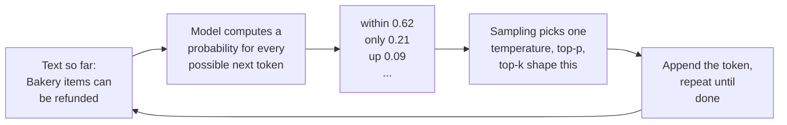

Three questions keep coming back from FreshCart's business teams, and each is a classic interview question in disguise. Meera: "Why does the same question get two differently worded answers?" Finance: "Why do Marathi questions cost more than English ones?" And after one bad week: "Why does it sometimes invent a policy that does not exist?"

## 1. Tokens: the unit everything is measured in

Models do not read letters or words. They read **tokens**: pieces of text produced by a **tokeniser**, a fixed vocabulary learned from training data. Common English words are often a single token. Rare words, codes like `ERR_SLOT_EXPIRED`, long numbers, and many non-English scripts are split into several tokens each.

That explains finance's question. English averages roughly three quarters of a word per token. Marathi, written in Devanagari, usually needs more tokens to say the same thing, so the same question costs more and fills the context window faster.

Everything practical is counted in tokens: the price, the context window, the provider's rate limits, chunk sizes, and the embedding model's input limit. Different providers use different tokenisers, so the same text has a different token count, and a different price, on different models.

## 2. How an answer is produced, and why it varies

Meera asks "Can bakery items be refunded after 6 hours?" twice and gets two differently worded answers. Here is why.



- The model never writes a whole answer at once. Given the text so far, it computes a probability for every token in its vocabulary.
- **Sampling** picks one token from those probabilities; it is appended to the text, and the process repeats, one token at a time.
- **Temperature** reshapes the probabilities before picking. Low temperature sharpens them, so the most likely token almost always wins and answers are predictable. High temperature flattens them, so less likely tokens get picked more often and answers vary. Temperature 0 means "always take the most likely token".
- **Top-k** keeps only the k most likely tokens before picking. **Top-p** keeps the smallest set of tokens whose probabilities add up to p (say 0.9). Sampling happens only within what is kept.
- One different token early on sends the rest of the answer down a different path, which is why two answers can differ throughout.

For Ask FreshCart's factual answers: low temperature, with the facts pinned down by retrieved chunks and citations. The wording may still vary; the rule should not.

**Why temperature 0 still is not perfectly repeatable**: providers process many users' requests together in batches on GPUs, and the arithmetic gives very slightly different results depending on how each batch is composed, which depends on server load. When two tokens are almost tied, that tiny difference flips the choice, and the answers diverge from there. Providers also update models and infrastructure underneath you.

Correction: "set temperature to 0 and outputs are reproducible" is wrong for hosted models. Design and test for variation (the agent evals page's pass^k), and pin model versions.

## 3. The context window, and why long prompts cost more

The **context window** is the most tokens a single call can handle, prompt and answer together.

- Before writing its first token, the model processes every input token (**prefill**). That is why both the price and the wait for the first word grow with prompt length.
- While writing, the model keeps intermediate results for every token already processed, called the **KV cache**, so it does not recompute the whole prompt for each new token. That cache takes GPU memory in proportion to the context length, which limits how many requests a server can handle at once. It is part of why long contexts are slow and expensive.
- **Prompt caching** at the provider reuses that work across requests that start with the same text. That is why Ask FreshCart puts its fixed instructions at the start of every prompt.
- At the limit, the provider rejects the request, or a framework silently drops the oldest messages, sometimes including the instructions. Well before the limit, quality already drops on long inputs (the "lost in the middle" finding on the debugging page).

## 4. Hallucination

A model produces likely-sounding text, not checked facts. When it does not know FreshCart's bakery rule, the most likely continuation is a plausible, generic rule. That is a **hallucination**: fluent, confident, wrong. Each cause has its own fix:

- **Missing knowledge** (private, recent or rare facts): retrieval with citations, and explicit permission to say "I do not know".
- **Ambiguous or leading questions**: clearer instructions, a clarifying question back to the user, structured output with an explicit "unknown" value.
- **Pressure to always answer**: an abstain path, a groundedness check after generation, and low temperature for factual tasks.

Measure it as faithfulness on a test set (the RAG metrics page), not from anecdotes.

**Decision point: someone proposes fine-tuning a model on FreshCart's policies so it "just knows" them.** **Fine-tuning** means continuing to train a model on your own examples so its behaviour changes. It teaches behaviour (format, tone, a narrow task) reliably, and facts unreliably: the model cannot cite what it learned, may blend it with older knowledge, and would need retraining every time a policy changes. Policies stay in retrieval. Fine-tuning fits a different FreshCart problem: the ticket classifier runs on a large, slow model at 95% accuracy. Label a few thousand tickets with that large model, fine-tune a small model on them (LoRA, which trains a small add-on instead of all the model's weights, is enough), and switch if the small model matches the quality at a fraction of the cost.

## 5. Complete example: sampling by hand

```python
import math, random

def softmax(logits, temperature):
    if temperature == 0:
        best = max(range(len(logits)), key=lambda i: logits[i])
        return [1.0 if i == best else 0.0 for i in range(len(logits))]
    scaled = [l / temperature for l in logits]
    m = max(scaled)
    exps = [math.exp(s - m) for s in scaled]
    total = sum(exps)
    return [e / total for e in exps]

def top_p_filter(probs, p):
    order = sorted(range(len(probs)), key=lambda i: probs[i], reverse=True)
    kept, running = [], 0.0
    for i in order:
        kept.append(i)
        running += probs[i]
        if running >= p:
            break
    total = sum(probs[i] for i in kept)
    return {i: probs[i] / total for i in kept}

def sample(tokens, logits, temperature=0.7, top_p=0.9, rng=random):
    probs = top_p_filter(softmax(logits, temperature), top_p)
    r, acc = rng.random(), 0.0
    for i, pr in probs.items():
        acc += pr
        if r <= acc:
            return tokens[i]
    return tokens[max(probs, key=probs.get)]

def context_fits(prompt_tokens, max_output_tokens, window=128_000):
    return prompt_tokens + max_output_tokens <= window
```

Expected behaviour, for `tokens = ["within", "only", "up"]` and model scores `logits = [2.0, 0.9, 0.1]`:

- `softmax(logits, 0)` returns `[1.0, 0.0, 0.0]`: at temperature 0, "within" is always chosen.
- `softmax(logits, 1.0)` returns about `[0.67, 0.22, 0.10]`; at temperature 2.0 the probabilities flatten to about `[0.51, 0.29, 0.20]`, so "only" and "up" are chosen more often.
- `top_p_filter` with p = 0.85 at temperature 1.0 keeps "within" and "only" (0.67 + 0.22 = 0.90, the first point at or above 0.85) and drops "up" entirely. With p = 0.95, all three stay.
- `context_fits(126_000, 4_000)` returns False: the prompt plus the room reserved for the answer exceeds the window, so the prompt must be trimmed, summarised or retrieved more selectively.
