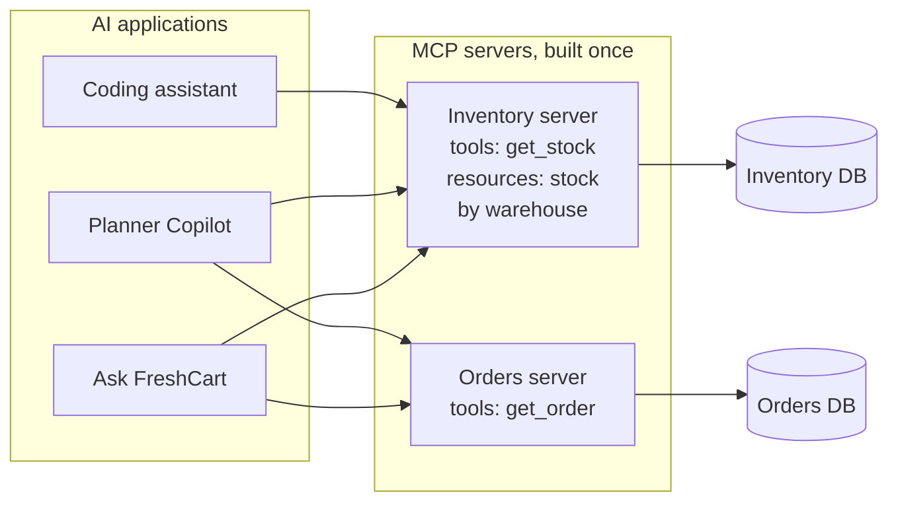
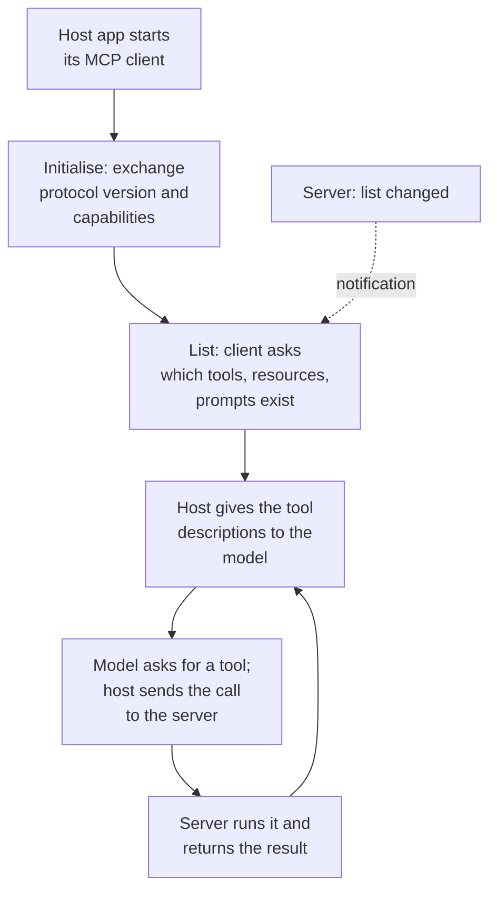

The warehouse team wants their inventory system available inside Ask FreshCart, inside Planner Copilot, and inside the engineers' coding assistant. Writing a custom tool integration for each app means three integrations to build and maintain, and every new system multiplies the work again.

## 1. What MCP is

**MCP (Model Context Protocol)** is an open standard for connecting AI applications to tools and data. A system is wrapped once as an **MCP server**. Any application that speaks MCP, called the **host**, connects to that server through its built-in **client** and can use what it offers.

An MCP server offers three kinds of things:

- **Tools**: actions the model can call, such as `get_stock(sku, warehouse)`. The model decides when to use them.
- **Resources**: data the application can read into the model's context, such as `inventory://pune/kothrud`. The application decides when to load them.
- **Prompts**: reusable templates a person can pick, such as "summarise today's stock-outs". The user decides when to use them.

It talks over one of two **transports**:

- **stdio**: the server runs as a local program started by the application. Simple, and nothing is exposed on the network. Good for local tools.
- **Streamable HTTP**: the server runs as a remote service shared by many applications. It needs authentication, encryption and the usual hardening of any web service.

## 2. Build once, use everywhere

- Each system is wrapped once as a server.
- Each application connects to the servers it needs; adding a fourth application needs no new integration.
- With N applications and M systems, you build N + M pieces instead of N x M custom integrations.

Correction: MCP does not replace tool calling. The model still asks for tools exactly as on the tool-calling page. MCP standardises how the application discovers those tools and invokes them on the server.

## 3. The security catch

A third-party MCP server's tool descriptions and outputs go straight into the model's context. That makes them untrusted input: a channel for prompt injection (the security page). A malicious or compromised server can hide instructions in a tool description, or change the description after you approved it.

**Decision point: an engineer wants to install a popular community MCP server that reads email and can also send it.** That one server holds two legs of the lethal trifecta. Install only reviewed servers, pin their versions so descriptions cannot change silently, give each its own narrowly scoped credentials, require approval for sensitive tools, and never let a workflow combine a server that reads private data with one that can send data out.

In LangChain, MCP servers load as ordinary tools (from version 1.4, through `langchain.mcp`), so an MCP tool passes through the same validation, permission checks and approval middleware as any other tool.

## 4. What happens when a client connects

- **Initialise**: client and server agree on a protocol version and say what each supports.
- **Discover**: the client lists the server's tools, resources and prompts.
- **Use**: the host passes tool descriptions to the model as usual; when the model asks for one, the host sends the call to the server and returns the result.
- **Change**: a server can notify clients when its list of tools changes.

The protocol also lets a server ask things of the client: request a model completion through the host's model (**sampling**), or ask the user for missing input (**elicitation**). Remote servers use OAuth-based authorisation so the user grants access explicitly, and the server acts with that user's permissions, not with a shared admin key.

## 5. Building an MCP server for FreshCart's inventory

- Expose a few well-designed tools (`get_stock`, `get_forecast`), not one tool per database table. The tool-design rules from the tool-calling page apply unchanged.
- Read-only by default; put any write tool behind approval in the host.
- Check the caller's identity and permissions inside the server, on every call.
- Return short, structured results; paginate big ones.
- Version the server and keep tool descriptions stable, since hosts and users approve them.

Also asked: "What problem does MCP solve that function calling does not?" Function calling is how a model asks for a tool; MCP is how tools and data are packaged and discovered, so one server works with every MCP-capable application.
