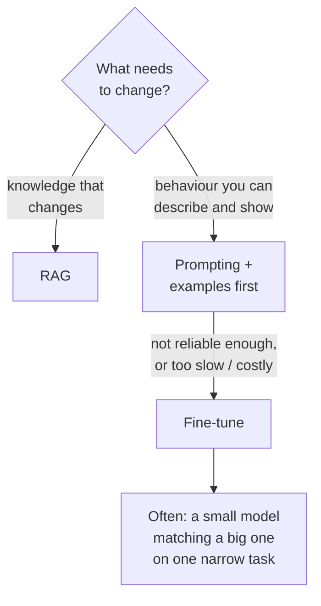
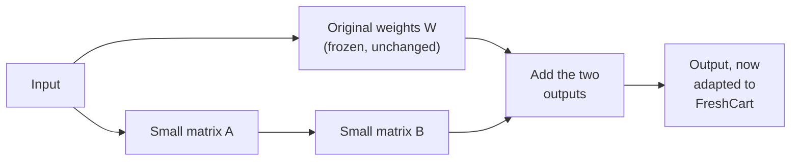
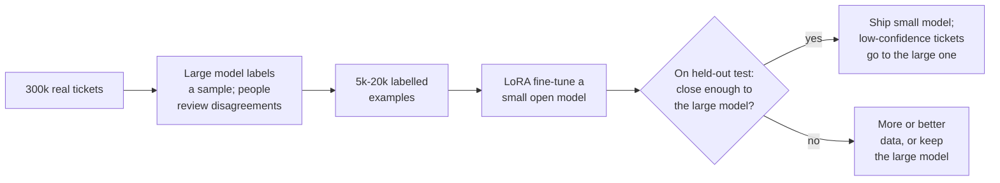

Ask FreshCart's ticket classifier runs on a large hosted model: 95% accurate, but 1.2 seconds and too expensive per ticket at 300,000 tickets a day. Separately, the marketing team wants push notifications written "in FreshCart's voice", and prompting gets close but never quite right. Both are cases where fine-tuning earns its place. This page explains what fine-tuning changes, the main methods, and how to decide.

## 1. What fine-tuning is, and what it is not

**Fine-tuning** means continuing to train an existing model on your own examples, so its weights (the learned numbers inside it) change and it behaves differently. It is good at teaching **behaviour**: a format, a style, a narrow task done consistently. It is poor at teaching **facts**: the model absorbs them unreliably, cannot cite them, and must be retrained whenever they change. Facts stay in RAG.

## 2. Supervised fine-tuning (SFT)

**Supervised fine-tuning** trains on input-output pairs: a ticket and its correct label, or a product update and the push notification marketing approved. The model learns to produce outputs like the examples.

What it takes:

- **Data**: hundreds to a few thousand high-quality examples for a narrow task; quality matters far more than quantity. Inconsistent labels teach inconsistency.
- **A held-out test set**, never trained on, to measure the result.
- **A baseline**: the best prompt on the base model. Fine-tuning that does not beat it is not worth owning.

## 3. LoRA and QLoRA: fine-tuning without retraining everything

Updating all of a model's billions of weights needs a lot of GPU memory and produces a full-size copy of the model per task. **LoRA (low-rank adaptation)** avoids both.

- The original weights are **frozen**.
- Next to chosen weight matrices, LoRA adds two small matrices whose product acts as a correction. Only these small matrices are trained, often well under 1% of the model's parameters.
- Training needs far less memory, and the result is a small **adapter** file. One base model can serve many adapters (classifier, voice, summariser), swapped per request.
- **QLoRA** does the same on a base model stored in 4-bit precision (quantisation, the serving page), so even large models can be fine-tuned on a single GPU.

## 4. Preference tuning: RLHF and DPO

Some qualities are easier to judge than to demonstrate: "which of these two notifications sounds more like FreshCart?" Preference tuning learns from such comparisons.

- **RLHF (reinforcement learning from human feedback)**: people compare pairs of answers; a separate **reward model** is trained to predict their preferences; then the main model is trained with reinforcement learning to produce answers the reward model scores highly, with a penalty for drifting too far from the original model. Powerful, and complex to run.
- **DPO (direct preference optimisation)**: skips the reward model and reinforcement learning. It trains directly on pairs of (preferred, rejected) answers, making preferred answers more likely and rejected ones less. Simpler and more stable, and widely used.

This is how chat models were made helpful in the first place (the foundations page); companies use the same methods at small scale for tone and style.

## 5. Distillation: making a small model do a big model's job

**Distillation** trains a small model to imitate a large one on a specific task. It is the answer to the classifier problem.

- The large model (plus human review of hard cases) produces the training labels.
- A small model fine-tuned on them can come close on this narrow task, at a fraction of the cost and latency.
- A **cascade** keeps quality: the small model handles confident cases, and uncertain ones go to the large model.
- Check the provider's terms before training on another model's outputs.

## 6. What fine-tuning costs you

- **Ownership**: you now host, version, monitor and retrain a model.
- **Drift**: as tickets change (new product lines, new complaint types), the model goes stale; schedule retraining from fresh labelled data.
- **Forgetting**: training hard on one task can degrade general abilities; LoRA reduces this but evaluate broadly.
- **Evaluation**: a fine-tuned model needs the same eval discipline as everything else, on a test set it never saw.

**Decision point: someone proposes fine-tuning on all 12,000 policy documents so Ask FreshCart "knows" them.** No. That is knowledge, not behaviour: the model would answer with confidence from a blurred memory, cite nothing, and need retraining with every policy change. RAG stays; fine-tuning is for the classifier and the brand voice.

Also asked: "LoRA in one sentence?" Freeze the model and train a small low-rank correction next to selected weight matrices, so a tiny adapter changes the model's behaviour.
