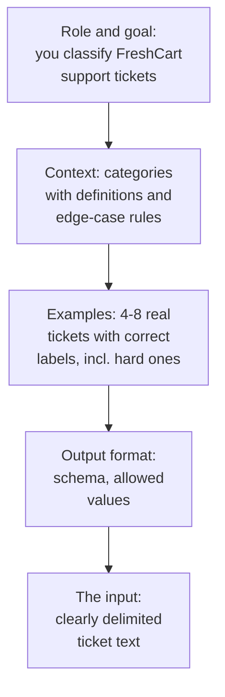
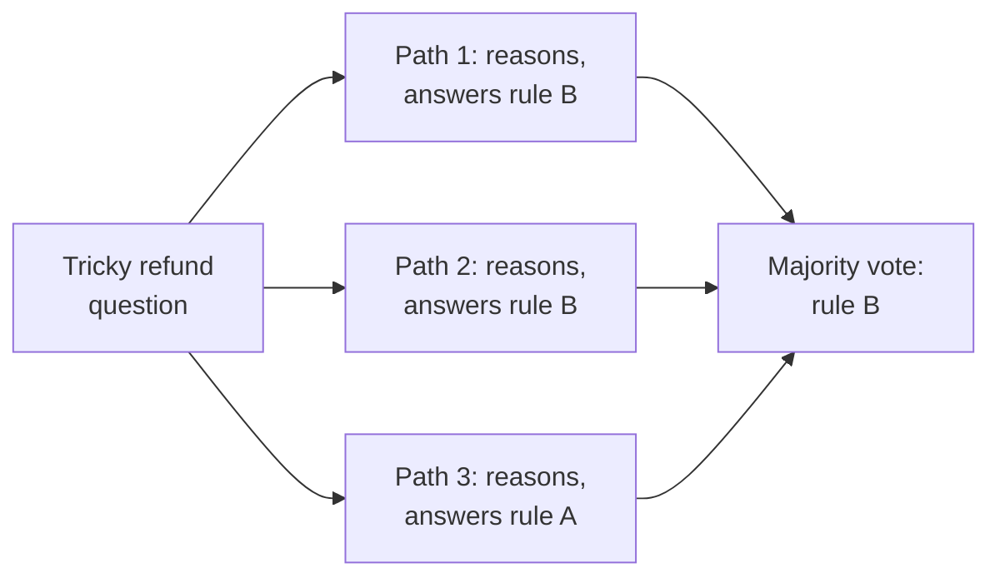
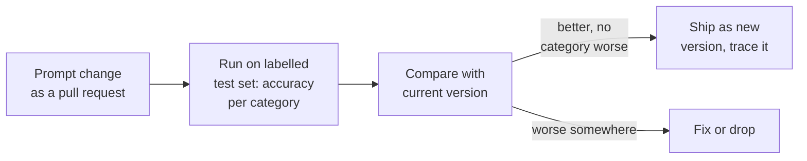

Ask FreshCart's ticket classifier gets 81% of tickets right. Meera's team keeps adding lines to its prompt ("IMPORTANT: refunds are not complaints!!!"), and each fix breaks something else. Prompting looks like writing; done well, it is engineering: a clear structure, examples chosen on purpose, techniques used where they help, and every change measured on a test set.

## 1. The anatomy of a good prompt

- **Role and goal**: what the model is doing and for whom, in a sentence or two.
- **Context and rules**: definitions of each category and how to resolve the confusing cases ("a late delivery that also mentions damaged items is damaged_item").
- **Examples** (few-shot, section 2).
- **Output format**: an exact schema, ideally enforced with structured output.
- **The input**, clearly separated from the instructions, for example inside tags such as `<ticket>...</ticket>`, so the model never mistakes the ticket's text for instructions.

Clarity beats emphasis. "Classify as refund only when the customer asks for money back" works; "IMPORTANT!!! REFUNDS!!!" does not.

## 2. Zero-shot, few-shot and examples that teach

- **Zero-shot**: instructions only. Fine for simple, common tasks.
- **Few-shot**: a handful of input-output examples in the prompt. The model copies the pattern, which is often the fastest way to fix format and tricky boundaries.

How to choose examples:

- **Cover the hard boundaries**, not the easy cases: the late-and-damaged ticket, the angry ticket that is not a complaint.
- **Balance the labels**: if 7 of 8 examples are refunds, the model leans toward refund.
- **Vary the wording**, or the model copies surface features.
- **Dynamic few-shot**: retrieve the most similar labelled examples for each new input from a pool, instead of using fixed ones. This is RAG applied to examples, and it often beats a static list.

## 3. Letting the model think

Some tasks need steps: "The customer ordered on Monday, the slot was moved twice, and the item arrived Thursday spoiled. Which refund rule applies?"

- **Chain-of-thought (CoT)**: ask the model to reason step by step before answering. On multi-step problems it measurably improves accuracy, because the model can use its own written intermediate steps. Put the reasoning in a separate field (or separate tags) so your code reads only the final answer.
- **Self-consistency**: sample several reasoning paths at a non-zero temperature and take the majority answer. More reliable, and several times the cost.
- **Reasoning models** (the foundations page) do this thinking internally; for them, asking for explicit step-by-step text adds little. Give them the goal and constraints, not a procedure.

## 4. Prompts for agents: ReAct

**ReAct** (reasoning and acting) is the prompting pattern behind tool-using agents: the model alternates between a short thought ("I need the order's delivery time"), an action (a tool call), and an observation (the tool's result), until it can answer. Modern tool-calling APIs build this in; the prompt's job is to describe the tools well, state when to stop, and give rules for uncertain cases ("if the order is not found, ask for the order id; never guess").

## 5. Prompt chaining versus one giant prompt

When one prompt tries to classify, extract, check policy and draft a reply, it does all of them a bit worse. Split it into a chain: classify, then extract, then draft, with code between steps that checks each output. Each step's prompt is short, testable on its own, and can use a smaller model. This is the prompt-chaining workflow from the workflows page.

## 6. Treating prompts as code

**Decision point: Meera's team keeps patching the classifier prompt by hand. What process do you put in place?**

- Prompts live in version control, not in a dashboard text box.
- Every change runs against a labelled test set, with results per category, because a fix for refunds often breaks complaints.
- Each production trace records which prompt version produced it.
- Model upgrades are tested the same way: a prompt tuned for one model can behave differently on the next.

Some teams go further with **automatic prompt optimisation**: tools such as DSPy search over instructions and examples to maximise a metric on your labelled data. It works when the metric is trustworthy, and it is another reason a good test set comes first.

Correction: "prompt engineering is about magic phrases" is wrong. The gains come from clear instructions, good examples, sensible task decomposition and measurement.

Also asked: "When does chain-of-thought help?" On multi-step reasoning with standard models; little on simple lookups, and little extra on reasoning models, which already think internally.
