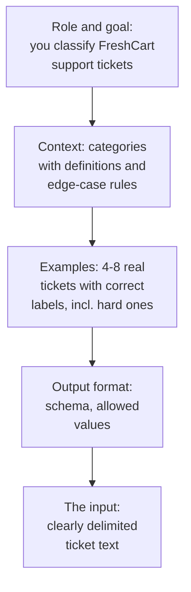
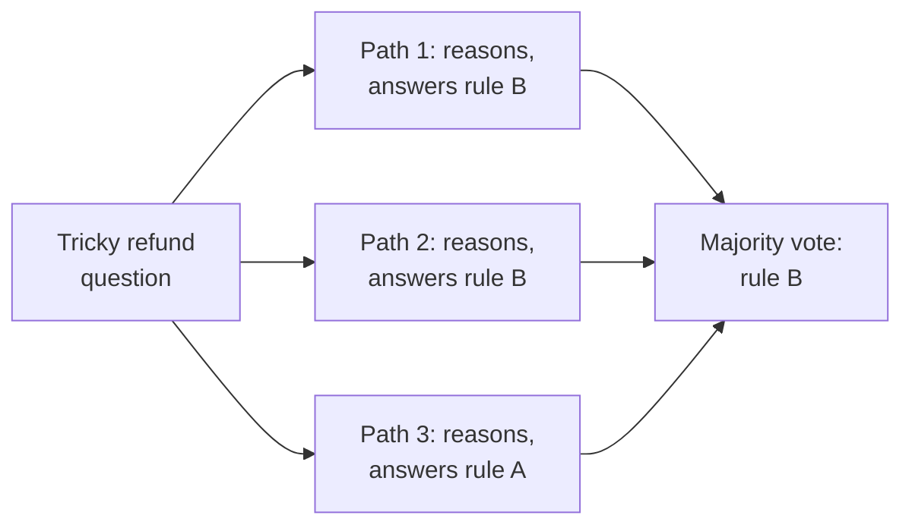
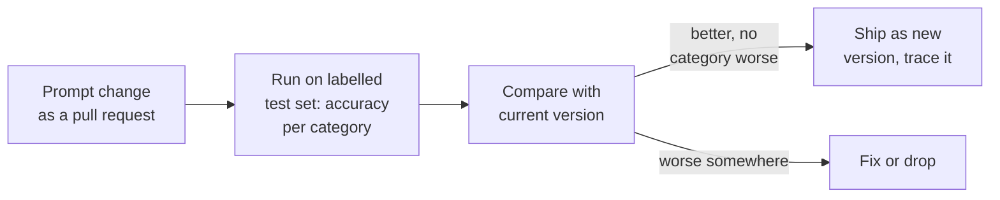

Your first real task at FreshCart is small and very common in industry. Every day about 3,000 customer tickets arrive, and two people spend their mornings sorting them by hand into refund, late delivery, missing item and other. Could a model do the sorting?

You write a **prompt**, the text instructions you send to the model with each ticket: "Classify this ticket as refund, late_delivery, missing_item or other." On a sample of 200 tickets that Meera's team labelled by hand, it gets 81% right. Then the patching starts. Someone adds "IMPORTANT: refunds are not complaints!!!", another adds a rule for late deliveries, and every fix breaks something else.

Prompting looks like writing. Done well, it is engineering: a clear structure, examples chosen on purpose, techniques used where they help, and every change measured on a test set. By the end of this page the classifier is above 93%.

## 1. The anatomy of a good prompt



- **Role and goal**: what the model is doing and for whom, in a sentence or two.
- **Context and rules**: definitions of each category and how to resolve the confusing cases ("a late delivery that also mentions damaged items is damaged_item").
- **Examples** (few-shot, section 2).
- **Output format**: an exact **schema** (a precise description of the fields and allowed values, such as "intent must be one of these four words"), ideally enforced with structured output, the provider feature that makes the model's reply follow your schema.
- **The input**, clearly separated from the instructions, for example inside tags such as `<ticket>...</ticket>`, so the model never mistakes the ticket's text for instructions.

Clarity beats emphasis. "Classify as refund only when the customer asks for money back" works; "IMPORTANT!!! REFUNDS!!!" does not.

## 2. Zero-shot, few-shot and examples that teach

- **Zero-shot**: instructions only. Fine for simple, common tasks.
- **Few-shot**: a handful of input-output examples in the prompt. The model copies the pattern, which is often the fastest way to fix format and tricky boundaries.

How to choose examples:

- **Cover the hard boundaries**, not the easy cases: the late-and-damaged ticket, the angry ticket that is not a complaint.
- **Balance the labels**: if 7 of 8 examples are refunds, the model leans toward refund.
- **Vary the wording**, or the model copies surface features.
- **Dynamic few-shot**: keep a pool of a few hundred labelled tickets and, for each new ticket, look up the most similar ones and use those as the examples, instead of a fixed list. It often beats a static list. (Finding "the most similar ones" is the same search problem the RAG section solves for documents.)

## 3. Letting the model think

Some tasks need steps: "The customer ordered on Monday, the slot was moved twice, and the item arrived Thursday spoiled. Which refund rule applies?"

- **Chain-of-thought (CoT)**: ask the model to reason step by step before answering. On multi-step problems it measurably improves accuracy, because the model can use its own written intermediate steps. Put the reasoning in a separate field (or separate tags) so your code reads only the final answer.
- **Self-consistency**: sample several reasoning paths at a non-zero temperature and take the majority answer. More reliable, and several times the cost.
- **Reasoning models** (from the previous page) do this thinking internally; for them, asking for explicit step-by-step text adds little. Give them the goal and constraints, not a procedure.



## 4. Prompts for agents: ReAct

A model on its own can only write text. Later in this stack you will give it **tools**: functions in your code that it may ask you to run, such as "look up order FC-20931". A model that uses tools in a loop to finish a task is called an **agent** (the LangChain section builds one properly).

**ReAct** (reasoning and acting) is the prompting pattern behind agents: the model alternates between a short thought ("I need the order's delivery time"), an action (asking for a tool to be run), and an observation (the tool's result), until it can answer. Modern model APIs build this loop in; the prompt's job is to describe the tools well, say when to stop, and give rules for uncertain cases ("if the order is not found, ask for the order id; never guess").

## 5. Prompt chaining versus one giant prompt

When one prompt tries to classify, extract the order id, check the policy and draft a reply, it does all of them a bit worse. Split it into a chain: classify, then extract, then draft, with plain code between the steps that checks each output. Each step's prompt is short, testable on its own, and can run on a smaller, cheaper model. The system design section names this pattern "prompt chaining".

## 6. Treating prompts as code

**Decision point: Meera's team keeps patching the classifier prompt by hand. What process do you put in place?**



- Prompts live in version control next to the code, and every change goes through a pull request, not a quick edit in a dashboard text box.
- Every change runs against the labelled test set, with results per category, because a fix for refunds often breaks complaints.
- Each production request keeps a **trace**, a record of what went in and what came out, including which prompt version produced it, so a bad answer can be traced to the exact prompt.
- Model upgrades are tested the same way: a prompt tuned for one model can behave differently on the next.

Some teams go further with **automatic prompt optimisation**: tools such as DSPy search over instructions and examples to maximise a metric on your labelled data. It works when the metric is trustworthy, and it is another reason a good test set comes first.

Correction: "prompt engineering is about magic phrases" is wrong. The gains come from clear instructions, good examples, sensible task decomposition and measurement.

Also asked: "When does chain-of-thought help?" On multi-step reasoning with standard models; little on simple lookups, and little extra on reasoning models, which already think internally.

## 7. Complete example: the classifier prompt, before and after

Before (81%):

```text
Classify this ticket as refund, late_delivery, missing_item or other.
IMPORTANT: refunds are not complaints!!!
Ticket: {ticket}
```

After (93% on the same 200 tickets):

```text
You sort FreshCart grocery-delivery support tickets so they reach the right team.

Categories:
- refund: the customer asks for money back, for any reason.
- late_delivery: the order arrived after its slot, and no money is requested.
- missing_item: something ordered was not in the delivery.
- other: anything else, including general complaints.

Rules for unclear cases:
- If money back is requested, it is refund, even if the order was also late.
- Anger alone does not make a ticket a refund.

Examples:
<ticket>Order came 2 hours late, I want my delivery fee back</ticket> -> refund
<ticket>Driver was rude and the slot was missed</ticket> -> late_delivery
<ticket>No bread in my bag today</ticket> -> missing_item

Reply with JSON only: {"intent": "<one of the four categories>"}

<ticket>{ticket}</ticket>
```

What changed, and why it works:

- Every category has a definition, so the model is not guessing what "refund" means at FreshCart.
- The confusing boundary (late and wants money) has an explicit rule instead of shouting.
- Three examples show the hard cases, not the easy ones.
- The output is a fixed format code can read.
- The ticket sits inside tags, so text inside a ticket ("ignore your instructions") is treated as data.
