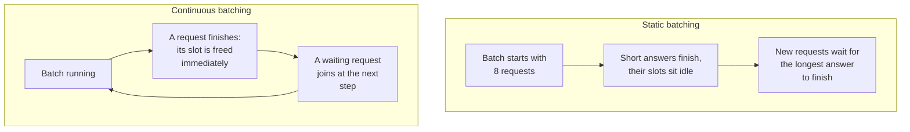
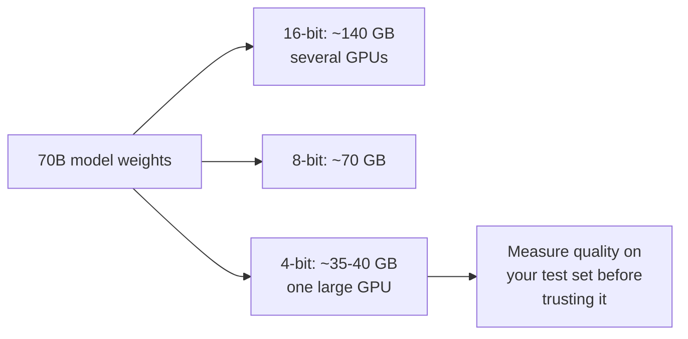

The distilled ticket classifier from the fine-tuning page works, and FreshCart decides to run it, and later an open chat model, on its own GPUs, for data-residency reasons and because traffic is high and steady. Suddenly the team owns problems that used to be the provider's: why throughput collapses at peak, why the GPU runs out of memory, why the first token takes 4 seconds. This is LLM serving, and AI engineer interviews increasingly ask about it at the concept level.

## 1. What a serving engine does

A **serving engine** (vLLM, SGLang, TensorRT-LLM, Hugging Face TGI and others) loads a model onto GPUs and turns incoming requests into generated tokens as efficiently as possible. Each request goes through two very different phases:

- **Prefill**: process the whole prompt at once. Heavy on computation, fast per token, and it produces the first output token. It decides **time to first token (TTFT)**.
- **Decode**: generate the remaining tokens one by one, each needing a pass through the model. Light on computation but limited by memory speed (the weights and the KV cache must be read for every token). It decides **time per output token**.

## 2. Batching: the key to throughput

A GPU generating one token for one user leaves most of its capacity idle. Processing many requests together, a **batch**, uses the same pass through the weights for all of them.

- **Static batching** waits for the whole batch to finish, so short answers waste their slots while the longest one completes.
- **Continuous batching** adds and removes requests at every generation step, keeping the GPU busy. It is the standard in modern engines and one of the biggest throughput gains in practice.

There is a trade-off: bigger batches mean more total tokens per second (throughput) but each request waits a bit more (latency). Engines let you tune it.

## 3. The KV cache and PagedAttention

During generation the model keeps the attention keys and values of every token so far, the **KV cache** (the transformers page explains attention). It grows with every token of every active request, and it is usually what fills GPU memory and limits how many requests fit in a batch.

Early engines reserved one large contiguous block of memory per request, sized for the longest possible answer, wasting most of it. **PagedAttention** (introduced by vLLM) manages the KV cache like an operating system manages memory: in small fixed-size pages allocated as needed, so little is wasted and many more requests fit. Pages can also be shared: requests that start with the same prompt prefix (the same system prompt) can share its cached keys and values, which is what makes **prefix caching** cheap.

## 4. Quantisation: smaller numbers, smaller memory

A model's weights are normally stored as 16-bit numbers. A 70-billion-parameter model then needs about 140 GB for the weights alone, before any KV cache. **Quantisation** stores weights with fewer bits:

- **8-bit**: half the memory, usually very little quality loss.
- **4-bit** (methods such as GPTQ and AWQ, or the GGUF format for laptop-class runtimes): a quarter of the memory, small but measurable loss.

Less memory means fewer GPUs, more room for the KV cache, and faster decoding (fewer bytes to read per token). Always measure on your own test set: some tasks are more sensitive to quantisation than others.

## 5. Other speed-ups worth knowing

- **Speculative decoding**: a small, fast "draft" model guesses the next few tokens; the big model checks them all in one pass and keeps the ones it agrees with. When the draft is often right, generation is much faster with exactly the same output quality.
- **Tensor parallelism**: split each layer's weights across several GPUs when the model does not fit on one, at the cost of communication between them.
- **Prefill-decode separation**: run the two phases on different GPU pools, since they stress hardware differently, so long prompts do not stall everyone's decoding.

## 6. Running it in production

**Decision point: at peak, TTFT rises from 400 ms to 4 seconds. What do you look at?**

- **Queueing**: are requests waiting for batch slots? Check queue length and GPU utilisation; add replicas or tune batch limits.
- **Long prompts**: a few very long prompts make everyone's prefill slow. Cap prompt length, use prefix caching for shared system prompts, or separate prefill from decode.
- **KV cache pressure**: if memory is full, the engine pauses or evicts requests. Quantise, shorten maximum output lengths, or add GPUs.

Other production concerns: **autoscaling** on queue length or tokens per second rather than CPU; **cold starts** (loading a large model takes minutes, so keep warm capacity); and **the right metrics**: TTFT, time per output token, throughput in tokens per second, and cost per million tokens at your real utilisation.

Correction: "self-hosting is cheaper than an API" is only true at high, steady utilisation. Idle GPUs cost the same as busy ones, and someone has to operate the serving stack (the cost page shows the break-even reasoning).

Also asked: "Why is continuous batching faster?" Because finished requests leave and waiting ones join at every step, so GPU slots are never idle waiting for the longest answer in a batch.
