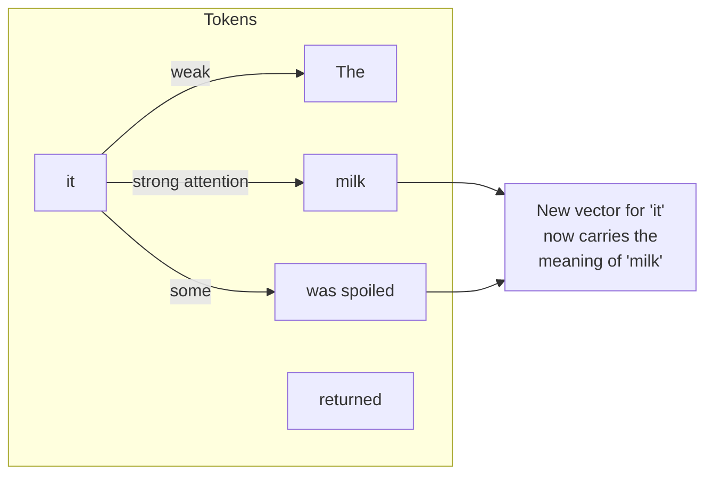
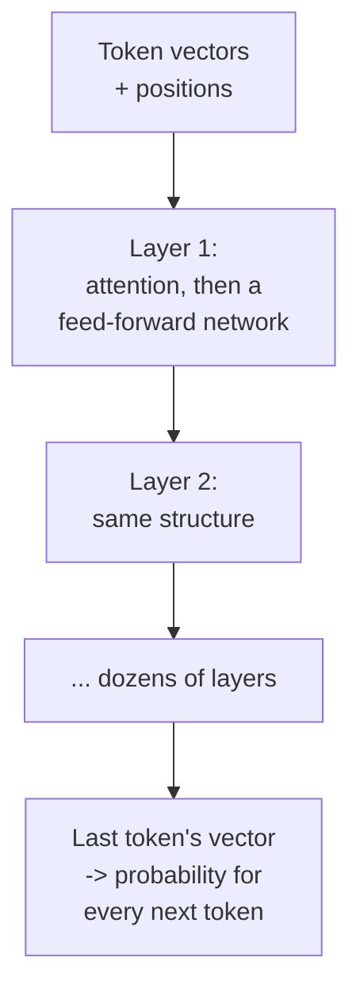

A FreshCart director, reviewing the AI budget, asks two questions that sound simple: "Why does a longer prompt cost more? And why can't we just give it all 12,000 documents at once?" Both answers live inside the transformer, the architecture behind every modern language model. You do not need the maths for an AI engineer interview; you do need the picture.

## 1. From text to vectors

A model never sees letters. Text goes through three steps before any "thinking" happens:

- **Tokenise**: the text is split into tokens from a fixed vocabulary (the "How LLMs behave" page covers tokens).
- **Embed**: each token id is looked up in a table and replaced by a **vector**, simply a list of numbers (for example 4,096 of them), which the model learned during training to represent that token.
- **Add position**: the model also needs to know the order of tokens ("dog bites man" versus "man bites dog"), so position information is added to each token's vector.

Now the sentence is a list of vectors, one per token. Everything after this works on that list.

## 2. Attention: tokens looking at each other

The word "it" in "The milk was spoiled, so the customer returned it" means "the milk". To understand "it", the model must look back at other tokens. **Attention** is the mechanism that does this: for every token, it decides how much to look at every other token, and mixes in information from the ones that matter.

How it works, in words:

- Each token produces three vectors: a **query** (what am I looking for?), a **key** (what do I contain?) and a **value** (what do I pass on if chosen?).
- Each token's query is compared with every token's key; high similarity means "look here". The scores become weights that add up to 1.
- The token's new vector is the weighted mix of the values. "it" ends up carrying "milk".
- **Multi-head attention** runs several of these in parallel, each free to track a different kind of relationship (who did what, which word refers to which, grammar).

In a model that writes text, attention is **causal**: each token can only look at tokens before it, never ahead, because when generating, the future does not exist yet.

## 3. Layers, and where knowledge lives

- A **layer** is attention (tokens share information) followed by a **feed-forward network** (each token's vector is transformed on its own). Large models stack dozens of layers.
- Early layers tend to capture surface patterns, later layers more abstract meaning. Much of the model's factual knowledge is stored in the feed-forward weights.
- At the end, the final vector of the last token is turned into a probability for every token in the vocabulary. Sampling picks one (the "How LLMs behave" page), it is appended, and the whole thing runs again for the next token.

The **parameters** of a model (7 billion, 70 billion, more) are all these learned numbers: embedding tables, attention weights, feed-forward weights. More parameters can hold more knowledge and skill, and cost more memory and compute per token.

## 4. Answering the director

**Why a longer prompt costs more.** Before writing anything, the model runs every prompt token through every layer (the prefill), and attention compares every token with every earlier token. Doubling the prompt more than doubles the attention work: the cost of attention grows roughly with the square of the length. Providers price per token, and time to first token grows with prompt length.

**Why not give it all 12,000 documents.** 12,000 documents are hundreds of millions of tokens, far past any context window. Even within a window, attention spread over a huge context gets diluted: models use information in the middle of long inputs less reliably (the "lost in the middle" finding). And the **KV cache**, the stored keys and values of every token so far, takes GPU memory in proportion to the context length, which limits how many conversations a server can handle at once. Retrieval exists because sending the right 2,000 tokens beats sending everything.

## 5. Variations you will hear about

- **Encoder versus decoder models**: chat models are **decoder-only** (causal attention, generate text). Embedding models and rerankers are usually **encoder** models: attention looks both ways across the whole input, which is better for understanding a fixed text than for writing one.
- **Mixture of experts (MoE)**: instead of one big feed-forward network per layer, the model has many smaller "expert" networks and a router that sends each token to a few of them. The model has a huge total parameter count, but only a fraction is used per token, which makes it cheaper to run than a dense model of the same size.
- **Long-context techniques**: newer position methods and attention variants let models handle very long windows; they extend the limit but do not remove the cost and dilution described above.

Correction: "the model understands the whole document at once, like a person reading it" is misleading. It processes tokens through attention whose reliability drops as the input grows, which is why what you put in the context matters so much.

Also asked: "Explain attention in one minute." Each token compares its query with every earlier token's key, turns the scores into weights, and takes a weighted mix of their values, so every token's vector absorbs information from the tokens that matter to it.
