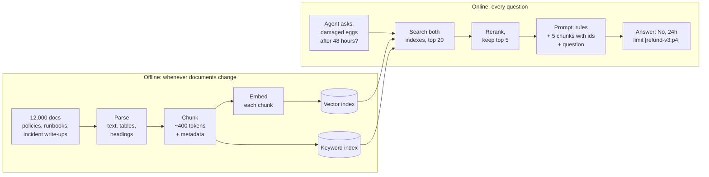

Meera leads FreshCart's support team. Her 80 agents spend half their day searching 12,000 internal documents. On day one she tries the plain model you wired up: "Can a customer get a refund for damaged eggs reported after 48 hours?" It answers confidently: "Yes, within 7 days." FreshCart's real policy says 24 hours.

Two things went wrong. The model has never seen FreshCart's documents, so it produced the most typical-sounding refund policy from what it learned in training. And even if it had been right, Meera has no way to check where the answer came from.

## 1. The idea: look it up first, then answer

A large language model (LLM) works by predicting likely text. It is excellent at language and at reasoning over text you give it, and unreliable at facts it was never shown. Private, recent or company-specific facts are exactly what it was never shown.

**Retrieval-Augmented Generation (RAG)** splits the job in two:

- **Retrieval**: before the model says anything, your system searches FreshCart's documents and picks the few passages that answer the question.
- **Generation**: those passages are pasted into the prompt, and the model is told to answer only from them and to say which passage it used.

The model stops being the source of facts. It becomes a reader of the evidence you hand it. That fixes both of Meera's problems: answers come from FreshCart's policies, and every answer points to its source.

One limit shapes the whole design: the **context window**, the maximum amount of text one model call can take in (prompt plus answer), measured in **tokens**. A token is a piece of text, often a short word or part of a word; roughly 100 tokens is 75 English words. You cannot paste 12,000 documents into one call, and even if you could, it would be slow and expensive. So RAG has to pick the right few passages.

## 2. Two new building blocks: chunks and embeddings

To pick passages, the documents are first cut into pieces. A **chunk** is one such piece, typically a few hundred tokens: a paragraph or a short section. Chunks are the unit you search and the unit you paste into the prompt. (The next page covers how to cut well.)

Now the search itself. Meera's agent types "eggs broken on arrival, can they get money back?" The policy says "damaged items reported within 24 hours are eligible for a full refund." These share almost no words, yet mean the same thing. Word matching misses this. You need search by meaning.

An **embedding** is how a computer captures meaning as numbers. An embedding model reads a piece of text and outputs a fixed-length list of numbers, for example 768 of them: a **vector**. You can picture each vector as a point in a space with 768 directions. The model has been trained so that texts with similar meaning land close together:

- "eggs broken on arrival" and "damaged items" land near each other.
- "delivery slot rules" lands far away from both.

So "find passages that mean the same as the question" becomes "find the stored points nearest to the question's point". A **vector index** is a data structure built to answer exactly that quickly, even over millions of points.

Alongside it, Ask FreshCart keeps an ordinary **keyword index**, the classic search that matches exact words. Meaning-based search and word-based search fail in different places (a later page shows why), so you keep both.

## 3. The two pipelines

RAG is two pipelines that run at different times.

The offline side, run whenever a document is created, edited or deleted:

- **Parse**: turn PDFs and wiki pages into clean text. Tables are the hard part. A refund table flattened into "Eggs 24 Dairy 24 Bakery 12" is close to useless for search.
- **Chunk**: cut the text into chunks of about 400 tokens. Each chunk also carries **metadata**, extra fields stored with it: document id, version, page, section heading, city, which franchise may see it, last updated.
- **Embed and store**: each chunk is embedded and stored in the vector index, and also stored in the keyword index. From now on, every chunk can be found two ways.

The online side, run for every question:

- **Search**: embed the question with the same embedding model, and fetch the 20 best candidates from both indexes, keeping only chunks this agent is allowed to see.
- **Rerank**: a slower, more accurate model rereads those 20 and keeps the best 5 (covered on the hybrid search page).
- **Prompt**: instructions first, then the 5 chunks each labelled with an id like `[refund-v3:p4]`, then the question last.
- **Answer**: the model answers and cites the ids. Meera can click an id and read the source.

The levers, in order of payoff: retrieval quality first, then how the context is assembled, then the prompt wording. Most answers people call "hallucinations" in a RAG system are retrieval misses: the right chunk was never in the prompt.

## 4. When RAG is the wrong tool

**Decision point: Meera's team asks "how many refunds did we issue last week?"** Should Ask FreshCart answer with RAG? No. Search returns some refund documents that look relevant; it cannot count every refund record. That is a database query, exposed to the assistant as a tool (the LangChain pages cover tools).

Other cases where RAG is the wrong answer:

- **A small, fixed set of documents**, say 30 pages: put all of it in the prompt every time. Providers offer **prompt caching**, which stores the processed start of a prompt so repeating it is much cheaper. No search, so no search misses.
- **Tone or format problems** ("answers are too long"): change the instructions, not the retrieval.
- **Facts that change every minute**, like live delivery-slot availability: call the live system.

RAG is for large or changing private text that needs citations or per-user access control.

## 5. Making it production-worthy

**Where the time goes.** For one answer: embedding the question 10-50 ms, both searches 10-50 ms, reranking 50-300 ms, and generation, which dominates everything else. The model first reads the whole prompt, so the wait before the first word grows with prompt length; total time grows with answer length. **Stream** the answer (show words as they are produced) so agents start reading after the first word.

Also worth caching: the embeddings of repeated questions, search results for very frequent questions (cleared whenever the index changes), and the fixed start of the prompt through prompt caching.

**Citations Meera can trust.** Ask the model for **structured output**, a fixed machine-readable shape such as `answer` plus `citations[]`, instead of free text. After generation, drop any cited id that was not actually retrieved, then check each sentence against its cited chunk: a second model call asks "is this sentence supported by this chunk?". Unsupported sentences are removed, or the assistant says it does not know.

**The refund policy is updated to version 4.** Every chunk is stored with its `doc_id` and `version`. On update: re-parse and re-chunk the document, embed and store the new chunks, and delete all old chunks of that `doc_id` from both indexes in one go. Change events come from the wiki's webhooks, or a nightly job comparing content fingerprints.

Correction: teams often add the new chunks and forget the delete. Then versions 3 and 4 are both searchable and answers mix them. Worse, a document that was deleted, or whose access was revoked, stays searchable. That is a data leak, not just a stale answer.

Also asked: "Where does the latency go, and what would you cache?" The answer is in this section: generation dominates, so stream it, keep prompts short, and cache the fixed prompt start, repeated embeddings and hot search results.
