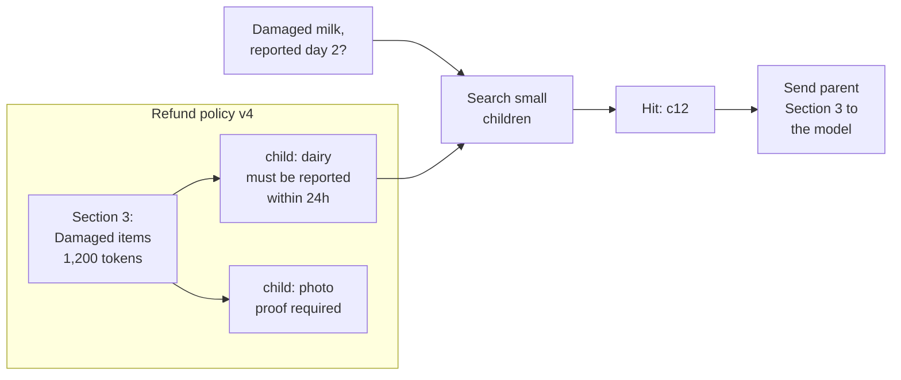
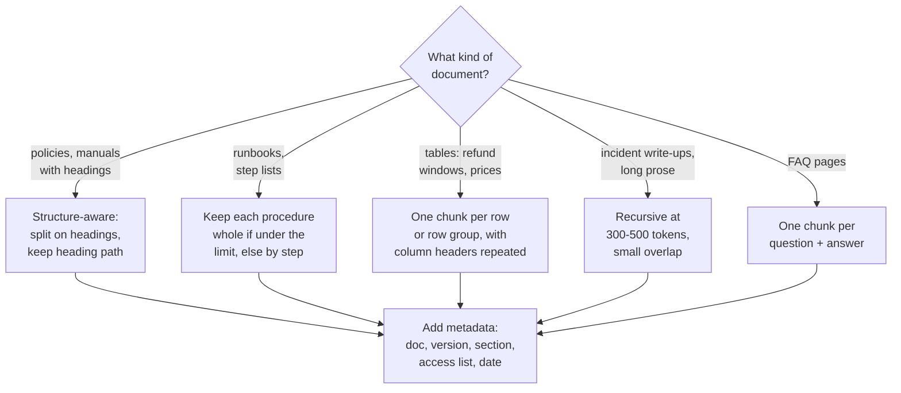

Week two of Ask FreshCart. An agent asks "what is the refund window for damaged dairy?" and gets a vague answer. You open the logs: the entire 40-page refund policy was indexed as a single chunk. Its embedding is a blend of 40 pages of meaning, so it matches every refund question weakly, and whenever it is retrieved it drags 20,000 tokens into the prompt.

How you cut documents, and how you turn chunks into vectors, decides what search can ever find.

## 1. Cutting documents into chunks

Chunk size is a trade-off between two ways to fail:

- **Too big**: the embedding averages many topics, so it matches nothing sharply, and every hit is expensive to paste into the prompt.
- **Too small**: "The limit is 24 hours." Limit on what? A tiny chunk loses the context that gives it meaning.

The common ways to cut:

- **Fixed-size with overlap**: every 400 tokens, with the last 50 tokens repeated at the start of the next chunk so a sentence cut at the border appears whole in one of them. Simple, but it slices through sentences and tables.
- **Recursive**: try to split on paragraph breaks; if a piece is still too big, split it on line breaks, then sentences, until every piece fits. The `RecursiveCharacterTextSplitter` in LangChain (a popular Python library for LLM apps, covered later) works this way. A strong default.
- **Structure-aware**: split on the document's own structure: headings, sections, list items, table rows, keeping each heading attached to its text. Best for well-structured documents like FreshCart's policies.
- **Semantic**: embed each sentence, and start a new chunk wherever neighbouring sentences stop being similar in meaning. More compute, sometimes better borders.

Two rules people get wrong:

- **Count tokens, not characters.** An embedding model reads at most a fixed number of tokens (often 512) and silently ignores the rest. A 3,000-token chunk is embedded from its first 512 tokens only, so anything after that is unfindable by meaning.
- **Overlap is a patch, not a goal.** 0-20% protects sentences at the borders; more just duplicates content and bloats the index.

**Decision point: what chunk size should Ask FreshCart use?** Do not guess; measure. Take 80 real agent questions and label, for each, the passage that answers it. Index the documents three times, at 200, 400 and 800 tokens per chunk. For each version, measure how often the right passage appears in the top 10 results, and how many tokens you would send to the model. Keep the winner. "I chose 512 because everyone does" is the weak interview answer; "I compared three sizes on real questions" is the strong one.

## 2. Two upgrades: parent-child and contextual retrieval

**Parent-child retrieval** gets precise matching and full context at the same time. You embed small chunks (one to three sentences), because small chunks have sharp meaning. Each small chunk remembers which bigger section it came from, its **parent**. Search runs over the small chunks; the model receives the parent sections.

- The child "dairy must be reported within 24h" matches "damaged milk" precisely.
- The system looks up its parent, Section 3.
- The model receives all of Section 3, so it also sees the photo-proof rule next to it. If several children of the same parent match, the parent is sent once.
- Cost: more tokens per hit, so cap the parent size.

**Contextual retrieval** fixes chunks that are meaningless alone. Before indexing, a model reads each chunk together with its whole document and writes one sentence placing it: "From FreshCart refund policy v4, section on damaged dairy items." That sentence is glued to the front of the chunk before it is embedded and before it goes into the keyword index. Now "The limit is 24 hours" carries its own context. Anthropic, who published the technique, reported that it roughly halved retrieval failures in their tests, and that adding a reranker cut them further. The cost is one model call per chunk at indexing time.

## 3. Embeddings in practice

Recall from the RAG overview: an embedding turns text into a vector, and similar meanings land close together. "Close" needs a definition. Three are common:

- **Cosine similarity**: compares the direction of two vectors, ignoring their length. 1 means same direction, 0 unrelated.
- **Dot product**: multiply the two vectors element by element and add up. It depends on direction and on length.
- **Euclidean (L2) distance**: the straight-line distance between the two points.

The practical trick: scale every vector to length 1 when you store it (**normalise** it). For vectors of length 1, cosine similarity and dot product give exactly the same number, and Euclidean distance ranks results in the same order. So you normalise once and use the dot product, the cheapest to compute.

In Postgres, the popular open-source database, vectors are usually stored with **pgvector**, an extension that adds a vector column type and vector indexes. The index must be built for the same comparison the query uses: an index built with `vector_cosine_ops` is only used by queries ordered with the `<=>` operator. A mismatch makes Postgres ignore the index and compare against every row.

**Choosing an embedding model.** Run three or four candidate models on the same 80 labelled questions and keep the one that finds the right passage most often. Public leaderboards such as MTEB rank models on general benchmarks; use them for a shortlist, not a decision, because their tasks are not your documents. Also weigh: the model's maximum input length against your chunk size; the number of dimensions (more numbers per vector means more storage and slower search); support for the languages your documents use; price; and whether your data may leave your network.

Correction: switching embedding models later is not a configuration change. Vectors from different models live in different spaces and cannot be compared, so the entire corpus must be re-embedded.

## 4. Choosing a strategy for each kind of document

FreshCart's documents are not all alike, and one chunking rule for all of them is a common mistake.

- **Headings are context.** Store the heading path with each chunk ("Refund policy > Damaged items > Dairy") and include it in the text you embed. A chunk that starts "Within 24 hours of delivery..." is far easier to find when it carries "Damaged items > Dairy".
- **Tables need their headers.** A table row "Bakery | 12 hours | Photo required" means nothing without the column names. Repeat them in every row chunk: "Category: Bakery. Refund window: 12 hours. Proof: photo required."
- **Keep procedures whole.** Splitting step 4 of a 6-step runbook from steps 1-3 produces answers that start halfway through.
- **FAQs are already chunked.** One question and its answer is the natural unit.

## 5. More ways to make a chunk findable

The text you embed does not have to be the text you show the model. Several techniques separate the two:

- **Multi-vector (summary) indexing**: generate a short summary, or a few questions the chunk answers, embed those, and point them at the full chunk. Users ask questions, so embedding "questions this chunk answers" often matches better than embedding the chunk.
- **Proposition chunking**: a model rewrites a passage into small self-contained facts ("Dairy items must be reported within 24 hours of delivery.") and each fact is indexed. Very precise, expensive to build.
- **Late chunking**: embed the whole document with a long-context embedding model first, then cut the resulting token vectors into chunks, so each chunk's vector already "knows" its surrounding document. A cheaper cousin of contextual retrieval.
- **Metadata filters**: some precision comes from not searching at all. If the agent works for the Pune franchise, filter to Pune and shared documents before ranking.

Every one of these is an indexing-time cost that must pay for itself on your retrieval test set.

## 6. Re-indexing without downtime

Changing chunk size, adding contextual sentences or switching embedding model all mean rebuilding the index. Doing it in place would leave half old, half new chunks in the index for hours. The safe pattern is **blue-green re-indexing**:

- Build the new index alongside the old one, from the same documents.
- Keep sending document updates to both while the new one fills.
- Run the retrieval test set against the new index; switch only if it is better.
- Point queries at the new index in one switch (an alias or a configuration flag), keep the old one briefly for rollback, then delete it.

Also asked: "What chunk size do you use?" There is no universal number; describe the per-document-type strategy above and the measurement that picked the size.
