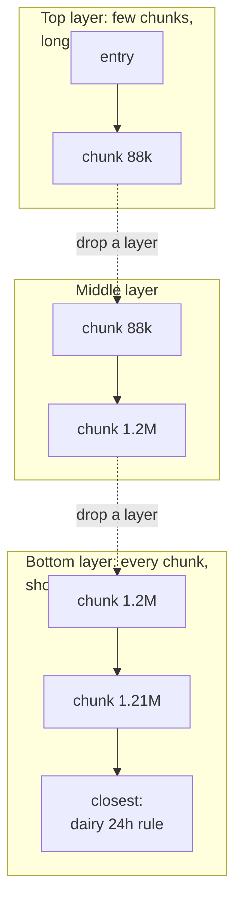
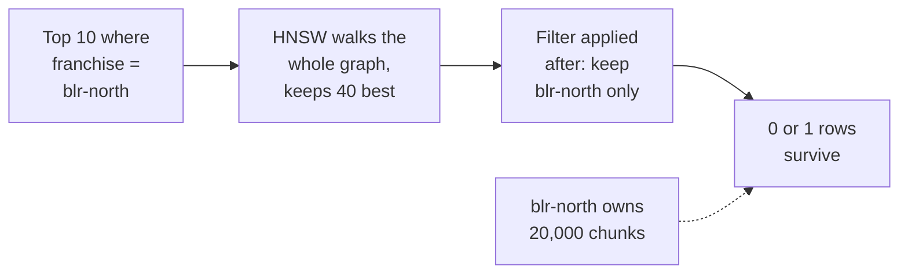
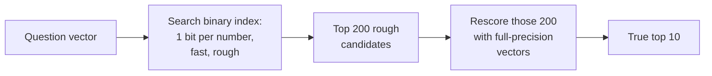

Ask FreshCart now holds 2 million chunk vectors. Finding the 10 nearest to a question the obvious way means comparing the question's vector with all 2 million and sorting. That is always correct, and far too slow to do for every question from 80 agents. Then, in the same week, the Bengaluru franchise partner complains that searches return nothing for their own runbooks, although the runbooks are definitely indexed.

Both problems live inside the vector index.

## 1. Approximate search: trading a little accuracy for a lot of speed

An **exact scan** compares against everything. An **approximate nearest neighbour (ANN) index** looks at only a small, cleverly chosen part of the data, answers in milliseconds, and occasionally misses one of the true nearest vectors.

How much it misses is measured as **recall**: of the true 10 nearest vectors, how many the index returned. A recall of 0.95 means it found 9.5 of 10 on average. Every ANN index has knobs that trade recall against speed, and you set them by measuring, not by guessing.

## 2. HNSW: an express train through the data

**HNSW (Hierarchical Navigable Small World)** is the default ANN index in pgvector and most vector databases. It builds a graph: every chunk is a node, linked to some of its nearest neighbours. The graph has several layers. Every node lives in the bottom layer. A random few also live in the layer above, fewer still in the layer above that. Upper layers are sparse, so one hop there crosses a long distance, like an express train that skips most stations.

How one search runs:

- Start at the fixed entry node in the top layer.
- Look at the current node's neighbours and move to whichever is closer to the question. Repeat until no neighbour is closer.
- Drop to the same node one layer down and repeat with the denser links there.
- In the bottom layer, instead of following one path, keep a list of the best candidates seen so far (its size is `ef_search`) and return the best 10 from it.

It is approximate because this greedy walk can stop at a spot that is only locally best. A longer candidate list explores more and finds more of the true neighbours.

Three settings control it (pgvector defaults):

- `m` = 16: how many links each node keeps. More links mean better recall, more memory and a slower build.
- `ef_construction` = 64: how hard the build works to find good links. Higher means a better graph and a slower build.
- `hnsw.ef_search` = 40: the candidate list at query time. Higher means better recall and slower queries. It must be at least the number of results you want.

**Decision point: answers feel slightly worse than an exact scan. What do you tune?** Take 1,000 real questions, compute their true nearest chunks with an exact scan, then raise `ef_search` step by step and record recall@10 and p95 latency (the time within which 95% of searches finish). Stop where recall meets your target. Rebuild with a larger `m` only if raising `ef_search` alone cannot get there.

## 3. IVFFlat: the alternative

**IVFFlat** first groups all vectors into clusters with k-means, an algorithm that finds natural groups of nearby points. The number of clusters is `lists`. A search finds the clusters whose centres are nearest to the question and scans only those (`probes` of them).

- pgvector's guidance: `lists` about rows / 1000 for up to a million rows.
- It builds faster and uses less memory than HNSW.
- It learns its clusters from the data present when the index is built, so build it after loading data, and rebuild as the data changes, or recall slowly drops.

HNSW is the usual default: a better balance of speed and recall, and nothing to retrain as data grows.

## 4. The Bengaluru bug: filtering

Back to the franchise complaint. All 40 franchise partners share one chunk table, and each chunk records its franchise. The Bengaluru-North partner's search is "the 10 nearest chunks where franchise = 'blr-north'". That franchise owns 1% of all chunks.

- The index knows nothing about franchises. It walks the graph and returns its 40 best candidates across all franchises.
- The franchise filter runs afterwards. With 1% ownership, on average 0.4 of those 40 belong to Bengaluru-North.
- The partner gets nothing back, although 20,000 of their chunks exist.

This is the **post-filtering** problem: filter after the search, and a selective filter throws away almost everything the index found. Filtering during the graph walk (**pre-filtering**) has its own problem: skipping most nodes breaks the links the walk depends on, so recall drops again.

The fixes:

- **Partition by the filter**: give each franchise (or each user session, if every search is scoped to one) its own table or index. The filter becomes free, and each graph stays small. The costs: many tables and indexes to manage, more build time, and cleanup when a partition is no longer needed.
- **Iterative index scans** (pgvector 0.8 and later): `SET hnsw.iterative_scan = relaxed_order;` makes the index keep walking past its first candidate list until enough rows pass the filter.
- **Over-fetch**: ask for 400 candidates when you need 10. A quick patch, not a design.

Correction: "just add a WHERE clause" is not a complete answer to multi-tenant vector search (many customers, or tenants, sharing one system). With a selective filter it silently returns too few results.

Also asked: "When would you not use an ANN index at all?" When a partition holds only tens of thousands of vectors, an exact scan is fast enough and always correct.

## 5. When the index outgrows memory

HNSW is fast because the graph lives in memory: every hop reads a node's links, and reading those from disk would be far slower. So memory is the first wall you hit.

FreshCart's 2 million chunks at 768 dimensions are about 6 GB of raw vectors plus the graph. At 50 million chunks that becomes 150 GB or more. Three tools push the wall back:

**Quantisation** stores each number with fewer bits.

- **Half precision** (`halfvec` in pgvector): 16 bits instead of 32. Half the memory, almost no loss in recall.
- **Int8 (scalar) quantisation**: each number squeezed into 8 bits. A quarter of the memory, small loss.
- **Binary quantisation**: each number becomes one bit, its sign. 32 times smaller, and comparing two vectors becomes counting differing bits, which is extremely fast. The loss is large on its own, so it is used with rescoring.

- The binary index is small enough to stay in memory and finds roughly the right neighbourhood very quickly.
- Only 200 candidates are rescored with the full vectors, which can sit on disk or in cheaper storage.
- The result is close to full-precision quality at a fraction of the memory. Hugging Face reported binary quantisation with rescoring keeping around 96% of retrieval performance in their tests.

**Fewer dimensions.** Some embedding models are trained so that the first 256 of their 768 numbers still work as a smaller embedding (Matryoshka embeddings, covered on the embeddings page). Cutting dimensions cuts memory and speeds up every comparison.

**Disk-based indexes.** Algorithms such as DiskANN keep a compressed copy in memory and the full graph on fast SSDs, trading some latency for much larger capacity.

## 6. The costs people forget: writes, deletes and scale-out

- **Inserts are not free.** Adding a vector to HNSW means searching for its neighbours and updating their links. Bulk loads are much faster if the index is built after the data is loaded.
- **Deletes leave holes.** Deleted nodes are usually marked rather than removed, and the graph routes around them. Many deletes degrade recall and waste memory until the index is rebuilt or vacuumed. In Postgres, `VACUUM` and occasional `REINDEX` matter for vector tables that change often.
- **Updates are delete plus insert.** A re-embedded document churns the graph, which is one more reason to re-index in a fresh copy (blue-green, from the chunking page) rather than in place.
- **Scaling out.** When one machine is not enough, the index is split into **shards** (each holding part of the vectors). A query goes to every shard, each returns its own top results, and the results are merged. **Replicas** (copies of each shard) add read capacity and survive machine failures. Dedicated vector databases do this for you; with pgvector you partition and replicate Postgres yourself.

**Decision point: FreshCart plans to grow to 40 million chunks. pgvector or a dedicated vector database?** It depends on more than size: filtering needs, hybrid search, write rate and who runs it. The vector databases page walks through that decision.

Also asked: "What is the trade-off in HNSW's m and ef_search?" Recall against memory, build time and query latency, and you pick the point by measuring recall against an exact scan.
