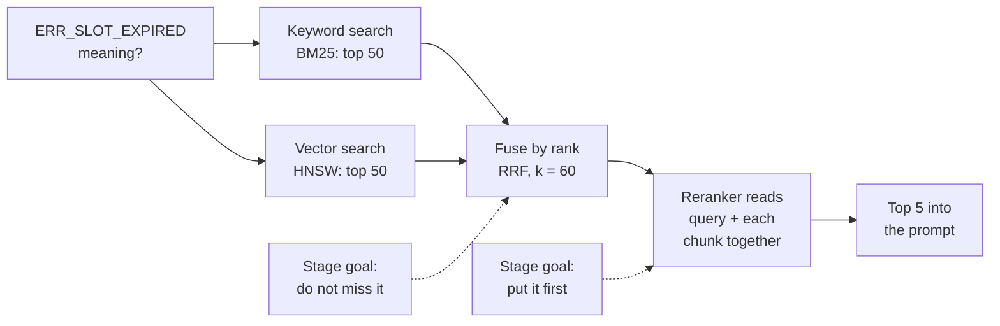
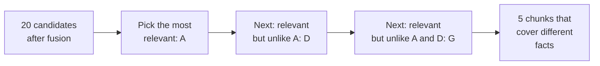

Week four. Agents start pasting error codes from the delivery app: "What does `ERR_SLOT_EXPIRED` mean?" Ask FreshCart returns chunks about delivery delays in general. The embedding model has never seen this code, so it maps it to a vague "something about delivery" meaning. A plain word search would have found the runbook containing that exact string instantly.

The opposite happens too. "Why do customers get logged out?" shares no words with the runbook line "sessions expire when token refresh fails". Word search misses it; meaning search finds it.

Each kind of search wins exactly where the other fails. So Ask FreshCart runs both and merges them. That is **hybrid search**.

## 1. The shape of hybrid retrieval

- Both searches run in parallel and return about 50 candidates each. This first stage cares about **recall**: the right runbook must be somewhere in those 100.
- The two lists are merged into one ranking (section 3).
- A reranker rescores the merged candidates. This second stage cares about **precision**: the right runbook must end up first.
- Only the top 5 reach the prompt, which keeps it short and focused.

## 2. How keyword search scores: BM25

**BM25** is the standard formula behind keyword search engines. For each word in the question, it scores a chunk using three ideas:

- **Rare words matter more.** This is IDF, inverse document frequency. `ERR_SLOT_EXPIRED` appears in 3 of 2 million chunks, so a match on it is very telling. "delivery" appears in half of them, so a match on it means little.
- **Repeats help, with diminishing returns.** A chunk mentioning "refund" three times is more about refunds than one mentioning it once, but the tenth mention adds almost nothing. A parameter `k1` (usually 1.2-2.0) controls how fast it levels off.
- **Long chunks do not win by size.** A long chunk contains more words by chance, so scores are adjusted for length. A parameter `b` (usually 0.75) controls how much.

Correction: Postgres's built-in `ts_rank` is not BM25. It does not know how rare a word is across the whole collection, so a match on `ERR_SLOT_EXPIRED` is not rewarded the way BM25 would reward it. Extensions such as ParadeDB's `pg_search` provide real BM25 inside Postgres.

## 3. Merging two rankings: Reciprocal Rank Fusion

The two searches return scores on completely different scales: BM25 might say 14.2, vector search 0.83. Adding them is meaningless. **Reciprocal Rank Fusion (RRF)** ignores the scores and uses only positions:

`RRF(chunk) = sum, over each list containing the chunk, of 1 / (60 + its rank in that list)`

FreshCart example:

- Keyword list: runbook-17 at rank 1, faq-3 at rank 2.
- Vector list: faq-3 at rank 1, incident-9 at rank 2, runbook-17 at rank 3.
- runbook-17: 1/61 + 1/63 = 0.0323
- faq-3: 1/62 + 1/61 = 0.0325
- incident-9: 1/62 = 0.0161
- Final order: faq-3, runbook-17, incident-9.

Chunks found by both searches rise above chunks found by one. The constant 60 comes from the original paper (Cormack and others, 2009): a large constant shrinks the gap between rank 1 and rank 2, so neither search can dominate the other. If one search deserves more trust, multiply its terms by a weight.

Also asked: "Why rank-based instead of normalising the scores?" Score ranges change from query to query and from engine to engine, so normalised scores are fragile. Ranks are always comparable.

## 4. Reranking: a slower, sharper second look

The embedding model used for search is a **bi-encoder**: it turns the question and each chunk into vectors separately. The chunk vectors are computed once at indexing time, which is why searching 2 million of them takes milliseconds. The cost is that the question and the chunk never "see" each other; their vectors are just compared.

A **cross-encoder** reads the question and one chunk together, as a single input, and outputs a relevance score. Because it sees how each word of the question relates to each word of the chunk, it judges relevance much more accurately. But nothing can be computed in advance: scoring 2 million chunks would mean 2 million model runs per question.

That is why they work as a pair: the cheap bi-encoder and BM25 shortlist 50-100 candidates, and the cross-encoder reorders only those.

**Decision point: the reranker adds 200 ms to every question. Keep it?** Measure. Run the same 80-question test set with and without it, and compare:

- recall@5: how often the right chunk is in the top 5;
- **MRR (mean reciprocal rank)**: for each question, 1 divided by the position of the first right chunk (1 if first, 0.5 if second, and so on), averaged over all questions;
- the added p95 latency and the cost per 1,000 questions.

Skip reranking when the right chunk is already almost always in the top 3, when the latency budget is tight (voice, autocomplete), or when you only send 3-5 chunks and the model reads all of them anyway.

## 5. Beyond BM25 plus vectors

Two newer ideas blur the line between keyword and meaning search:

- **Learned sparse retrieval** (for example SPLADE): a model reads each chunk and outputs a weighted list of words, including related words that never appear in the text ("refund" might also get weight on "return" and "money back"). It is searched like a keyword index, so it keeps exact-match strengths, but understands some synonyms.
- **Late interaction** (ColBERT): instead of one vector per chunk, store one small vector per token. At query time, each query token finds its best-matching chunk token, and the scores are added up. Much more precise than one vector per chunk, at the cost of a far bigger index. Often used as a reranker over a shortlist.

You do not need to have used them. You do need to know they exist and where they sit: between cheap single-vector search and expensive cross-encoders.

## 6. Diversity, thresholds and reranker choices

**Diversity.** If the top 5 chunks all come from the same paragraph, repeated in the policy, its FAQ and a training deck, the prompt contains one fact five times. **Maximal Marginal Relevance (MMR)** fixes this: it picks chunks one at a time, each time choosing the one that is most relevant to the question while least similar to the chunks already picked. A setting (often called lambda) balances relevance against diversity.

**Thresholds.** Always taking the top 5 means always sending 5 chunks, even when nothing relevant exists. A reranker score threshold ("drop anything below 0.3") lets the system notice there is no good evidence and say so, which is how unanswerable questions get honest answers. Tune the threshold on the test set's unanswerable questions.

**Which reranker.** Options range from hosted APIs (Cohere Rerank, Voyage and others) to open models you run yourself (the BGE reranker family, cross-encoders from sentence-transformers). Hosted is easiest; self-hosted keeps data in your network and cost predictable at high volume. Some teams use an LLM as the reranker for the hardest cases; it is the most accurate and the slowest.

Also asked: "Hybrid had a lower MRR than keyword search alone. Why, and what next?" The right chunk is being retrieved but ranked lower: fusion pulls meaning-based results above the exact match. Options, each measured on the same test set: add a cross-encoder after fusion; weight RRF toward keyword search for code-heavy questions; send error-code questions to keyword search only; or improve the vector side with a better embedding model or smaller chunks.
