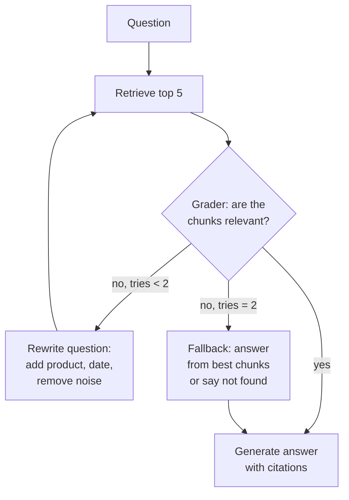

Month two. Ask FreshCart answers most questions well, but some fail in a frustrating way. An agent types: "it keeps failing after the update, what changed?" There is no product name, no error code, no date. Search returns noise, and the model writes a confident answer from that noise. The retriever is fine. The question is a bad search query.

Two families of fixes: improve the question before searching, and check the search results before answering.

## 1. Improving the question before searching

All of these use a model call to transform the question before retrieval:

- **Multi-query** (also called RAG-Fusion): a model writes 3-5 rephrasings of the question, each is searched, and the result lists are merged with RRF (the rank-fusion formula from the hybrid search page). Helps vague questions. Costs one model call and several searches.
- **Decomposition**: "compare the Pune and Bengaluru slot rules" becomes two questions, each searched and answered, then combined. For multi-part and comparison questions.
- **Step-back**: also search a broader version of the question ("how do slot rules work?") so the general rule comes back alongside the specific detail.
- **HyDE** (hypothetical document embeddings): a model writes a plausible fake answer, and the fake answer is embedded instead of the question. A paragraph shaped like an answer sits closer to real answer paragraphs than a short question does. Risk: a confidently wrong fake answer pulls in the wrong documents.
- **Routing**: classify the question first and send it to the right place: policy documents, the orders database, the incident archive, or no search at all for small talk. The router's choice caps the whole answer, so test it on its own labelled questions.

Every one of these adds latency. Turn each on only where your test set shows the failure it fixes.

## 2. Corrective RAG: checking what came back

The second family accepts that search sometimes returns junk, and checks before answering. **Corrective RAG** adds a grader after retrieval. If the chunks are not relevant, it rewrites the question and searches again, instead of generating from bad context.



The run keeps a few values between steps: the original `question`, the current `query`, the `chunks` just retrieved, a `tries` counter, and `best_chunks` (the best set seen so far).

- **Retrieve**: search with the current query. If these chunks grade better than any earlier attempt, save them as `best_chunks`.
- **Grade**: a small, cheap model answers "relevant: yes or no" for each chunk, in structured output so the answer is machine-readable.
- **Relevant**: go straight to generation.
- **Not relevant, fewer than 2 tries**: a model rewrites the query (adds the likely product, removes filler), `tries` goes up by one, and the system searches again.
- **Not relevant, 2 tries used**: stop. Answer from `best_chunks`, or say "I could not find this in FreshCart's documents". Never return an empty answer.

Three brakes keep the loop from running forever: the `tries` counter, a hard limit on total steps in the workflow engine, and the fallback.

**Decision point: the grader adds a model call to every question, and the retry path roughly doubles latency. Is it worth it?** Keep it if, on your test set, the retry path rescues questions the first search missed. If it fires on most questions, your retrieval is the real problem; fix that instead. If it rarely changes the answer, delete it.

Related ideas you will hear:

- **Self-RAG / adaptive RAG**: the system first decides whether it needs to search at all, and checks afterwards that its answer is supported by the chunks. In practice that check is a groundedness test after generation.
- **Agentic RAG**: retrieval becomes a tool that an agent calls whenever it decides it needs more information, possibly several times across several sources. More flexible, but harder to bound, harder to test (you must judge the sequence of steps, not just the answer), and exposed to instructions hidden inside retrieved text (covered on the security page).

## 3. Complete example: the retrieval core of Ask FreshCart

```python
import numpy as np

def vector_top_k(query_vec, chunk_vecs, k):
    scores = chunk_vecs @ query_vec               # vectors normalised: dot == cosine
    return list(np.argsort(-scores)[:k])

def rrf(rank_lists, k=60):
    scores = {}
    for ranks in rank_lists:
        for pos, chunk in enumerate(ranks, start=1):
            scores[chunk] = scores.get(chunk, 0.0) + 1.0 / (k + pos)
    return sorted(scores, key=scores.get, reverse=True)

def ask(question, retrieve, grade, rewrite, generate, max_rewrites=2):
    query, best, best_hits = question, [], -1
    for attempt in range(max_rewrites + 1):
        chunks = retrieve(query)                   # keyword + vector, fused with rrf(), reranked
        hits = sum(grade(question, c) for c in chunks)
        if hits > best_hits:
            best, best_hits = chunks, hits
        if hits >= 2:
            return generate(question, chunks)
        query = rewrite(question, chunks)
    if best_hits == 0:
        return "I could not find this in FreshCart's documents."
    return generate(question, best)
```

Expected behaviour:

- `rrf([["runbook-17", "faq-3"], ["faq-3", "incident-9", "runbook-17"]])` returns `["faq-3", "runbook-17", "incident-9"]`.
- A clear question whose first search has 2 or more relevant chunks costs one search and one grading pass.
- A question that never finds relevant chunks makes exactly 3 searches and returns the "could not find" message instead of an invented answer.
- If the second attempt was the best but still weak, the answer is built from the second attempt's chunks.
