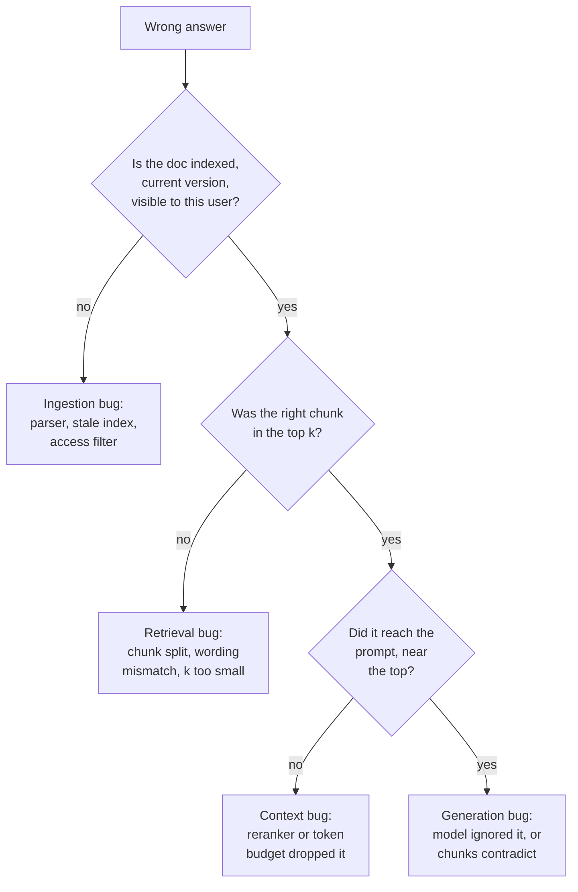
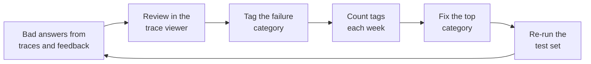

Meera forwards a ticket: "Ask FreshCart said bakery items can be returned within 48 hours. The policy page clearly says 12." The right document exists. The answer is still wrong. Where did it break?

Guessing and tweaking the prompt is how teams lose weeks. Debugging RAG is a walk backwards through the pipeline, one stage at a time.

## 1. The trace: your debugging record

Every answer should leave a **trace**: a record of the full request. The question, the rewritten query if any, the chunk ids retrieved with their scores, the exact final prompt, the answer, and the time and tokens each step took. Without traces you are guessing. With them, every failure has a location.

## 2. Walking a wrong answer backwards

- **Ingestion**: is the bakery policy in the index at all, in its current version, and visible to this agent? A table parsed into garbage, an index that missed the last update, or a wrong access filter all fail here.
- **Retrieval**: search the index directly for the passage. If it is not in the top results, the answer may be split across two chunks, the agent's wording may not match the document's (add keyword search or a query rewrite), or too few results are fetched.
- **Context assembly**: the chunk was retrieved but dropped by the reranker, cut by the token limit, or buried in the middle of a long prompt.
- **Generation**: the chunk was right there in the prompt and the answer still contradicts it. Look for a second chunk that disagrees (often an outdated version) or weak grounding instructions.

FreshCart's bakery bug was the first box: the old 48-hour policy had never been deleted when the new one was published.

## 3. Separating the two halves at scale

One ticket can be traced by hand. A thousand need numbers. Two measurements split every failure into "search" or "answer" (the evals pages compute them in detail):

- **Context recall**: did the retrieved chunks contain the facts the answer needed?
- **Faithfulness**: are the claims in the answer supported by the retrieved chunks?

Low context recall means fix retrieval. High context recall with low faithfulness means the model strays from good evidence: fix generation. Both high and still wrong means the documents themselves are wrong or out of date.

## 4. Two traps in the prompt itself

**Lost in the middle.** Models use information at the start and end of a long prompt better than information in the middle (Liu and others, 2023). Chroma's "context rot" study found that answer quality drops as the input grows, even on simple tasks. So more chunks is not safer: send fewer, better chunks, most relevant first.

**Answering without evidence.** When the chunks do not contain the answer, the model still tends to produce one. Counter it in layers:

- An explicit instruction with an example: "If the documents do not answer the question, say you could not find it."
- Ask for a structured field `answerable: true/false` before the answer.
- If the best search score is weak, do not generate at all.
- Keep unanswerable questions in the test set and track how often the system correctly declines. Declining too often is also a failure.

Correction: fixing a RAG bug by editing the prompt until one failing example passes usually breaks other questions. Add the case to the test set and fix the category of failure.

## 5. When the documents disagree

FreshCart has 12,000 documents written by different teams over years. They disagree: the 2023 policy says 48 hours, the 2026 policy says 12, a training slide still says 24. Retrieval faithfully finds all three. This is a data problem, and it needs data fixes:

- **Version and status metadata**: every chunk carries `version`, `effective_from`, and a status such as current or superseded. Filter superseded documents out of search by default.
- **One owner per policy**: a document registry says which document is authoritative for each topic. Duplicates (slides, FAQs) point to it rather than restate it.
- **Show conflicts honestly**: when two current documents disagree, the answer says so and cites both, and the conflict is logged for the document owners to resolve.

## 6. Tools that make debugging fast

Teams that improve RAG quickly have three things:

- **A trace viewer** that shows, for one question, the rewritten query, every retrieved chunk with its score and source, what the reranker kept, the final prompt and the answer, on one screen. Hamel Husain argues that a custom viewer built for your data is the highest-value tool an AI team can build.
- **A retrieval playground**: type a question, see the top 20 from keyword search, vector search and the fused list side by side. Most retrieval bugs are obvious there in seconds.
- **Failure tags**: every reviewed failure gets a category (stale document, chunk split, wording mismatch, ignored context), so weekly counts show which fix pays most.

## 7. Signals to watch in production

You cannot read every answer, so watch signals that move when quality drops:

- the share of questions where the best retrieval score is below the threshold (rising means content gaps or a broken index);
- the share of answers that cite nothing or decline to answer;
- thumbs-down rate and "asked again in different words" rate;
- groundedness-check failures;
- the age of the newest indexed document (a stalled ingestion pipeline shows up here first).

Also asked: "The model answers confidently when the context lacks the answer. Fix it." The layered list in section 4 is the answer.
