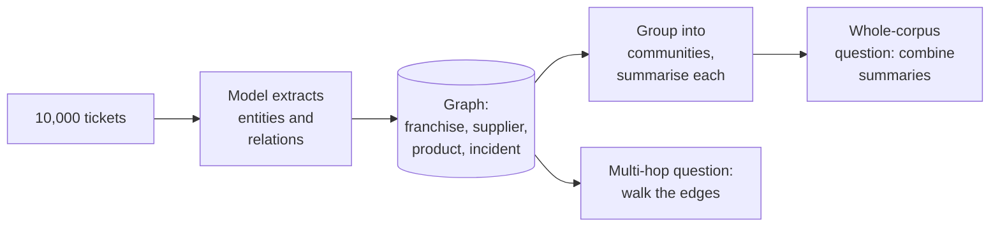

At a quarterly review, three ideas come up that would each change Ask FreshCart's design. "The new models read a million tokens, so let's skip search and give them everything." "Leadership wants to ask questions across all 10,000 complaints at once." "Agents keep asking for counts and totals." Each is a classic interview follow-up.

## 1. Long context: is RAG dead?

A model that reads a million tokens could, in principle, take FreshCart's entire policy library in every prompt. It still is not a replacement for retrieval:

- **Cost and time**: every question pays for every input token, and the wait for the first word grows with prompt length. Search sends a few thousand tokens instead of hundreds of thousands.
- **Quality**: answers get worse as the input grows (the "lost in the middle" and "context rot" findings from the debugging page). A focused prompt is usually more accurate.
- **Access control and freshness**: search filters each chunk by who may see it and reflects today's documents. A prompt stuffed with everything does neither.
- **Citations** come naturally from retrieval.

Long context is the right tool for a small, fixed corpus (paste it in, use prompt caching to make repeats cheap), for whole-document tasks such as summarising one contract, and as a generous window after retrieval.

## 2. GraphRAG: questions no single chunk can answer

Two kinds of question defeat chunk search:

- **Multi-hop**: "which suppliers of our largest franchise had food-safety incidents?" The answer needs following links: franchise to suppliers to incidents.
- **Whole-corpus**: "what are the main complaint themes across 10,000 tickets?" No single chunk holds the answer.

**GraphRAG** (an approach from Microsoft) uses a model to extract entities (franchises, suppliers, products) and the relationships between them into a **knowledge graph**: nodes for things, edges for how they relate. It then groups the graph into communities of closely connected nodes and writes a summary of each. Multi-hop questions walk the graph; whole-corpus questions combine the community summaries.

The price: indexing makes many model calls per chunk, so it is slow and expensive; updating the graph incrementally is hard; and extraction mistakes become wrong edges. Use it when these question types matter and you can measure the gain; otherwise hybrid search is cheaper.

## 3. Cache-augmented generation and agentic search

Two more patterns appear in recent interviews:

- **Cache-augmented generation (CAG)**: for a corpus that fits in the context window and rarely changes, such as FreshCart's 40-page franchise handbook, load all of it into the prompt once, let the provider cache that prefix, and answer every question against the cached copy. No retrieval step, no retrieval misses, and repeat questions are cheap. It stops working as soon as the corpus grows past the window, changes often, or needs per-user access control.
- **Agentic search**: instead of one retrieval, an agent searches, reads, decides what is still missing and searches again, often across several sources (documents, tickets, a database). It handles open questions ("why did complaints in Kothrud rise this month?") that no single search can, at the cost of more calls, more latency and harder testing. It is the same loop as corrective RAG with more freedom.

## 4. Multimodal RAG

Some FreshCart knowledge is not text: photos of damaged deliveries, warehouse floor plans, scanned supplier invoices, charts in incident reports. Two approaches:

- **Convert to text first**: a vision-capable model describes each image or chart, and the description is indexed like any chunk. Simple, and works with the existing pipeline.
- **Multimodal embeddings**: a model that embeds images and text into the same space, so a text question can retrieve an image directly. Newer document-retrieval models embed whole page images, which avoids parsing problems for complex layouts.

The document ingestion page covers how PDFs, tables and scans become searchable in the first place.

## 5. Counts and totals belong in SQL

"How many orders were delivered late in Kothrud last week?" Search returns some late-delivery documents; it cannot count every order. That is a database query. Give the assistant a tool that runs safe, read-only SQL (the security page covers the guard rails) or a typed function such as `count_late_deliveries(area, week)`, and keep RAG for the "why" questions that follow, such as "what were the common causes?".
