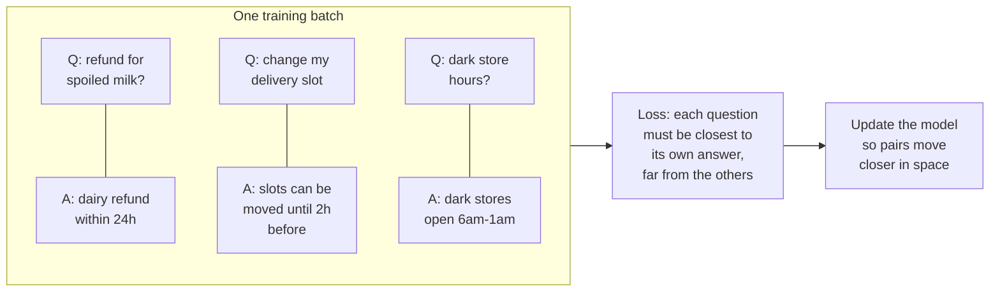
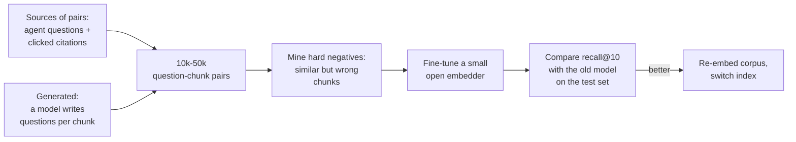

Ask FreshCart's search keeps tripping on FreshCart's own vocabulary. Agents write "FC slot" for a delivery window, "dark store" for a small warehouse, and Marathi words mixed into English. The general-purpose embedding model has never seen these terms used this way, so "dark store Kothrud stock" lands near articles about retail lighting. To fix that you need to understand where an embedding's sense of "similar" comes from.

## 1. How an embedding model learns what "similar" means

An embedding model is a neural network that reads a text and outputs one vector. It is not born knowing that "refund" and "money back" are close. It learns it from millions of examples of **pairs that belong together**: a question and its answer, a title and its article, a search query and the page people clicked.

Training uses **contrastive learning**: pull matching pairs together, push non-matching ones apart.

- Each question is paired with its correct answer.
- The other answers in the same batch act as wrong answers for free (**in-batch negatives**). "refund for spoiled milk" must end up closer to the dairy-refund answer than to the slot answer or the dark-store answer.
- The best training sets also include **hard negatives**: wrong answers that look very similar, such as the bakery refund rule for a dairy question. They teach fine distinctions.
- After enough batches, texts that answer each other sit close together. That is why search by embedding finds an answer whose words differ from the question's.

Inside, the model is a transformer (covered on the transformers page) that produces one vector per token; a **pooling** step, usually averaging, turns those into the single vector for the whole text.

## 2. Bi-encoders, and why queries and documents may differ

The embedding model used for search is a **bi-encoder**: questions and chunks pass through it separately, and only their vectors meet. That is what allows chunk vectors to be computed once at indexing time.

Questions and chunks are different kinds of text: a 10-word question against a 400-word passage. Many models handle this asymmetry with **prefixes**: you embed questions as `"query: refund for spoiled milk"` and chunks as `"passage: Dairy items..."`. Forgetting the prefixes, or using the wrong one, quietly lowers search quality. Always check the model's documentation for how it expects queries and documents to be marked.

## 3. Dimensions, Matryoshka embeddings and precision

More dimensions can hold finer meaning, and cost more: memory, storage and comparison time grow in step.

- 384 dimensions: small, fast models; fine for simple corpora.
- 768-1,024: the common middle.
- 1,536-3,072: large hosted models.

**Matryoshka embeddings** (named after Russian nesting dolls) are trained so that the first part of the vector is a usable embedding on its own: take the first 256 of 1,024 numbers and you still get a good, smaller embedding. That lets you trade quality for cost after the fact: search with short vectors, rerank with full ones.

**Precision**: vectors can also be stored as 16-bit, 8-bit or even 1-bit numbers (the vector search page shows binary quantisation with rescoring). Dimensions and precision multiply: 256 dimensions in int8 is 1/16 the memory of 1,024 dimensions in 32-bit floats.

## 4. Multilingual and domain-specific text

FreshCart's agents write in English, Hindi and Marathi, often mixed in one sentence.

- **Multilingual models** are trained on many languages so that a Marathi question and an English policy with the same meaning land close together. Test on your real mix: quality varies a lot between languages, and code-mixed text (Hinglish, Marathi in Latin script) is hard for all of them.
- **Domain vocabulary** ("dark store", "FC slot", SKU codes) is where general models fail. Hybrid search covers exact codes; contextual retrieval adds explanation to chunks; for the rest, fine-tune the embedder.

## 5. Fine-tuning an embedding model

**Decision point: hybrid search and contextual retrieval are in place, but "dark store" questions still miss.** Fine-tune the embedding model on FreshCart's own pairs.

- **Pairs from real use** are best: agent questions and the chunk they clicked or that the answer cited.
- **Generated pairs** fill gaps: a model writes two or three questions each chunk answers. Review a sample; generated questions copy the chunk's words and are too easy.
- **Hard negatives**: for each question, retrieve similar-but-wrong chunks with the current model and use them as negatives.
- **Train** a small open model (for example with the sentence-transformers library). A few thousand good pairs can noticeably improve domain retrieval.
- **Measure** on the held-out test set, then re-embed the whole corpus and switch indexes blue-green.

The cost is owning a model: hosting it, re-embedding when it changes, and keeping the training data fresh. Fine-tune only after cheaper fixes stop paying.

Correction: "the best model on the leaderboard will be best for us" is often false. Leaderboards average many general tasks; a smaller model fine-tuned on your pairs can beat a leaderboard leader on your data.

Also asked: "Why do embeddings put similar meanings close together?" Because contrastive training pulled matching texts together and pushed non-matching ones apart, over millions of pairs.
