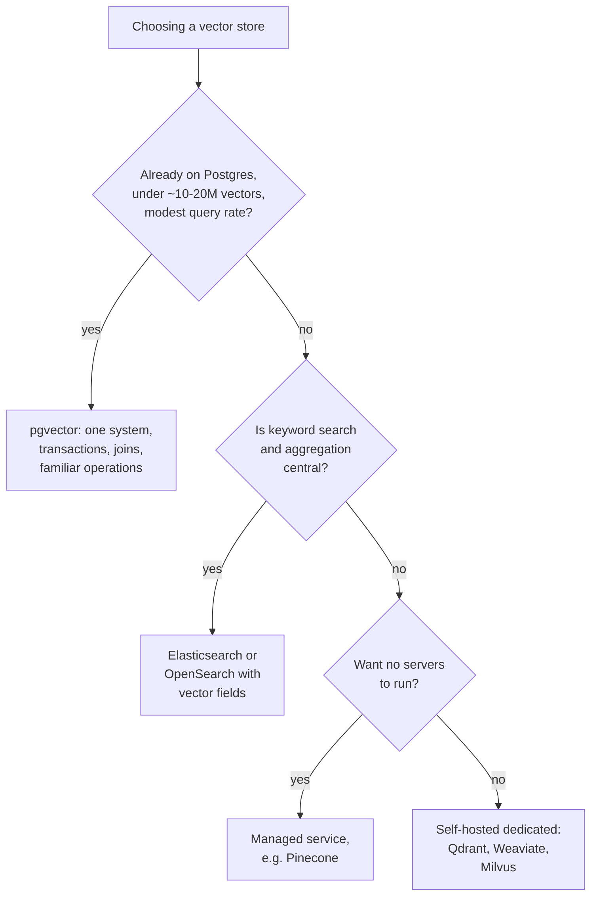
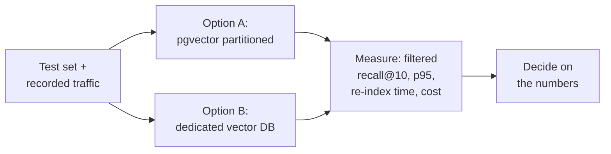

FreshCart's architecture review gets to the inevitable question: "Ask FreshCart runs on pgvector inside our Postgres. We are heading to 40 million chunks across 40 franchises. Do we need a real vector database?" Interviewers ask the same thing, and "it depends" only scores if you can say on what.

## 1. What a vector database actually adds

A **vector database** is a system built around storing vectors and running nearest-neighbour search on them, plus everything around that: filtering by metadata, updates, scaling across machines, and often keyword search too.

The choice is really between four families:

- **A vector extension in your existing database**: pgvector for Postgres. Vectors live next to your other tables, with transactions, joins, backups and access control you already run.
- **A dedicated vector database**: Qdrant, Weaviate, Milvus, or a managed service such as Pinecone. Built for vector search at scale, with filtered search, sharding and replication handled for you.
- **A search engine with vector support**: Elasticsearch or OpenSearch. Excellent keyword search (BM25), mature filtering and aggregation, with vector search added.
- **A library**: FAISS. Very fast in-memory search inside your own process, with no storage, updates, filtering or durability. Good for experiments and offline batch jobs, not as a service.

## 2. The questions that decide it

The size threshold is a rough guide, not a rule; well-tuned Postgres handles more. What actually decides it:

- **Scale and memory**: how many vectors, how many dimensions, and whether the index fits in memory (the vector search page shows the arithmetic).
- **Filtering**: if most searches are filtered (by franchise, date, access list), how well the engine searches with selective filters matters more than raw speed. Dedicated databases invest heavily here.
- **Hybrid search**: do you need good BM25 in the same engine? Search engines and several dedicated databases have it built in; with pgvector you add an extension.
- **Consistency and transactions**: must the chunk, its metadata and its vector change atomically with other business data? That favours keeping vectors in your main database.
- **Write rate**: constant re-embedding and deletes stress some indexes more than others.
- **Operations and cost**: who is on call for it, and the price at your query rate. Managed services are the least work and can be the most expensive at high volume.

## 3. FreshCart's answer

**Decision point: what does FreshCart choose?** At 2 million chunks, pgvector was the right call: one database, transactional updates with the document metadata, and row-level security for franchise isolation. At 40 million chunks with heavy filtering by franchise, the team benchmarks two options on its own test set and its own traffic: pgvector with partitions per large franchise and iterative scans, against a dedicated database such as Qdrant. They measure recall@10 with filters, p95 latency at peak load, re-index time, and the monthly bill. They pick whichever wins on those numbers, not on reputation.

## 4. Moving between them

Switching vector stores is mostly a data-migration problem: re-index every chunk with its metadata into the new store, dual-write updates during the move, compare results on the test set, then cut over. The embeddings themselves can be copied if the model does not change. Keeping your retrieval code behind a small interface (search, upsert, delete) makes the swap far cheaper.

Correction: "we need a vector database because we are doing RAG" is not a reason. Many production RAG systems run happily on pgvector or Elasticsearch. Add a new database when measured needs (scale, filtering, operations) justify running another system.

Also asked: "pgvector or Pinecone?" Give the decision questions in section 2 and say you would benchmark on your own data.
