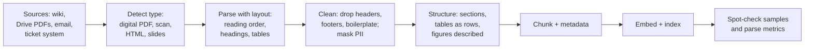
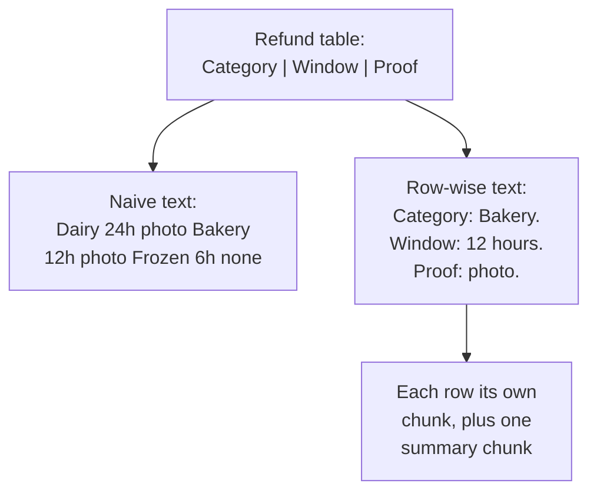

Most RAG failures in real companies are not retrieval or prompt problems. They happen earlier, when documents are turned into text. FreshCart's refund policy is a PDF with a two-column layout, a table of refund windows, and a footer on every page. The first parser read it left to right across both columns, merged the table into one long line of numbers, and repeated "FreshCart Confidential - Page 7" forty times. Search could only ever be as good as that text.

## 1. The ingestion pipeline

**Ingestion** is everything between "a document exists somewhere" and "its chunks are in the index".

- **Detect the type.** A digital PDF has a text layer you can extract; a scanned PDF is just images of pages and needs OCR. HTML and slides each need their own parser.
- **Parse with layout.** Find the reading order (columns, sidebars), the heading levels, the tables and the figures.
- **Clean.** Remove repeated headers and footers, navigation menus and legal boilerplate. Mask personal data (customer phone numbers in tickets) before it ever reaches the index.
- **Structure.** Keep headings as a path, turn tables into row-wise text with column names, and describe figures in words.
- **Chunk, embed and index**, as on the chunking page.
- **Check quality.** Sample parsed output by eye every time the parser or the source changes.

## 2. PDFs, scans and OCR

**OCR (optical character recognition)** turns images of text into text. It is needed for scanned documents, photographed invoices and text inside images. OCR introduces its own errors (a "1" read as "l", a "24h" as "2411"), so scanned sources deserve extra checks.

Layout matters as much as characters. Modern parsing tools such as Docling and Unstructured use layout models to detect columns, headings, tables and figures, and output clean structured text (often Markdown or JSON). Some pipelines now hand difficult pages directly to a vision-capable model and ask for structured Markdown, which handles odd layouts well but costs a model call per page.

## 3. Tables

Tables carry many of FreshCart's most-asked facts: refund windows, slot fees, delivery zones. They break naive parsing in two ways: rows get merged into one line, and cells lose their column names.

- Write each row as its own sentence-like chunk, repeating the column names, plus the table's title.
- Add one summary chunk for the whole table ("Refund windows by category: dairy 24h, bakery 12h, frozen 6h") for overview questions.
- Keep the original table (as Markdown or HTML) attached, so the answer can show it.
- For very large tables (a price list with 5,000 rows), do not chunk at all: load them into a database and answer through a SQL tool.

## 4. Keeping the index in sync

Documents change all the time, and re-processing all 12,000 every night wastes money and hours. **Incremental ingestion** processes only what changed:

- Keep a fingerprint (hash) of each document's content. On each sync, compare: unchanged documents are skipped.
- Changed documents are re-parsed and re-chunked; their old chunks are deleted and new ones inserted, in one step.
- Deleted documents, and documents whose access changed, are handled as events, quickly (the RAG overview explains why deletes matter).
- Every chunk records which parser version produced it, so a parser upgrade can re-process only affected documents.

**Decision point: the new parser fixes tables but changes how every document is chunked. How do you roll it out?** Re-index into a fresh copy (blue-green, from the chunking page), compare retrieval quality on the test set, then switch.

## 5. Measuring ingestion quality

Parsing quality is measurable, and it is worth measuring because everything downstream depends on it:

- the share of documents that parsed without errors, by file type;
- the share of pages with no extracted text (likely scans that needed OCR);
- a handful of "golden documents" whose correct parsed output is known, checked on every parser change;
- retrieval test-set questions whose answers live in tables or scans, tracked as their own slice.

Correction: "the PDF loader handles it" is the assumption behind many failing RAG systems. Look at the parsed text of your most important documents before tuning anything else.

Also asked: "How would you handle tables in RAG?" Row-wise chunks with column names, a summary chunk, the original table attached, and SQL for very large tables.
