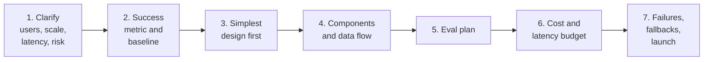
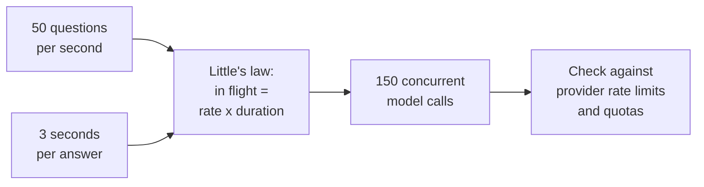

FreshCart is expanding: 6 cities, 40 franchise partners, 2,000 support agents, a million questions a day. Leadership asks you to present the design for "Ask FreshCart for everyone" in a 45-minute review. That review has exactly the shape of an LLM system design interview.

## 1. Why a fixed structure

Weak answers jump straight to boxes: "a vector database, an LLM, done." Strong answers define what success means first, then design for quality, cost, speed and failure. The easiest way to do that under pressure is to run the same seven steps every time, out loud, so the interviewer can follow and you never forget evals, guardrails or fallbacks, the three things weaker answers leave out.

Roughly 5 minutes on steps 1-2, 15 on steps 3-4 and 15 on steps 5-7.

## 2. The seven steps

**1. Clarify.** Who uses it, how many, how fast must it be, and what does a wrong answer cost? For FreshCart: support agents, not customers; a million questions a day with peaks around 50 per second; first words on screen within 2 seconds; a wrong refund rule costs money and trust, so citations are mandatory.

**2. Success metric and baseline.** Decide how you will know it works before drawing anything. For FreshCart: answer accuracy on a test set for each franchise, the share of questions resolved without escalation, agents' thumbs-up rate, and cost per resolved question. The **baseline** is what happens today without the system: agents search the wiki for about 4 minutes per question.

**3. Simplest design first.** Climb only as far as needed: a single model call, then retrieval (RAG), then a fixed workflow, then an agent. Justify each step up. FreshCart needs private documents, so RAG; live order status, so a few tools; nothing needs several agents.

**4. Components and data flow.** The building blocks most designs share:

- a **gateway** in front of the models: one entry point that checks who is calling, applies rate limits and quotas, picks the model, caches, and logs;
- the **data pipeline** that keeps the indexes fresh;
- **retrieval**, **orchestration** (the workflow or agent) and **tools**;
- **guardrails**: checks on what goes in and what comes out;
- **observability**: traces, cost, online evals.

**5. Eval plan.** A golden set, a check per important failure type, a judge checked against human labels, a gate in CI, and online evals on live traffic (the evals pages).

**6. Cost and latency budget.** Put numbers on it: a time budget for each step of the request, and a monthly cost estimate (the cost page shows how).

**7. Failures, fallbacks and launch.** What happens when the model provider or the index is down, how access changes and deletions propagate, how quality drift is caught, and how you launch: shadow, then a small canary, then full rollout, with rollback triggers written down in advance.

## 3. Phrases that carry the round

- "Before architecture, here is how we will know it works": then the metric and the baseline.
- "The simplest design that could work is X; I would only add Y if the eval shows Z."
- "Permissions are enforced at retrieval, never in the prompt."
- "Every external call has a timeout, a retry policy and a fallback."
- "We launch behind a canary with a written rollback trigger."

**Decision point: halfway through, the interviewer asks "how do you know it is helping and not making things worse?"** Go back to step 2. Name the success metric and baseline, the guardrail metrics that must not get worse (complaints, wrong refunds, repeat contacts), and the launch plan that proves it: a shadow run, then a 5% canary compared with everyone else, expanded only if resolution improves and the guardrails hold.

## 4. Numbers worth carrying into the room

Quick estimates make a design concrete. These are rough and change with providers and models, so present them as assumptions:

- **Tokens**: about 0.75 English words per token; a page of text is roughly 500-700 tokens.
- **Embedding storage**: dimensions x 4 bytes per vector (768 dimensions is about 3 KB), plus index overhead.
- **Latency**: embedding a query 10-50 ms; vector search 5-50 ms; reranking 50-300 ms; a model's time to first token from a few hundred ms to over a second, then tens of tokens per second.
- **Concurrency from traffic**: by **Little's law**, requests in flight = arrival rate x time per request. 50 questions per second x 3 seconds each = 150 requests in flight at once. That number, not the daily total, decides whether you hit the provider's rate limits.
- **Cost**: tokens per request x requests x price per token (the cost page works an example).

## 5. The usual prompts, and the twist each one hides

Interview design questions come in a few families. Each has one part that separates strong answers:

- **"Design a chat assistant like ChatGPT"**: the twist is conversation state and context management at scale (where history lives, how it is trimmed), streaming, and abuse limits.
- **"Design document Q&A for many companies"**: tenant isolation and permissions enforced at retrieval, plus freshness (the worked design page).
- **"Design a customer support bot"**: success metrics, human handoff, and safe actions such as refunds.
- **"Design an agent that changes data"**: approvals, idempotent writes, verification (the agent design page).
- **"Design a summarisation or classification pipeline for millions of items"**: batch processing, rate limits, retries, cost, and quality sampling, not chat.

## 6. Hosted model or your own?

Every design eventually asks which model, and where it runs:

- **Hosted APIs** (OpenAI, Anthropic, Google and others): the strongest models, no infrastructure, pay per token. Your data leaves your network (under the provider's terms), and you depend on their rate limits and uptime.
- **Open-weight models you run yourself** (Llama, Qwen, Mistral and others) on your own GPUs or a cloud: full control of data, predictable cost at high, steady volume, and the ability to fine-tune freely. You run and scale the serving stack yourself (the serving page).

Most companies start hosted, and move specific high-volume or sensitive tasks to their own models once the volume and the measured quality justify it.

The next pages fill in each step: workflows versus agents, security, cost and latency, and two complete worked designs.
