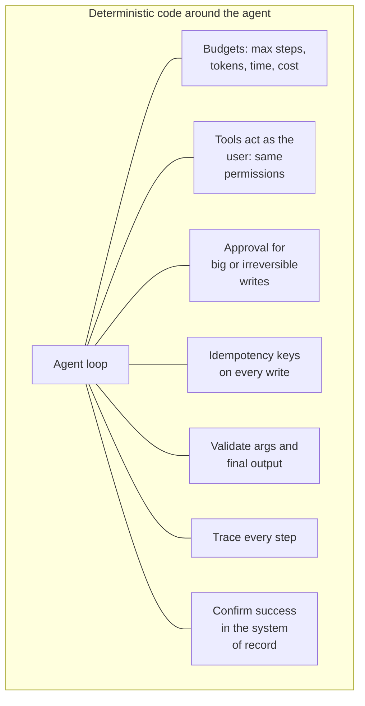

Excited by Planner Copilot, a leadership offsite produces a new mandate: "make Ask FreshCart fully autonomous; let the AI decide everything." The interview version of this moment is a single question: "workflow or agent, which is your default?"

## 1. Workflows and agents

- In a **workflow**, your code decides the order of steps, and model calls happen at fixed points. "Classify the ticket, then search the policy, then draft the reply."
- In an **agent**, the model decides the steps at run time: which tool to call next, and when to stop.

They sit on a ladder of increasing freedom and cost: a single model call (with retrieval and tools) -> a workflow -> an agent. Climb a rung only when testing shows the lower one failing. Workflows are cheaper, faster, testable step by step and predictable. Agents earn their place on open-ended tasks where the steps genuinely cannot be known in advance, and where mistakes are cheap to catch or gated by approval.

**Decision point: what do you tell the offsite?** Ask FreshCart stays a workflow with a few tools, because its steps are known. Autonomy goes where the steps are not known, such as investigating why late deliveries doubled, and even there the agent runs inside strict limits.

## 2. Five workflow patterns

Anthropic's widely cited guide "Building effective agents" names five patterns. Each, with a FreshCart use:

- **Prompt chaining**: a fixed sequence of model calls, each using the last one's output. Classify the ticket -> retrieve the policy -> draft the reply.
- **Routing**: classify first, then send the request down the right path. Policy questions to search, order questions to the order tool, angry customers to a human.
- **Parallelisation**: run independent work at the same time (search policies while looking up the order), or ask the same question several times and take the majority answer.
- **Orchestrator-workers**: one model breaks a task into subtasks at run time and hands them to workers. "Why did late deliveries in Pune double?" becomes separate investigations of traffic, staffing and stock.
- **Evaluator-optimizer**: one model drafts, another critiques against criteria, and the draft is revised until it passes. Drafting a customer apology that must follow tone rules.

## 3. The cage every agent needs

When you do use an agent, it runs inside deterministic code that enforces the limits. None of these live in the prompt.

- **Budgets**: a maximum number of steps, tokens, seconds and rupees per run, with a defined answer when one is hit.
- **Least privilege**: every tool call carries the user's identity and goes through the same permission checks as the normal app. The agent never holds an admin credential.
- **Approval** for large or irreversible writes (the human-in-the-loop pages).
- **Idempotency**: every write carries a key derived from the request, so a retry after a timeout cannot apply it twice.
- **Validation** of tool arguments and of the final output.
- **Tracing** of every step, linked to an audit record.
- **Outcome verification**: success is reported only after reading the result back from the system of record, never because the agent said so.

## 4. Tools are the interface

The tools an agent uses (their names, descriptions, arguments, outputs and error messages) are its whole view of the world, the way a screen is a person's view of an app. Anthropic has reported spending more time refining tools than prompts when building agents. Good tools make the right action obvious and the wrong one hard: clear names, a description of when to use each, tightly typed arguments, short outputs, and error messages that say what to do next.

Also asked: "Name the workflow patterns." The five in section 2, each with an example, is the expected answer.
