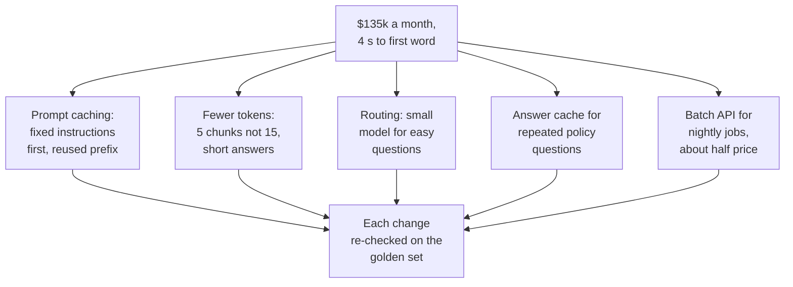
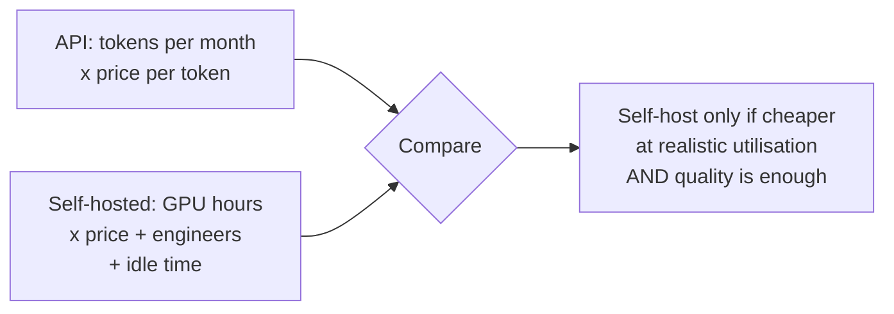

A month after the expansion, finance sends the first bill for a million questions a day, along with a complaint from agents that answers now take 4 seconds to start appearing. Two questions follow, and interviewers ask both: what does it cost, and where does the time go?

## 1. Estimating the bill

Model providers charge per token, with different prices for input (what you send) and output (what the model writes). For one Ask FreshCart question:

- about 3,000 input tokens: instructions, 5 chunks, the question;
- about 300 output tokens: the answer.

Per day that is 3 billion input and 0.3 billion output tokens. At an assumed price of $1 per million input tokens and $5 per million output tokens:

3,000 x $1 + 300 x $5 = $4,500 a day, about $135,000 a month.

In an interview, always say the price is an assumption; real prices change often.

## 2. Where the time goes

A model's response time has two parts:

- **Time to first token**: time waiting in the provider's queue, plus **prefill**, in which the model reads every input token before it writes anything. It grows with prompt length.
- **Time per output token**: the speed at which the model writes, set by model size and server load.

Total time is roughly time to first token plus the number of output tokens times the time per token. So long answers dominate total time, and long prompts delay the first word. **Streaming** (showing words as they are produced) makes the wait feel like only the time to first token.

## 3. The levers



- **Prompt caching**: providers store the processed start of a prompt and reuse it when the next prompt starts with exactly the same text, charging a fraction of the price and answering faster. So put fixed content first (instructions, tool descriptions, examples) and changing content last (the chunks and the question).
- **Fewer tokens**: rerank and send 5 chunks instead of 15; cap the answer length.
- **Routing, or cascades**: answer easy questions with a small, cheap model and escalate to the strong model only when confidence is low or the answer fails validation.
- **Caching answers**: exact repeats are safe to cache for stable content. **Semantic caching**, reusing an answer for a question that is merely similar, is risky: "cancel my order" and "do not cancel my order" look similar; answers can be specific to one user or out of date. Use a high similarity threshold, keep separate caches per franchise and permission group, set expiry times, and cache only stable, FAQ-style questions.
- **Batch APIs** for work that does not need an instant answer, such as nightly summaries: results come back within hours at roughly half the price.

Every change is re-run against the golden set, because each one can quietly lower quality.

## 4. The right number to optimise

**Decision point: a reranker and a bigger model raised quality, but time to first word doubled and cost tripled.** In order: measure each step's time and tokens from the traces; take the cheap wins first (prompt caching, fewer chunks, shorter history, capped answers); route easy questions to a smaller model; run independent calls in parallel and stream the answer; then decide with the trade-off visible. Maybe only part of the quality gain is worth its price.

Correction: "cost per request" is the wrong target. **Cost per resolved question** is total spend divided by questions answered without escalation. A model three times pricier per call that resolves twice as many questions on its own can be cheaper per outcome.

## 5. Rate limits and capacity

Providers limit **requests per minute** and **tokens per minute** per account or key. At peak, Ask FreshCart sends 50 questions a second, about 3,000 requests and 10 million input tokens a minute. If the limit is lower, requests fail with 429 errors exactly when traffic is highest.

- Estimate peak needs from the traffic and Little's law (requests in flight = rate x duration; the design framework page shows it) and request higher limits ahead of launches.
- Put a **gateway** in front of providers that tracks usage against limits, queues low-priority work (nightly summaries) behind interactive questions, and spreads load across keys or regions where the provider allows.
- On a 429, honour the provider's `Retry-After` header, back off with jitter, and route to a fallback model if the wait would break the latency budget.

## 6. When running your own model pays off

At high, steady volume, hosting an open model can be cheaper than paying per token, but only if the GPUs stay busy. A rough break-even:



- A GPU costs the same whether it serves 10 or 10,000 requests an hour, so self-hosting wins only with steady, high utilisation.
- Add the people cost: someone has to run, scale, patch and monitor the serving stack (the serving page covers what that involves).
- Quality must hold on your own test set; a cheaper model that answers worse is not cheaper per resolved question.

## 7. Complete example: the cost estimate

```python
def monthly_cost(questions_per_day, in_tokens, out_tokens, price_in_per_m, price_out_per_m):
    per_day = questions_per_day * (in_tokens * price_in_per_m + out_tokens * price_out_per_m) / 1_000_000
    return round(per_day * 30)

def cost_per_resolved(total_cost, questions, resolved_share):
    return total_cost / (questions * resolved_share)
```

Expected behaviour:

- `monthly_cost(1_000_000, 3000, 300, 1.0, 5.0)` returns 135000.
- Halving input tokens to 1,500 through caching and fewer chunks: `monthly_cost(1_000_000, 1500, 300, 1.0, 5.0)` returns 90000.
- `cost_per_resolved(135000, 30_000_000, 0.6)` is 0.0075 dollars per resolved question; a pricier model at `cost_per_resolved(270000, 30_000_000, 0.9)` is 0.01. Here the cheaper model still wins, but the comparison is per outcome, not per call.
