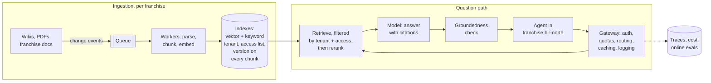

This page runs the full seven-step design from the system design framework page on FreshCart's real problem: Ask FreshCart for 40 franchise partners, each of which must see only its own private documents plus FreshCart's shared ones. In interviews this is "design a document Q&A system for many tenants", the most common applied-AI design question. A **tenant** is one customer organisation sharing the system, here one franchise.

## 1. Requirements in numbers

- 2,000 support agents across 40 franchises; a million questions a day, peaks around 50 per second.
- 12,000 shared documents, plus about 500 private ones per franchise: roughly 2 million chunks.
- First words within 2 seconds.
- Strict isolation: one franchise must never see another's documents.
- Freshness: a deleted document, or a person's revoked access, must stop appearing within 5 minutes.

## 2. The design

Ingestion:

- Every change to a document (created, updated, deleted, permissions changed) becomes an event on a queue.
- Workers parse, chunk and embed, and store each chunk tagged with `tenant_id`, `doc_id`, `version` and its **access list** (the groups allowed to see it).
- An update deletes all old chunks of that document; a delete removes them everywhere, including caches.

Question path:

- The **gateway** checks who is asking, applies the franchise's rate limit and quota, picks the model, logs the request and serves cached results.
- **Retrieval** runs vector and keyword search, filtered to the agent's franchise and groups, then fuses and reranks down to 5 chunks.
- The **model** answers with citations; the **groundedness check** removes any sentence the chunks do not support.
- Every step writes to the trace; a sample is graded by online evals.

## 3. Keeping franchises apart

Two ways to isolate tenants in the index:

- **An index per franchise**: strong isolation, no filtered-search problem, and deleting a franchise's data is trivial. But 40 indexes to operate, and small franchises waste resources.
- **One shared index with a mandatory franchise filter**: efficient, but every search becomes a filtered vector search, which loses results when the filter is selective (the vector search page explains why), and a single bug can leak data across franchises.

FreshCart's choice: shared documents in one index; each large franchise's private documents in its own partition; and the franchise filter enforced below the application, by Postgres row-level security or a data-access layer that application code cannot bypass.

**Permissions are enforced at retrieval, not in the prompt.** A chunk the agent may not see must never reach the prompt. An instruction like "only use documents the user may see" is not a control: the model cannot check permissions, and injected text can override it. Store access by group, and resolve the agent's groups at question time, so revoking one person's access needs no re-indexing.

## 4. The time budget

For "first words within 2 seconds":

- check identity and groups: 50 ms
- embed the question: 30 ms
- hybrid search: 80 ms
- rerank: 150 ms
- build the prompt: 20 ms
- model's time to first token: 600-1,200 ms, then stream the rest

Over budget? Skip reranking for simple questions, send fewer chunks, use a faster model, or cache frequent questions.

## 5. When things fail

- **Vector index down**: fall back to keyword-only search, with a banner saying answers may be less complete.
- **Model provider down or rate-limited**: switch to a fallback model through the gateway, one already tested on the golden set. If everything fails, show the top documents as links with "cannot generate an answer right now".
- **Document deleted or access revoked**: handled as an event within the 5-minute target, plus a nightly job comparing source systems with the index to catch missed events.
- **Quality drifting quietly**: pinned model versions and online evals sliced per franchise.

**Decision point: an agent reports that Ask FreshCart promised a customer a refund rule that does not exist.** That is generation without grounding. Answer policy questions only from retrieved policy chunks with citations; let the groundedness check block unsupported promises; make refunds a tool call checked against policy in code, never a promise in free text; and add the case to the regression set.
