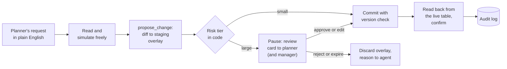

The second classic agent design question is "design an agent that can change data in a business system, safely." FreshCart's version: "design Planner Copilot so planners in all 6 cities can change replenishment settings in plain English." This page assembles the pieces from the human-in-the-loop pages and the agent controls page into one design you can present in 15 minutes.

## 1. Tools first

An agent's safety starts with the tools it is given. Planner Copilot gets four, split cleanly between reading and writing:

- `query_settings`: read-only lookups of current stock settings and forecasts, through parameterised queries on allowed views.
- `simulate_change`: a what-if run on a copy of the data, showing the expected effect of a change.
- `propose_change`: writes a proposed change to a staging overlay, never to live data.
- `commit_change`: applies an approved proposal. The agent cannot call it directly; only the approval step can trigger it.

Every tool call carries the planner's identity and goes through the same permission checks as the normal planning screens. A Pune planner's agent cannot touch Bengaluru warehouses, because the planner cannot.

## 2. The flow

- The agent reads and simulates without restriction, since nothing changes.
- It writes its proposal to the staging overlay.
- Code, not the model, decides the risk tier: small reversible changes commit directly; larger ones pause the workflow and send a review card with the diff, the reasoning and any risk flags.
- An approved or edited proposal is committed with a version check, so it cannot overwrite a change someone else made in the meantime; a rejected or expired one is discarded and the reason goes back to the agent.
- After committing, the agent reads the live table back and reports success only if the change is really there.
- Every decision lands in the audit log.

The workflow runs on LangGraph with a Postgres checkpointer, so a proposal can wait days, across restarts and deploys, without anything running.

## 3. The controls, and where each is enforced

- **Permissions**: in the tools and the services behind them, never in the prompt.
- **Limits**: maximum steps, tokens and time per run, enforced by the workflow.
- **No double writes**: every commit is keyed by its proposal id, so a retry after a timeout returns the first result instead of applying twice. After a timeout, read the live data to learn whether the first attempt landed before retrying.
- **No stale overwrites**: a version check at commit time.
- **Expiry**: proposals that nobody answers are closed after 24-72 hours, and their overlays deleted.

## 4. Testing before launch, and debugging after

Before launch, replay a set of realistic requests in a sandbox (a seeded test database with fake external services), several times each. Grade the end state of the database, check trajectory rules (it read before proposing, it never committed without approval when the tier required it, it finished within the step limit), and report the share of tasks that pass on every run, not just once.

After launch, every run leaves a trace: each model call with its prompt version, inputs and outputs; each tool call with its arguments, results and errors; the saved state at each step; the reviewer's decision; and the final outcome, all under one trace id linked to the audit record. Because the state is saved at every step, a failing run can be replayed from any point to reproduce it.

**Decision point: the interviewer asks "how do you verify the agent did what it says it did?"** Never by its own message. Read the system of record after the commit and compare it with the approved diff; in tests, grade the database's end state, not the agent's final text.

Also asked: "A tool call times out and the agent retries. How do you prevent a double write?" The idempotency key on every commit, plus reading the live state before retrying.
