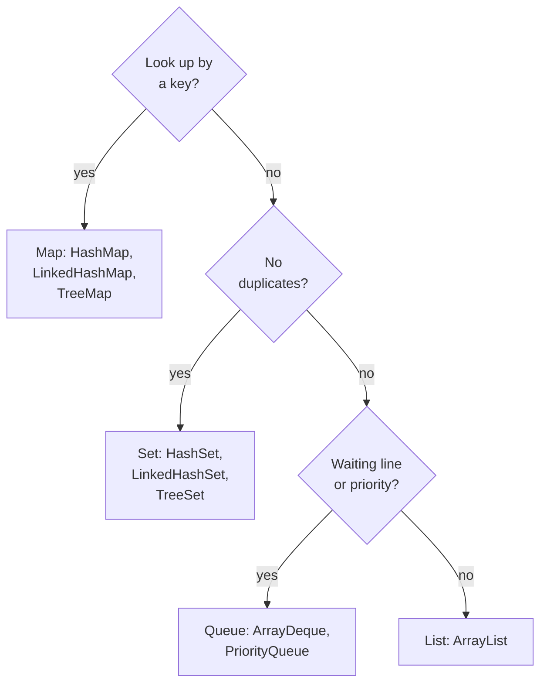
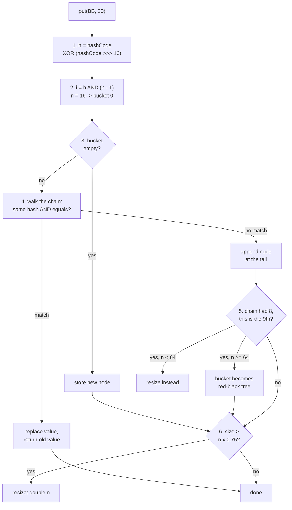
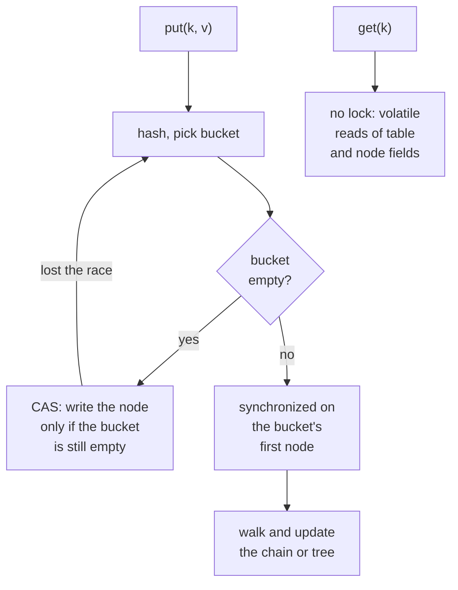
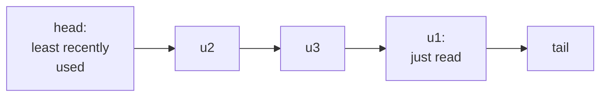

# Java Part 1: Collections and HashMap Internals

## 1. Choosing a collection [P1]

A small game server keeps four kinds of state in memory: each player's score, the set of player ids already online, the matches waiting to start, and the list of moves in the current match. Each one belongs to a different family of collections.

Four words first:
- A **List** keeps items in positions and allows duplicates.
- A **Set** keeps no duplicates.
- A **Queue** is a waiting line: you take items from the head.
- A **Map** stores key -> value pairs with unique keys. It is its own family and does not extend `Collection`, because `add(item)` makes no sense for a pair. It gives three views instead: `keySet()`, `values()`, `entrySet()`.



Two more questions pick the exact class. Does order matter? Insertion order means a `Linked...` class; sorted order means a `Tree...` class. Do many threads touch it? Then a `Concurrent...` class.

- Scores: `Map<String, Integer>`.
- Players online: `Set<String>`.
- Matches waiting, best rating first: `PriorityQueue<Match>`.
- Moves in a match: `List<Move>`.

`Collection` is the root interface of List, Set and Queue. `Collections` is a helper class of static methods: `sort`, `unmodifiableList`, `synchronizedMap`, `emptyList`.

Write `List<Move> moves = new ArrayList<>()`, not `ArrayList<Move> moves`. Callers depend only on the interface, so the implementation can change without touching them.

`Vector`, `Stack` and `Hashtable` are legacy from Java 1.0. Every method takes a lock, so they are slow even with one thread. Do not use them in new code.

Say it like this: "Key lookup means a Map, uniqueness means a Set, a waiting line means a Queue, and everything else is an ArrayList."

## 2. ArrayList and LinkedList [P0]

A report loads 100,000 rows into a `LinkedList`, then loops `for (int i = 0; i < list.size(); i++) list.get(i)`. It takes over 4 seconds. The same loop over an `ArrayList` takes about 9 ms.

### ArrayList

An **ArrayList** is one array behind the scenes. `get(i)` jumps straight to slot i, so it is O(1).

How it grows:
- `new ArrayList<>()` starts with an empty array. The first `add` creates an array of 10.
- When the array is full, it grows to 1.5x (old + old/2) and copies everything: 10 -> 15 -> 22 -> 33.
- Adding at the end is O(1) on average. The one add that triggers a copy is O(n).
- Adding or removing in the middle shifts everything after it: O(n). That shift is one fast block copy over continuous memory.
- It never shrinks on its own. `trimToSize()` does that.

If you know the size, `new ArrayList<>(n)` skips every copy.

### LinkedList

A **LinkedList** is a chain of node objects. Each node holds the item plus `prev` and `next` pointers.

- `get(i)` walks node by node from the nearer end: O(n). So a `get(i)` loop is O(n^2), which is the 4 seconds above.
- Insert or remove is O(1) only once you are standing at the node. Reaching the middle is O(n).
- Every element costs an extra object with two pointers, and nodes are scattered in memory, so the CPU cache helps far less.

Correction: "LinkedList is faster for insertion and deletion" is incomplete. It is O(1) only after you reach the position, and reaching it is O(n). In practice ArrayList wins even for middle inserts: its shift is a fast memory copy, while LinkedList allocates a node and jumps around memory.

Use ArrayList by default and ArrayDeque for queues and stacks. LinkedList wins only when you are already at the node, for example removing through an iterator while you walk.

One trap with `List<Integer>`:
```java
List<Integer> list = new ArrayList<>(List.of(10, 20, 30));
list.remove(1);                      // removes by INDEX -> [10, 30]
list.remove(Integer.valueOf(10));    // removes the VALUE 10
```

Also asked: array vs ArrayList. An array has a fixed size, can hold primitives and has `length`. An ArrayList grows by itself, holds objects only (`int` becomes `Integer`) and has `size()`.

Say it like this: "ArrayList is one growing array with O(1) get; LinkedList is a chain of nodes whose O(1) insert only starts after an O(n) walk, so I default to ArrayList."

## 3. Removing while iterating: fail-fast and fail-safe [P0]

A cleanup step removes players who have left:

```java
for (Player p : players)
    if (p.isOffline()) players.remove(p);     // throws ConcurrentModificationException
```

It fails with **one** thread. "Concurrent" here means "while iterating", not "multiple threads".

How it is detected:
- The collection keeps a counter, `modCount`, that goes up on every structural change (add, remove, resize).
- The for-each loop uses an iterator. When the iterator is created, it saves `modCount`.
- On every `next()`, the iterator compares its saved count with the current one. `players.remove(p)` changed the count behind its back, so the next `next()` throws.
- This check is best effort. It exists to catch bugs, not to make anything thread-safe.

The fix:
```java
players.removeIf(Player::isOffline);                   // best
scores.values().removeIf(s -> s == 0);                 // maps too

Iterator<Player> it = players.iterator();              // classic
while (it.hasNext()) if (it.next().isOffline()) it.remove();
```
`it.remove()` works because the iterator updates its own saved count.

A **fail-fast** iterator throws `ConcurrentModificationException` when the collection changes under it. ArrayList, HashMap and HashSet are fail-fast.

A **fail-safe** iterator never throws. There are two different kinds:
- `CopyOnWriteArrayList` iterates over a snapshot: the array as it was when the loop started. Changes made during the loop are not seen.
- `ConcurrentHashMap` iterates over the live table and is **weakly consistent**: it may or may not see changes made during the loop. Keys added during a loop can show up in that same loop.

Correction: "ConcurrentHashMap iterates over a copy" is a common claim, and it is wrong. Only CopyOnWrite collections copy.

Say it like this: "The iterator saves modCount and checks it on every next(), so removing through the list breaks the loop even with one thread; I use removeIf or iterator.remove()."

## 4. equals() and hashCode() [P0]

A map stores a label for each point on a grid:

```java
class Point { int x, y; /* equals() overridden, hashCode() NOT */ }

labels.put(new Point(1, 2), "home");
labels.get(new Point(1, 2));           // null
labels.put(new Point(1, 2), "home");
labels.size();                         // 2 -> duplicates
```

Two words first:
- `==` checks whether two references point to the **same object**.
- `equals()` checks whether two objects have the **same value**, as the class defines it. If a class does not override it, `Object.equals` is just `==`.

A HashMap uses **hashCode() to pick the bucket** and **equals() to find the match inside that bucket** (a bucket is one slot in the map's internal array; section 5 shows them). Above, the two points are equal by `equals`, but they get different default hashCodes. The lookup goes to a different bucket, so `equals` never even runs. The opposite mistake, hashCode without equals, reaches the right bucket, but `equals` is still `==`, so nothing matches. Same symptoms: nulls and duplicates.

The contract:
- If `a.equals(b)`, then `a.hashCode() == b.hashCode()`. This one is mandatory.
- The same hashCode does **not** mean equal. That is a collision, and it is allowed.
- Fields used in `hashCode()` must not change while the object is a key.
- `equals` must be reflexive, symmetric, transitive and consistent, and `x.equals(null)` is false.

The fix: use the same fields in both.
```java
@Override public boolean equals(Object o) {
    return o instanceof Point p && x == p.x && y == p.y;
}
@Override public int hashCode() { return Objects.hash(x, y); }
```
Or `record Point(int x, int y) {}`, which generates both.

What the default `Object.hashCode()` returns: an identity hash the JVM generates for that object and stores in its header. Correction: it is not the memory address. It does not change when the garbage collector moves the object.

Also asked: if `hashCode()` always returns 1, the map is still correct, because `equals` tells keys apart, but every key sits in one bucket. Lookups become O(n), or O(log n) once that bucket becomes a tree and the keys are `Comparable`.

Also asked: `Integer` caches values from -128 to 127. Two boxed `Integer`s compared with `==` are equal at 127 and not equal at 128. A real bug when comparing map values; use `equals`.

Say it like this: "hashCode picks the bucket and equals picks the entry, so equal objects must have equal hashCodes, built from the same immutable fields."

## 5. HashMap internals [P0]

A game server keeps `Map<String, Integer> scores` (player -> score). It holds 2 million players and serves 10,000 lookups a second. If the scores were in a list, each lookup would scan about a million entries. A HashMap goes straight to the right place in about one step.

### 5.1 The bucket array

Terms first:
- A **bucket** is one slot of the map's internal array, `table`. Each bucket holds a chain of nodes.
- A **node** stores four things: `hash | key | value | next`.
- A **collision** means two keys land in the **same bucket**. They do not need the same hashCode.
- The **load factor** is entries / buckets: how full the table is. The default limit is 0.75.

Six puts into a new map:

```java
scores.put("Aa", 10);      scores.put("BB", 20);
scores.put("Rohit", 45);   scores.put("Ishan", 30);
scores.put("Dhoni", 56);   scores.put("Shami", 12);
```


- Bucket 0 holds `"Aa"` and `"BB"`. These two strings have exactly the same hashCode, 2112. They are the classic example: `'A' * 31 + 'a'` and `'B' * 31 + 'B'` are both 2112.
- Bucket 1 holds `"Rohit"` and `"Ishan"`. Their hashCodes differ (79138838 and 70946059), but their last 4 bits match after mixing, so they collide too.
- `get("BB")` returns 20, not 10: both keys are in bucket 0, and `equals` tells them apart.

Correction: "a collision means two keys have the same hashCode." A collision means the same bucket. `"Rohit"` and `"Ishan"` collide with different hashCodes.

The table is created lazily. `new HashMap<>()` has no array at all; the first `put` creates 16 buckets.

### 5.2 put() and get()



1. HashMap calls `key.hashCode()` and mixes it: `h ^ (h >>> 16)`. This folds the top 16 bits into the bottom 16 (5.5 shows why).
2. It picks the bucket with `h & (n - 1)`. With n = 16, that keeps the last 4 bits.
3. If the bucket is empty, it stores a new node there. Done.
4. Otherwise it walks the chain. For each node it compares the stored hash first (a cheap int check) and calls `equals()` only when the hashes match. For `"BB"`, the hash matches `"Aa"`'s node, `equals` says no, so a new node is appended at the tail. A match would replace the value and return the old one.
5. If the chain already had 8 nodes, the 9th triggers treeify (5.3).
6. If size now exceeds capacity x 0.75, the table doubles (5.4).

`get()` repeats steps 1 and 2, then walks the bucket the same way and returns the value or null.

Say it like this: "HashMap mixes the hashCode, picks a bucket with hash AND (n - 1), walks that bucket comparing hash then equals, and either replaces the value or appends a node."

### 5.3 A crowded bucket becomes a tree

A long chain makes lookups in that bucket O(n). Since Java 8, a crowded bucket turns into a **red-black tree**, a self-balancing binary search tree with O(log n) lookups. The rules come from three constants in `java.util.HashMap`:

- `TREEIFY_THRESHOLD = 8`: a bucket that already has 8 nodes becomes a tree when the 9th node is added.
- `MIN_TREEIFY_CAPACITY = 64`: only if the table has at least 64 buckets. With fewer, HashMap resizes the whole table instead, because in a small table a crowded bucket means the table is too small.
- `UNTREEIFY_THRESHOLD = 6`: when a resize splits a tree bucket and a half has 6 or fewer nodes, that half goes back to a plain list.


Example: 11 keys with the same hashCode go into a default map. The 9th key finds 8 nodes, but the table has only 16 buckets, so the table doubles to 32. The 10th doubles it to 64. The 11th turns the bucket into a tree.

Why the numbers:
- Why not always a tree? Tree nodes take about twice the memory, and for a few items a list is faster.
- Why 8? With a decent hashCode, 8 keys in one bucket happens with probability about 0.00000006. A tree shows up only with a bad `hashCode()` or an attack with colliding keys (hash flooding). Strings like `"Aa"` and `"BB"` combine into endless colliding keys, which is exactly how such attacks work.
- Why 6 to go back, not 8? The gap stops a bucket near the limit from flipping between list and tree.

Tree buckets order keys by hash, and by `compareTo` when keys are `Comparable`. Non-comparable keys with equal hashes still work, just less efficiently.

Correction: "a bucket always becomes a tree at 8." It happens on the 9th node, and only when the table has at least 64 buckets.

### 5.4 Resize

The **threshold** is capacity x load factor. With defaults, 16 x 0.75 = 12, so the **13th** put triggers the first resize, to 32 buckets.

Why 0.75: fewer entries per bucket means shorter chains but more wasted buckets. 0.75 balances memory against chain length.

When the table doubles, HashMap does not recompute each bucket from scratch. Doubling adds exactly one bit to the index, so it checks that one bit of each hash (the bit worth the old capacity):
- bit is 0: the entry stays at the same index.
- bit is 1: the entry moves to index + old capacity.


In bucket 1, `"Rohit"` has that bit as 0 and stays at 1. `"Ishan"` has it as 1 and moves to 1 + 16 = 17. Java 8 keeps each chain's order while splitting.

A resize touches every entry, so the one put that triggers it is slow: a latency spike on a hot path.

The fix is to pre-size. `new HashMap<>(100)` rounds up to 128 buckets with a threshold of 96, so it still resizes at the 97th entry. For N entries use `HashMap.newHashMap(N)` (Java 19+) or `new HashMap<>((int) (N / 0.75f) + 1)`.

Also asked: does `new HashMap<>(100)` resize before 100 entries? Yes, at entry 97.

### 5.5 Why capacity is a power of 2, and why the hash is mixed

Capacity is always a power of 2 (16, 32, 64...), for two reasons:
1. **Fast index.** With n = 16, `n - 1` is binary `1111`, so `h & 1111` gives the same result as `h % 16`, in one fast instruction. With 12 buckets (`1011`), some buckets could never be used.
2. **Cheap resize.** Doubling adds exactly one bit, which is why the one-bit split in 5.4 works.

Why `h ^ (h >>> 16)`: with 16 buckets only the last 4 bits pick the bucket, so keys that differ only in their high bits would all collide. Integer keys 65536, 131072 and 196608 all end in sixteen zero bits. Without mixing they all land in bucket 0. With mixing, the high bits are folded down, and they land in buckets 1, 2 and 3.

Say it like this: "Capacity is a power of two so AND replaces modulo and a resize splits on one bit, and the hash is XOR-ed with its top half so the high bits still influence the bucket."

### 5.6 Changing a key after putting it

The grid map uses a mutable `Point` as its key:

```java
Point p = new Point(1, 2);       // equals/hashCode use x and y
labels.put(p, "home");
p.x = 5;                          // the key object changes

labels.get(p);                    // null
labels.get(new Point(1, 2));      // null
labels.size();                    // 1 -> it is still in there
```


- The node sits in the bucket picked by the hash of (1, 2), but its key now says (5, 2).
- `get(p)` hashes (5, 2), goes to that bucket and finds nothing.
- `get(new Point(1, 2))` goes to the right bucket and finds the node, but `equals` compares (1, 2) with (5, 2) and fails.
- `remove` fails the same way. The entry still counts in `size()` and cannot be reached: a memory leak.

HashMap cannot "move" the node, because nothing tells it that the key changed.

The fix is immutable keys: final fields, `equals` and `hashCode` on the same fields. `String` is ideal: it is immutable and caches its hashCode after the first call. Records with immutable fields, `Integer`, `UUID` and enums are also good keys.

### 5.7 Nulls, Java 7 vs Java 8, and threads

Nulls: HashMap allows one null key (hash 0, so bucket 0) and any number of null values. So `get()` returning null is ambiguous; use `containsKey()` or `getOrDefault()`.

What changed in Java 8:
- Crowded buckets become trees, so the worst case is O(log n) instead of O(n).
- Hash mixing became one step, `h ^ (h >>> 16)`; Java 7 used several shifts and XORs.
- New nodes go at the tail of a chain; Java 7 inserted at the head.
- Resize splits each chain on one bit and keeps its order; Java 7 recomputed every index.

Sharing a HashMap between threads breaks it: two writers to the same bucket can overwrite each other (lost updates), and `size()` drifts. In Java 7 it was worse: two threads resizing at once, with head insertion reversing chains, could link a chain into a loop (A -> B -> A), and the next `get()` spun at 100% CPU forever.

Correction: "Java 8 made HashMap thread-safe." Tail insertion only removed the infinite loop. Lost updates remain. Use ConcurrentHashMap (section 6).

Complexity: get, put and remove are O(1) on average and O(log n) in the worst case since Java 8. `containsValue` is O(n). Iterate with `entrySet()` or `forEach((k, v) -> ...)`; looping over `keySet()` and calling `get(k)` hashes every key twice.

Java 8 methods for coding rounds:
```java
counts.merge(word, 1, Integer::sum);                                    // count
byDept.computeIfAbsent(e.dept(), d -> new ArrayList<>()).add(e);        // group
```

### 5.8 HashSet is a HashMap

A **HashSet** wraps a HashMap. Each element is a key, and every value is one shared dummy object (`PRESENT`). So uniqueness comes from `hashCode` + `equals`, exactly as above.

`set.add(x)` calls `map.put(x, PRESENT)`. It returns true if put returned null (the element was new) and false if it was already there.

**LinkedHashSet** wraps a LinkedHashMap, so it keeps insertion order (section 7). It is the standard way to remove duplicates and keep order: `new ArrayList<>(new LinkedHashSet<>(list))` turns `[B, A, B, C, A]` into `[B, A, C]`.

Say it like this: "HashSet is a HashMap whose keys are the elements and whose values are one dummy object, so add returns whether put found the key new."

## 6. Thread-safe maps and ConcurrentHashMap [P0]

A web server counts page views in a shared map. Two threads each record 50,000 views of `/home`, starting from 0. The expected count is 100,000. With a plain HashMap, or with the get-then-put code below, it comes out far lower: updates are lost, and nothing crashes, so tests usually pass.

There are three ways to make a map thread-safe.

**Hashtable** (Java 1.0) synchronizes every method on the whole map. It allows no null keys or values. Legacy; never use it in new code.

**`Collections.synchronizedMap(map)`** wraps any map so that every method takes one lock. Iterating still needs your own lock: `synchronized (map) { for (...) }`. Rarely the right choice today.

**ConcurrentHashMap** is built for many threads. It uses the same bucket array as HashMap, and locks only what it touches.

### How ConcurrentHashMap writes and reads (Java 8+)



- **CAS** (compare-and-swap) is a CPU instruction: "write this value only if the slot still holds what I read". An empty bucket is filled with one CAS, with no lock. If another thread won the race, the loop retries.
- A non-empty bucket is locked with `synchronized` on that bucket's **first node**. Writers to other buckets keep going.
- `get()` takes no lock. The table and node value fields are `volatile`, so a reader sees the latest completed write.
- Crowded buckets become trees, like HashMap.
- A resize is shared: threads that arrive during a resize help move buckets. A moved bucket is marked with a forwarding node, so readers follow it to the new table.
- `size()` is computed from spread-out counters and is only an estimate while writers are active.

Java 7 was different: the map was split into 16 fixed segments, each with its own lock, so at most 16 writers could run at once. Java 8 removed segments and locks per bucket.

Correction: "ConcurrentHashMap locks the whole map" (that is Hashtable), and "it uses 16 segments" (that was Java 7).

### Where it still breaks: check-then-act

Each single call on ConcurrentHashMap is thread-safe. A sequence of calls is not.

```java
// Broken: another thread can update between get and put
int v = views.getOrDefault(page, 0);
views.put(page, v + 1);
```
```java
// Fixed: one atomic call
views.merge(page, 1, Integer::sum);
```

Both threads read 41, both write 42, and one view is lost. `putIfAbsent`, `computeIfAbsent`, `compute`, `computeIfPresent` and `merge` are atomic on ConcurrentHashMap. Keep their functions short, because the bucket stays locked while they run.

The same bug in another shape:
```java
if (!seen.containsKey(requestId)) seen.put(requestId, true);   // two threads both pass the check
seen.putIfAbsent(requestId, true);                             // atomic
```

Also asked: the function passed to `computeIfAbsent` must not modify the same map. Doing so (for example a recursive memoized Fibonacci) can throw `IllegalStateException: Recursive update` or hang.

### Why no nulls

If `get(k)` returns null, you cannot tell "no key" from "key maps to null". With one thread you would check `containsKey()`, but here another thread can change the map between the two calls. So ConcurrentHashMap bans null keys and values and throws `NullPointerException`.

Say it like this: "ConcurrentHashMap fills empty buckets with CAS, locks only a bucket's first node for writes, reads without locks, and only single calls are atomic, so I update with merge or compute, never get-then-put."

## 7. LinkedHashMap and an LRU cache [P1]

A service caches user profiles and may keep only 1,000 in memory. When full, it should evict the one used least recently: an **LRU** (least recently used) cache.

A **LinkedHashMap** is a HashMap plus one doubly linked list running through all entries (`before`/`after` pointers on each entry). The buckets give O(1) lookup; the list gives a predictable order.

- **Insertion order** (default): iteration follows the order keys were first added. Re-putting an existing key does not move it.
- **Access order** (`new LinkedHashMap<>(16, 0.75f, true)`): every `get` or `put` moves that entry to the tail. The head is always the least recently used entry.



After `put u1, put u2, put u3, get u1`, access order gives `[u2, u3, u1]`.

An LRU cache in a few lines:
```java
class Lru<K, V> extends LinkedHashMap<K, V> {
    private final int cap;
    Lru(int cap) { super(16, 0.75f, true); this.cap = cap; }
    @Override protected boolean removeEldestEntry(Map.Entry<K, V> e) { return size() > cap; }
}
```
`removeEldestEntry` runs after every put; returning true removes the head. With cap 2: put u1, put u2, get u1, put u3 leaves `[u1, u3]`, because u2 was least recently used.

Also asked: making it thread-safe. Wrap it in `Collections.synchronizedMap`. A read-write lock does not help, because in access order even `get()` rewires the list, so every read is a write. In production, use a cache library such as Caffeine.

Say it like this: "LinkedHashMap is a HashMap with a linked list through its entries; in access order with removeEldestEntry it is an LRU cache."

## 8. Sorted order: Comparable, Comparator, TreeMap and TreeSet [P1]

A payroll screen lists employees by salary, highest first, then by name. An HR export lists them by id. A class gets only one built-in order, so where do the other rules live?

- **Comparable**: the class's one natural order, written inside it as `compareTo(other)`.
- **Comparator**: any other order, written outside as `compare(a, b)`, usually a lambda.

Both return negative (first argument comes first), zero (same position) or positive.

```java
record Employee(int id, String name, int salary) implements Comparable<Employee> {
    public int compareTo(Employee o) { return Integer.compare(id, o.id); }   // natural order: by id
}
staff.sort(Comparator.comparingInt(Employee::salary).reversed()
                     .thenComparing(Employee::name));                      // payroll screen
```

Never compare by subtracting:
```java
(a, b) -> a - b                 // broken: -2,000,000,000 - 2,000,000,000 overflows to positive
Integer.compare(a, b)           // fixed, or Comparator.comparingInt(...)
```

`List.sort` uses TimSort for objects: O(n log n) and **stable**, so equal elements keep their previous order. Primitive arrays use Dual-Pivot Quicksort, which is not stable, but for numbers nobody can tell.

### TreeMap and TreeSet

A **TreeMap** is a red-black tree. get, put and remove are O(log n), and keys are always sorted. It uses only `compareTo` or the Comparator, never `hashCode` or `equals`, so compare = 0 means "same key". It allows no null key with natural ordering (`NullPointerException`); null values are fine. A key that is not `Comparable`, with no Comparator, throws `ClassCastException` on the first put.

Its real value is nearest-key queries. Tax slabs: income from 0 -> 0%, from 300,000 -> 5%, from 700,000 -> 10%.
```java
TreeMap<Integer, Integer> slab = new TreeMap<>(Map.of(0, 0, 300_000, 5, 700_000, 10));
slab.floorEntry(450_000).getValue();   // 5:       biggest key <= 450,000
slab.ceilingKey(450_000);              // 700000:  smallest key >= 450,000
```
`lowerKey`/`higherKey` are the strict versions; `headMap(x)` gives keys < x and `tailMap(x)` keys >= x. Other real uses: "price at time t" with `floorEntry(t)`, and a consistent-hashing ring with `ceilingEntry(hash)`, wrapping to `firstEntry()`. A HashMap can only answer "is 450,000 a key?".

A **TreeSet** wraps a TreeMap, so it decides duplicates with `compare() == 0`, not `equals()`. A TreeSet of employees sorted only by salary silently drops a second employee with the same salary. Fix: add a tie-breaker, `.thenComparing(Employee::id)`.

Also asked: `new BigDecimal("1.0")` and `new BigDecimal("1.00")` in a HashSet give size 2 (`equals` compares scale too), and in a TreeSet size 1 (`compareTo` says equal).

Also asked: why red-black and not AVL? Red-black needs fewer rotations per insert and delete; AVL is stricter, with slightly faster reads but more rotations on writes.

The thread-safe sorted map is `ConcurrentSkipListMap`.

Say it like this: "Comparable is the one natural order inside the class, Comparator is every other order, and TreeMap uses only compare, which gives me sorted keys and floor and ceiling lookups in O(log n)."

## 9. Queues: PriorityQueue and ArrayDeque [P1]

Every Queue method has two versions: one throws on failure, the other returns false or null. `add`/`offer`, `remove`/`poll`, `element`/`peek`.

**PriorityQueue** is a binary min-heap stored in an array. The only rule is parent <= children, so only the head is guaranteed in order.
- `offer`/`poll` are O(log n), `peek` is O(1), `contains`/`remove(x)` are O(n), building from a collection is O(n).
- Insert 5, 1, 4, 2, 3 and print it: `[1, 2, 4, 5, 3]`. Polling repeatedly gives 1 2 3 4 5.
- Max-heap: `new PriorityQueue<>(Comparator.reverseOrder())`, not `(a, b) -> b - a`.
- Top-K largest: keep a min-heap of size k and poll when it grows past k. O(n log k).
- Not thread-safe (use `PriorityBlockingQueue`) and no nulls.

**ArrayDeque** is a circular array with O(1) at both ends. Use it for stacks (`push`/`pop`/`peek`) and queues (`offer`/`poll`). It rejects null, because `poll()` uses null to mean "empty".

`Stack` extends `Vector`: every method is synchronized, and it exposes `get(i)`, which breaks stack behaviour. Its own Javadoc recommends `Deque`. LinkedList also works as a queue and allows null, but costs a node object per element.

Say it like this: "PriorityQueue is an array min-heap where only the head is ordered, and ArrayDeque is my default stack and queue."

## 10. Thread-safe lists and blocking queues [P1]

**Synchronized** collections (`Vector`, `Collections.synchronizedList`) put one lock around every method. Check-then-act (`contains` then `add`) and iteration still need your own lock.

**CopyOnWriteArrayList** copies the whole array on every write, and reads take no lock. Good for many reads and rare writes (listeners, config). Bad for frequent writes or big lists. Its iterator walks a snapshot, so `iterator.remove()` throws `UnsupportedOperationException`.

A **BlockingQueue** is the producer-consumer tool:
```java
BlockingQueue<Task> q = new ArrayBlockingQueue<>(1000);   // bounded
q.put(task);                              // producer waits while full
Task t = q.take();                        // consumer waits while empty
q.offer(task, 2, TimeUnit.SECONDS);       // waits at most 2 s, then false
```
`ArrayBlockingQueue` is fixed-size with one lock. `LinkedBlockingQueue` has an optional size, **`Integer.MAX_VALUE` by default**, and separate put and take locks.

The trap: `Executors.newFixedThreadPool(n)` uses an unbounded `LinkedBlockingQueue`. If consumers slow down, tasks pile up until `OutOfMemoryError`. Fix: `new ThreadPoolExecutor(...)` with a bounded queue and a rejection policy. That is **backpressure**: slowing producers instead of buffering forever.

Say it like this: "For many threads I use concurrent collections, not synchronized wrappers, and every queue in front of a thread pool is bounded."

## 11. Complete example: your own HashMap [P0]

An array of buckets, each a linked list. Same hash mixing and index as the JDK.

```java
class MyHashMap<K, V> {
    private static class Node<K, V> {
        final int hash; final K key; V val; Node<K, V> next;
        Node(int h, K k, V v, Node<K, V> n) { hash = h; key = k; val = v; next = n; }
    }
    @SuppressWarnings("unchecked")
    private Node<K, V>[] table = new Node[16];
    private int size;

    private static int hash(Object key) {
        int h = (key == null) ? 0 : key.hashCode();
        return h ^ (h >>> 16);
    }

    public V get(K key) {
        int h = hash(key);
        for (Node<K, V> e = table[h & (table.length - 1)]; e != null; e = e.next)
            if (e.hash == h && Objects.equals(e.key, key)) return e.val;
        return null;
    }

    public void put(K key, V val) {
        int h = hash(key), i = h & (table.length - 1);
        for (Node<K, V> e = table[i]; e != null; e = e.next)
            if (e.hash == h && Objects.equals(e.key, key)) { e.val = val; return; }   // replace
        table[i] = new Node<>(h, key, val, table[i]);                                   // add
        if (++size > table.length * 0.75) resize();
    }

    @SuppressWarnings("unchecked")
    private void resize() {
        Node<K, V>[] old = table;
        table = new Node[old.length * 2];
        for (Node<K, V> head : old)
            for (Node<K, V> e = head; e != null; ) {
                Node<K, V> next = e.next;
                int i = e.hash & (table.length - 1);
                e.next = table[i]; table[i] = e;
                e = next;
            }
    }
}
```

Expected behaviour:
- `put("Aa", 10)` then `put("BB", 20)`: both land in bucket 0; `get("BB")` returns 20 because the hash check passes and `equals` picks the right node.
- `put("Aa", 11)` replaces 10; size stays the same.
- `put(null, 1)` works: a null key hashes to 0, bucket 0.
- The 13th entry doubles the table to 32 and every node is re-placed.

Talk while you write: pick the bucket, walk it comparing hash then equals, replace or add, resize past 0.75. Then name what the JDK adds: tail insertion, trees on the 9th node with 64+ buckets, and the one-bit resize split.

**Before the next part:** from memory, draw the 16-bucket table after the six score puts, then walk `put("Ishan", 30)` through every step, including where `"Ishan"` goes when the table grows to 32.
